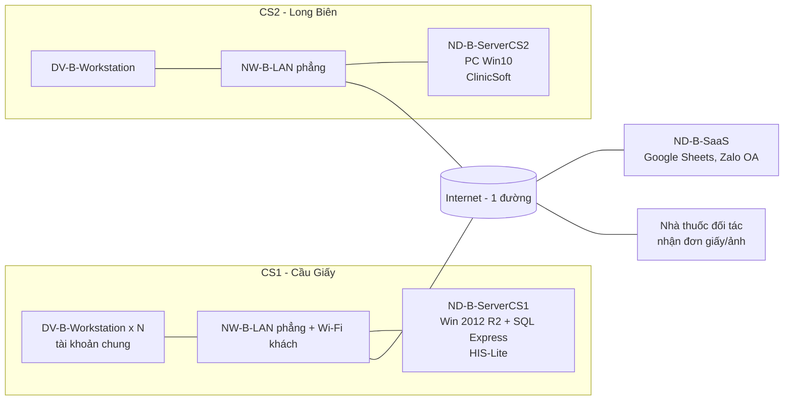
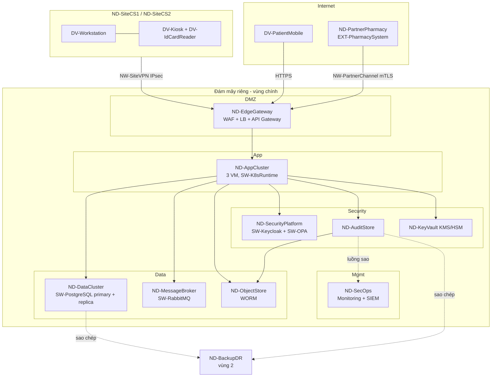

# Chương: Kiến trúc Công nghệ (Pha D) — TV3, bản nháp v0.1 (2026-11-03)

> Mã phần tử theo `tech-catalog.md` (TV3), `app-catalog.md` (TV2), `01-vision/catalog.md` (TV1).
> Góc nhìn ArchiMate dùng đúng tên trong bài giảng Chương 5: **Hạ tầng (Infrastructure)**, **Sử dụng hạ tầng (Infrastructure Usage)**, **Thực hiện và triển khai (Implementation & Deployment)**. Trình bày theo cách ArchiSurance (Chương 9): "Hạ tầng cơ sở (cơ sở)" → "Hạ tầng cơ sở (mục tiêu)" → phân tích khoảng trống.
> Sơ đồ Mermaid dưới đây chỉ để xem nhanh; file nguồn vẽ bằng Archi là `02-models/archimate/ehealth-tv3-exchange.xml`.

## 1. Bối cảnh và đầu vào

| Đầu vào | Nội dung dùng cho tầng công nghệ |
|---|---|
| ASSUMP-02, -03 | 2 cơ sở (CS1 Cầu Giấy ~300 lượt/ngày, CS2 Long Biên ~200), cao điểm 7h–10h ≈ 45% lượt khám (≈ 75 lượt/giờ), ~80 nhân viên dùng hệ thống |
| ASSUMP-04 | 2 nhà thuốc nội bộ + 6 nhà thuốc đối tác với phần mềm riêng |
| ASSUMP-05, -06 | HIS-Lite (CS1), ClinicSoft (CS2), Google Sheet/Zalo OA cho đặt lịch; thu ngân/BHYT giữ nguyên |
| NFR-SEC-01..05, NFR-AVL-01, NFR-PRF-01, NFR-INT-01/02, NFR-DAT-01 | Yêu cầu chất lượng mà hạ tầng phải hiện thực (mục 4) |
| CON-02, CON-03, CON-07 | Dữ liệu sức khỏe là dữ liệu nhạy cảm; ký số đơn; ngân sách hạn chế, ưu tiên lưu trữ trong nước |
| PR-03, PR-04, PR-08 | Tối thiểu quyền; mọi truy cập có vết; kết nối lỏng qua API |

## 2. Hạ tầng cơ sở (Baseline, PLT-0)

### 2.1. Mô tả

| Mã (baseline) | Loại ArchiMate | Mô tả hiện trạng |
|---|---|---|
| ND-B-ServerCS1 | Node (Device + System Software) | 1 máy chủ vật lý tại phòng kỹ thuật CS1: Windows Server 2012 R2 (đã hết hỗ trợ bảo mật), SQL Server Express; chạy HIS-Lite (thu ngân, BHYT, in đơn) |
| ND-B-ServerCS2 | Node | 1 máy tính để bàn làm "máy chủ" tại CS2, Windows 10, CSDL cục bộ của ClinicSoft |
| ND-B-SaaS | Node (bên ngoài) | Google Sheets (lịch hẹn), Zalo OA (nhắc lịch, nhận ảnh đơn) — dùng tài khoản chung |
| DV-B-Workstation | Device | Máy trạm quầy lễ tân/phòng khám, dùng chung tài khoản theo quầy; máy in đơn giấy |
| NW-B-LAN | Communication Network | LAN phẳng mỗi cơ sở, Wi-Fi khách chung dải mạng với máy trạm, 1 đường Internet |
| TS-B-Backup | Technology Service | Sao lưu thủ công hàng tuần ra ổ cứng ngoài, không kiểm thử khôi phục |
| (không có) | — | Không có VPN giữa 2 cơ sở, không có cổng API, không có IdP, không có log tập trung, không có ký số tập trung |

Đơn thuốc: bác sĩ in đơn từ HIS-Lite (CS1) hoặc viết tay (CS2); CS1 liên thông đơn quốc gia bằng nhập tay lần 2 (ASM-03). Nhà thuốc đối tác nhận đơn giấy/ảnh chụp qua Zalo (ASM-05).

### 2.2. Điểm yếu hạ tầng (pain points) và liên hệ Driver

| # | Điểm yếu | Hệ quả | Driver/ASM |
|---|---|---|---|
| T1 | Mỗi cơ sở 1 máy chủ đơn lẻ, OS hết hỗ trợ | Điểm lỗi đơn; lỗ hổng không được vá | DRV-04 |
| T2 | Tài khoản dùng chung, không MFA | Không quy được trách nhiệm cá nhân | DRV-04, ASM-04 |
| T3 | Không có log truy cập tập trung | Không chứng minh được ai đã xem hồ sơ | DRV-04, ASM-04 |
| T4 | LAN phẳng, Wi-Fi khách chung mạng | Khách có thể tiếp cận máy chủ dữ liệu bệnh nhân | DRV-04 |
| T5 | Không có kênh tích hợp (API, VPN) giữa 2 cơ sở và tới nhà thuốc | Hồ sơ phân tán, đơn gửi bằng ảnh | DRV-05, DRV-06 |
| T6 | Dữ liệu sức khỏe nằm trên SaaS tài khoản chung (Google Sheet, Zalo) | Rủi ro tuân thủ dữ liệu nhạy cảm | DRV-04, CON-02 |
| T7 | Sao lưu thủ công, không kiểm thử | Không đạt RPO/RTO | NFR-AVL-01 |
| T8 | Không có hạ tầng ký số tập trung | Không phát hành được đơn điện tử ký số | DRV-03, CON-03 |

## 3. Hạ tầng cơ sở (Target, PLT-3)

### 3.1. Quyết định nền: nơi đặt hạ tầng

Đây là quyết định có hệ quả lớn nhưng ít tranh cãi, nên ghi ngắn tại đây thay vì viết ADR riêng.

| Tiêu chí (trọng số) | (a) On-prem tại CS1 | (b) Đám mây riêng thuê tại VN, 2 vùng | (c) Đám mây công cộng nước ngoài |
|---|---|---|---|
| Tuân thủ lưu trữ dữ liệu sức khỏe trong nước (30%) | 5 | 5 | 2 |
| Sẵn sàng / DR (25%) | 2 (1 địa điểm, phụ thuộc điện, mạng CS1) | 4 | 5 |
| Chi phí 12 tháng (20%) | 3 (đầu tư máy chủ, phòng máy) | 4 (thuê theo tháng) | 3 |
| Năng lực vận hành của phòng CNTT nhỏ (15%) | 2 | 4 | 4 |
| Độ trễ tới 2 cơ sở và nhà thuốc (10%) | 3 (CS2 và nhà thuốc đi qua Internet về CS1) | 4 | 3 |
| **Tổng có trọng số** | **3,20** | **4,30** | **3,35** |

**Chọn (b):** thuê hạ tầng đám mây riêng (IaaS) của nhà cung cấp trong nước có trung tâm dữ liệu đạt chuẩn, vùng chính + vùng dự phòng (DR). Hai cơ sở chỉ giữ thiết bị đầu cuối, tường lửa và đường truyền. Đổi lại: phụ thuộc Internet tại cơ sở (xử lý bằng 2 nhà mạng + chế độ suy giảm, mục 6) và chi phí thuê định kỳ.

### 3.2. Phân vùng mạng (security zones)

| Vùng | Thành phần | Ai được vào | Kiểm soát |
|---|---|---|---|
| Internet | DV-PatientMobile, nhà thuốc đối tác | Công khai | Chỉ tới ND-EdgeGateway qua HTTPS/mTLS |
| DMZ | ND-EdgeGateway (WAF, LB, API Gateway) | Internet, VPN cơ sở | WAF, rate limit, kiểm tra token (PEP) |
| App | ND-AppCluster | Chỉ từ DMZ | Tường lửa vùng, mTLS giữa dịch vụ |
| Data | ND-DataCluster, ND-MessageBroker, ND-ObjectStore | Chỉ từ App | Không có đường từ Internet/DMZ; mã hóa khi lưu |
| Security | ND-SecurityPlatform, ND-AuditStore, ND-KeyVault | App (gọi dịch vụ), quản trị qua bastion | Tách quản trị viên audit khỏi quản trị viên hệ thống (phân tách nhiệm vụ) |
| Mgmt | ND-SecOps, máy bastion | Đội CNTT qua VPN + MFA | Ghi phiên quản trị |
| Site CS1/CS2 | DV-Workstation, DV-Kiosk, DV-IdCardReader | Nhân viên | VLAN nhân viên / thiết bị / Wi-Fi khách tách biệt; NW-SiteVPN về DC |
| DR | ND-BackupDR (vùng thứ 2) | Chỉ luồng sao chép | Bản sao mã hóa, bất biến |

### 3.3. Góc nhìn Hạ tầng (Infrastructure viewpoint) — Target

Quan hệ ArchiMate chính (để vẽ trong Archi):
- ND-AppCluster **composition** SW-K8sRuntime; ND-DataCluster composition SW-PostgreSQL; ND-SecurityPlatform composition SW-Keycloak, SW-OPA.
- ND-EdgeGateway **realization** TS-ApiGateway, TS-SecureChannel; ND-SecurityPlatform realization TS-Identity, TS-PolicyDecision; ND-AuditStore realization TS-Audit; ND-KeyVault realization TS-KeyManagement, TS-Signing; ND-DataCluster realization TS-Database; ND-MessageBroker realization TS-Messaging; ND-ObjectStore realization TS-ObjectStorage; ND-SecOps realization TS-Monitoring, TS-SIEM; ND-BackupDR realization TS-Backup.
- NW-SiteVPN, NW-PartnerChannel là **Path**, **realized by** NW-Internet; nối (association) ND-SiteCS1/CS2, ND-PartnerPharmacy với ND-EdgeGateway.
- TS-Audit **serves** … và TS-Audit **uses/serving từ** TS-ObjectStorage (niêm phong phân đoạn), TS-Signing (ký checkpoint).

### 3.4. Góc nhìn Sử dụng hạ tầng (Infrastructure Usage)

| Application Component (TV2) | Technology Service được dùng (serving) |
|---|---|
| AC-PatientPortal | TS-ApiGateway, TS-SecureChannel, TS-Identity (OTP bệnh nhân) |
| AC-Booking, AC-Reception | TS-ApiGateway, TS-Database, TS-Messaging (sự kiện nhắc lịch) |
| AC-EMR | TS-Database, TS-ObjectStorage (tài liệu đính kèm), TS-PolicyDecision |
| AC-ePrescription | TS-Database, TS-Signing, TS-Messaging, TS-PolicyDecision |
| AC-PharmacyGateway | TS-ApiGateway (cổng đối tác), TS-SecureChannel (mTLS), TS-Messaging, TS-Database |
| AC-Notification | TS-Messaging (+ EXT-SmsGateway) |
| AC-IAM | TS-Identity, TS-PolicyDecision |
| AC-Audit | TS-Audit, TS-ObjectStorage, TS-Signing, TS-SIEM |
| AC-MasterData | TS-Database |
| AC-Reporting | TS-Database (đọc từ read replica, không tải lên CSDL chính) |
| AC-HisLite-CS1, AC-ClinicSoft-CS2 (Retain) | Máy chủ tại cơ sở (ND-SiteServerCS1/CS2); kết nối về DC qua NW-SiteVPN |
| EXT-NationalRxSystem, EXT-InsurancePortal, EXT-SmsGateway (mock) | Gọi ra ngoài qua ND-EdgeGateway (egress có kiểm soát, danh sách cho phép) |
| Mọi AC | TS-Monitoring, TS-Backup (gián tiếp qua TS-Database) |

### 3.5. Góc nhìn Thực hiện và triển khai (Implementation & Deployment)

| Artifact | Hiện thực (realization) | Gán (assignment) cho |
|---|---|---|
| ART-booking-svc, ART-reception-svc, ART-emr-svc, ART-erx-svc, ART-pharmacy-gw, ART-notify-svc, ART-masterdata-svc, ART-reporting-svc, ART-portal-web, ART-pharmacy-web (AI-PharmacyWebUI) | AC tương ứng | ND-AppCluster (SW-K8sRuntime), mỗi dịch vụ ≥ 2 bản chạy trên 2 VM khác nhau |
| ART-emr-db | DO-Patient, DO-Encounter, DO-ClinicalRecord, DO-Appointment | SW-PostgreSQL / ND-DataCluster |
| ART-erx-db | DO-Prescription, DO-PrescriptionItem, DO-DispenseRecord, DO-Pharmacy, DO-OutboxEvent (+ DO-PrescriptionVersion nếu biến thể C) | SW-PostgreSQL / ND-DataCluster |
| ART-audit-log | DO-AuditEvent | SW-PostgreSQL / ND-AuditStore (phân vùng nóng) + ND-ObjectStore (phân đoạn niêm phong) |
| ART-abac-policy | DO-AccessPolicy | SW-OPA / ND-SecurityPlatform |
| ART-iam-realm | cấu hình vai trò, người dùng (DO-Practitioner tham chiếu) | SW-Keycloak / ND-SecurityPlatform |

Ghi chú quy mô (kiểm tra hợp lý, không cần chính xác): ~500 lượt/ngày × ~60 sự kiện truy cập/lượt ≈ 30.000 AuditEvent/ngày × ~1 KB ≈ 11 GB/năm, ~110 GB trong 10 năm (NFR-SEC-05). Đơn thuốc ~400/ngày. Như vậy cụm 3 VM (4 vCPU/16 GB) + CSDL 8 vCPU/32 GB là dư cho tải hiện tại; mở rộng ×5 vẫn trong khả năng scale ngang (xem câu hỏi "thay đổi giả định" #5).

## 4. NFR → giải pháp hạ tầng

| NFR/CON | Giải pháp hạ tầng | Phần tử | Cách kiểm chứng |
|---|---|---|---|
| NFR-SEC-01 MFA/OTP | IdP tập trung (OIDC), MFA TOTP/thẻ cho nhân viên, OTP SMS cho BN; bỏ tài khoản chung | TS-Identity, ND-SecurityPlatform | Đăng nhập thử không MFA → bị chặn |
| NFR-SEC-02 RBAC+ABAC | PEP tại API Gateway + PDP (policy engine) đánh giá vai trò và thuộc tính (quan hệ điều trị, cơ sở, ca trực, consent); break-glass | TS-ApiGateway, TS-PolicyDecision — **ADR-002** | Prototype: bác sĩ không phụ trách → 403 + log DENY |
| NFR-SEC-03 audit bất biến | Dịch vụ audit append-only, chuỗi băm, niêm phong định kỳ có ký số, lưu WORM; sao luồng sang SIEM để phát hiện bất thường | TS-Audit, TS-ObjectStorage, TS-Signing, TS-SIEM — **ADR-003** | Prototype: `GET /audit-events/verify` phát hiện bản ghi bị sửa |
| NFR-SEC-04 mã hóa | TLS 1.3 ngoài, mTLS giữa dịch vụ và với nhà thuốc, VPN IPsec cơ sở; mã hóa đĩa/CSDL AES-256, khóa do KMS quản lý, xoay khóa hằng năm | TS-SecureChannel, TS-KeyManagement | Quét cấu hình TLS; kiểm tra khóa trong KMS |
| NFR-SEC-05 lưu ≥ 10 năm | Phân vùng audit theo tháng; sau 90 ngày chuyển sang ND-ObjectStore chế độ khóa tuân thủ (không ai xóa được trước hạn) | TS-ObjectStorage, TS-Backup | Thử xóa object bị khóa → bị từ chối |
| NFR-AVL-01 99,5%, RPO 15', RTO 4h | ≥ 2 bản mỗi dịch vụ trên 3 VM; PostgreSQL bản sao đồng bộ trong vùng + bản sao bất đồng bộ sang vùng DR; WAL lưu trữ liên tục (RPO ≤ 15'); diễn tập khôi phục mỗi quý; 2 nhà mạng tại mỗi cơ sở | ND-AppCluster, ND-DataCluster, ND-BackupDR | Diễn tập tắt 1 VM / chuyển vùng DR |
| NFR-PRF-01 p95 ≤ 2 s | Scale ngang dịch vụ, read replica cho tra cứu hồ sơ, cache danh mục thuốc, rate limit theo đối tác tại gateway, ghi audit bất đồng bộ qua outbox (không chặn luồng khám) | TS-ApiGateway, ND-AppCluster, TS-Database | Kiểm thử tải 300 người dùng đồng thời |
| NFR-INT-01/02 FHIR, thêm đối tác bằng cấu hình | Cổng đối tác chung trên API Gateway (mỗi nhà thuốc = 1 client + chứng thư + hạn mức) | TS-ApiGateway, NW-PartnerChannel | Thêm nhà thuốc thứ 7 chỉ bằng cấu hình |
| NFR-DAT-01 không mất/không trùng | Hàng đợi bền (persistent, xác nhận thủ công), ràng buộc duy nhất `Idempotency-Key` trong CSDL | TS-Messaging, TS-Database | Prototype: gửi lại cùng khóa → không tạo bản ghi mới |
| CON-03 ký số | KMS/HSM giữ khóa ký của cơ sở; ký đơn theo bác sĩ qua dịch vụ ký số từ xa của CA (mock) | TS-Signing, ND-KeyVault | Prototype: đơn có trường `signature` |
| CON-07 trong nước, chi phí | Đám mây riêng thuê tại VN (mục 3.1) | toàn bộ DC | — |

## 5. Phần bổ sung theo biến thể (chỉ giữ biến thể được giao)

| Biến thể | Bổ sung tầng công nghệ | Liên quan |
|---|---|---|
| A – Liên thông 2 cơ sở | Adapter đặt **tại DC** (không cài vào HIS-Lite/ClinicSoft), kéo dữ liệu qua NW-SiteVPN; FHIR server + MPI chạy trên ND-AppCluster, CSDL riêng `ART-mpi-db`; consent đi qua TS-PolicyDecision (thuộc tính `consent`) | AC-IntegrationHub, AC-FhirAdapter-CS1/CS2, AC-MPI, AC-Consent; FR-A1..A3; CON-06 |
| B – Nhà thuốc mất kết nối | Thiết bị tại nhà thuốc chạy AC-PharmacyAgent với CSDL cục bộ mã hóa (cache đơn đã nhận + hàng đợi gửi đi); hàng đợi bền trên ND-MessageBroker giữ ≥ 72 giờ; khóa idempotency `dispenseId` sinh tại agent; đồng hồ thiết bị đồng bộ NTP; chặn cấp offline thuốc thuộc CON-04 | AC-PharmacyAgent, AC-Reconciliation; FR-B1..B3; ADR-001/ADR-004 (TV2) |
| C – Sửa/thu hồi đơn | Mỗi phiên bản đơn ký số riêng (TS-Signing); sự kiện `PrescriptionAmended/Revoked` qua TS-Messaging tới AC-PharmacyGateway rồi đẩy (webhook) tới nhà thuốc, có xác nhận; audit ghi lý do + người duyệt | AC-ePrescription (AF-PrescriptionVersioning); FR-C1..C3; ADR-004 (TV2) |

## 6. Chế độ suy giảm (degraded mode) — để trả lời câu hỏi "nếu X hỏng thì sao"

| Sự cố | Ảnh hưởng | Cách hạ tầng xử lý | Tuân theo |
|---|---|---|---|
| Mất Internet tại 1 cơ sở | Không vào được hệ thống | Tự chuyển sang nhà mạng thứ 2; nếu cả 2 mất: 4G dự phòng cho quầy lễ tân và 2 phòng khám ưu tiên; quy trình giấy dự phòng có mẫu in sẵn, nhập lại sau | NFR-AVL-01 |
| Hỏng 1 VM ứng dụng | Không đáng kể | Dịch vụ chạy ≥ 2 bản, LB tự loại bản lỗi | NFR-AVL-01 |
| Hỏng CSDL chính | Gián đoạn ngắn | Tự nâng bản sao đồng bộ lên chính (mục tiêu < 5 phút) | NFR-AVL-01 |
| Mất vùng chính | Gián đoạn ≤ 4 giờ | Khôi phục tại vùng DR từ bản sao + WAL | RTO/RPO |
| Dịch vụ audit chậm/không ghi được | Có nguy cơ mất vết | Mỗi dịch vụ ghi sự kiện audit vào outbox cùng giao dịch; nếu outbox đầy → **chặn truy cập đọc hồ sơ** (fail-closed) nhưng **cho phép break-glass** có cờ | PR-04 vs PR-01, ADR-003 |
| Nhà thuốc mất kết nối | Không tra cứu đơn | Lõi: BN xuất trình mã đơn/QR, nhà thuốc tra trên Hệ thống đơn thuốc quốc gia; biến thể B: agent cấp từ cache có giới hạn | CON-04, FR-B1 |

## 7. Ràng buộc pháp lý và khung tham chiếu (phần TV3 phụ trách)

Nhóm cần đối chiếu số hiệu/ngày hiệu lực trên cổng văn bản pháp luật trước khi nộp; dưới đây là căn cứ đã kiểm tra sơ bộ ngày 2026-11-03.

| Văn bản | Điểm ảnh hưởng tới kiến trúc | Phần tử/yêu cầu |
|---|---|---|
| Luật Bảo vệ dữ liệu cá nhân số 91/2025/QH15 (hiệu lực 01/01/2026) và Nghị định 356/2025/NĐ-CP hướng dẫn | Dữ liệu sức khỏe là dữ liệu cá nhân nhạy cảm: cần căn cứ xử lý/đồng ý, biện pháp bảo vệ, lưu vết, đánh giá tác động xử lý dữ liệu | CON-02, NFR-SEC-02..05, ADR-002, ADR-003 |
| Thông tư 26/2025/TT-BYT về kê đơn thuốc ngoại trú | Kê đơn điện tử bắt buộc (bệnh viện từ 01/10/2025, các cơ sở KCB khác chậm nhất 01/01/2026), liên thông Hệ thống đơn thuốc quốc gia | CON-01, FR-05, FR-06 — **lưu ý:** ở thời điểm 11/2026, hiện trạng "CS2 chưa liên thông" là **vi phạm**, nên PLT-1/PLT-2 phải xử lý sớm |
| Thông tư 13/2025/TT-BYT hướng dẫn triển khai hồ sơ bệnh án điện tử | Bệnh án điện tử phải ký số, lưu trữ, bảo đảm an toàn | CON-01, CON-03, NFR-SEC-05 |
| Luật Khám bệnh, chữa bệnh 2023 | Nghĩa vụ giữ bí mật thông tin người bệnh | PR-03 |
| Khung Kiến trúc Chính phủ điện tử Việt Nam 2.0 (bài giảng Ch.2 mục 4) | Dùng **Mô hình tham chiếu hạ tầng kỹ thuật (IRM)** để phân lớp: kênh giao tiếp → cổng kết nối → ứng dụng → dữ liệu → hạ tầng, an toàn thông tin xuyên suốt; giúp lý giải kết nối với Hệ thống đơn thuốc quốc gia và cổng BHXH qua trục/chuẩn chung, không kết nối điểm-điểm tùy tiện | Cấu trúc vùng mạng mục 3.2; PR-06, PR-08 |

Nguồn kiểm tra sơ bộ: thuvienphapluat.vn (Luật 91/2025/QH15, NĐ 356/2025), luatvietnam.vn (TT 26/2025/TT-BYT, TT 13/2025/TT-BYT).
