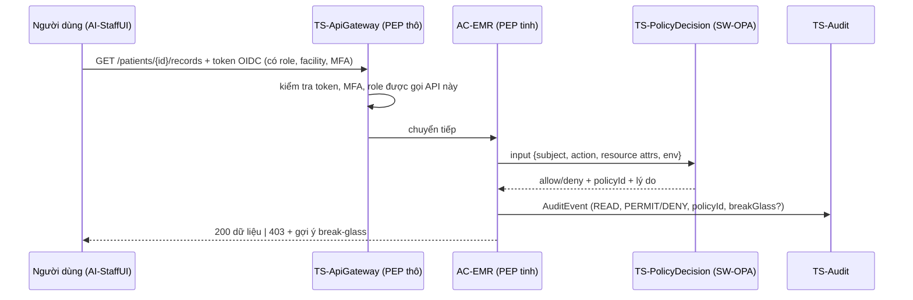

# ADR-002: Mô hình kiểm soát truy cập hồ sơ và đơn thuốc — RBAC nền + ABAC qua bộ quyết định chính sách tập trung

- **Trạng thái:** Đề xuất (chờ nhóm duyệt) | **Ngày:** 2026-11-03 | **Tác giả:** TV3 | **Người duyệt:** TV1, TV2
- **Liên quan:** G-03, FR-08, NFR-SEC-01, NFR-SEC-02, NFR-PRF-01, CON-02, CON-04, PR-01, PR-03, PR-04; ADR-003 (lưu vết quyết định truy cập)

## 1. Bối cảnh

- Hiện trạng dùng tài khoản chung theo quầy, ai đăng nhập cũng xem được mọi hồ sơ (ASM-04). Dữ liệu sức khỏe là dữ liệu cá nhân nhạy cảm (CON-02), nên phải chứng minh được "chỉ người cần mới xem" (PR-03).
- Câu hỏi quyền trong phòng khám **không chỉ phụ thuộc vai trò**. Ví dụ: cùng là bác sĩ, nhưng chỉ bác sĩ **đang có lượt khám với bệnh nhân** mới nên xem bệnh án; lễ tân chỉ xem thông tin hành chính; dược sĩ nhà thuốc đối tác chỉ xem đơn khi có **mã đơn** bệnh nhân xuất trình.
- Y tế cần **truy cập khẩn cấp** (break-glass): bệnh nhân trở nặng, bác sĩ trực khác phải xem ngay. Chặn cứng là trái PR-01 (an toàn người bệnh trên hết).
- Quy định có thể thay đổi (vd yêu cầu consent cho từng lần truy cập, câu hỏi "thay đổi giả định" #4). Kiến trúc phải đổi được chính sách mà không viết lại ứng dụng.
- Quy mô: ~80 nhân viên, ~10 vai trò, 2 cơ sở, 8 nhà thuốc. Phòng CNTT nhỏ (CON-07).

## 2. Phương án

| | Mô tả |
|---|---|
| **A. RBAC thuần** | Vai trò khai báo trong IdP (Bác sĩ, Lễ tân, Dược sĩ…), mỗi dịch vụ tự kiểm tra `role` trong token. Ngữ cảnh (bệnh nhân nào) xử lý bằng `if` rải rác trong code từng dịch vụ, nếu có. |
| **B. RBAC nền + ABAC tập trung** | IdP cấp vai trò (RBAC) cho quyền thô. Quyền tinh theo thuộc tính (quan hệ điều trị, cơ sở, ca trực, consent, trạng thái đơn, kênh truy cập) do **một bộ quyết định chính sách (PDP)** đánh giá; API Gateway và từng dịch vụ là **điểm thực thi (PEP)** gọi PDP. Chính sách viết dạng mã, có phiên bản. Có quy trình break-glass. |
| **C. ABAC thuần** | Không dùng vai trò; mọi quyền đều là quy tắc thuộc tính (kiểu XACML). Biểu diễn được mọi thứ như B, nhưng cả các quyền đơn giản ("lễ tân được tạo lịch hẹn") cũng thành quy tắc thuộc tính. |

## 3. Tiêu chí và chấm điểm (1–5, cao là tốt)

| Tiêu chí | Trọng số | A | B | C |
|---|---|---|---|---|
| An toàn dữ liệu, tối thiểu quyền (PR-03, NFR-SEC-02) | 30% | 2 | 5 | 5 |
| Đáp ứng ngữ cảnh y tế: quan hệ điều trị, break-glass, consent (FR-08) | 20% | 1 | 5 | 5 |
| Độ phức tạp triển khai & vận hành cho đội CNTT nhỏ (CON-07) | 20% | 5 | 3 | 1 |
| Hiệu năng quyết định (NFR-PRF-01) | 10% | 5 | 4 | 3 |
| Giải thích được & kiểm toán được quyết định ("vì sao được xem?") | 10% | 3 | 5 | 3 |
| Thích ứng khi quy định thay đổi | 10% | 1 | 5 | 5 |
| **Tổng có trọng số** | 100% | **2,70** | **4,50** | **3,80** |

Giải thích các điểm đáng chú ý:
- A thua ở an toàn vì RBAC không diễn đạt được "chỉ bệnh nhân của mình"; mọi bác sĩ xem được mọi hồ sơ, hoặc logic nằm rải rác, khó kiểm tra.
- C an toàn bằng B nhưng khó vận hành: rà soát "ai có quyền gì" phải đọc toàn bộ quy tắc thay vì một bảng vai trò; giải thích quyết định khó hơn vì không có vai trò làm điểm neo.
- B mất điểm độ phức tạp vì thêm một thành phần (PDP) và phải viết, kiểm thử chính sách.

## 4. Quyết định

**Chọn B: RBAC nền + ABAC tập trung.** Lý do: là phương án duy nhất đạt cả an toàn (30%) lẫn ngữ cảnh y tế (20%) mà vẫn giữ được bảng vai trò dễ rà soát. Phần phức tạp tăng thêm được giới hạn bằng cách chỉ áp ABAC cho **tài nguyên nhạy cảm** (bệnh án, đơn thuốc, nhật ký) và dùng RBAC cho phần còn lại.

### 4.1. Ma trận vai trò (RBAC, quyền thô)

| Vai trò (BR) | Lịch hẹn | Thông tin hành chính BN | Bệnh án (DO-ClinicalRecord) | Đơn thuốc | Ghi nhận cấp thuốc | Nhật ký (DO-AuditEvent) |
|---|---|---|---|---|---|---|
| BR-BenhNhan | CRUD của mình | R/U của mình | R của mình | R của mình | R của mình | R lịch sử truy cập hồ sơ của mình |
| BR-LeTan | CRUD | CRU | — | — | — | — |
| BR-DieuDuong | R | R | R + ghi sinh hiệu (ABAC) | R (ABAC) | — | — |
| BR-BacSi | R | R | CRU (ABAC) | CRU + ký (ABAC) | R | — |
| BR-DuocSi | — | R tối thiểu (tên, năm sinh) | — | R theo mã đơn (ABAC) | C | — |
| BR-QuanLy | R thống kê | — | — (chỉ số tổng hợp, không định danh) | — (chỉ số) | — (chỉ số) | — |
| BR-QuanTriBaoMat | — | — | — | — | — | R + xuất báo cáo (bị audit) |
| Quản trị hệ thống (IT) | — | — | — | — | — | — (tách nhiệm vụ: IT không đọc được dữ liệu y tế và nhật ký) |

### 4.2. Chính sách thuộc tính (ABAC) — viết thành policy bundle `ART-abac-policy`

| Mã | Chính sách | Thuộc tính dùng |
|---|---|---|
| POL-01 Quan hệ điều trị | Bác sĩ/điều dưỡng chỉ đọc/ghi bệnh án, đơn của BN **có lượt khám mở được phân cho mình** hoặc lượt khám mình đã thực hiện trong 90 ngày (tái khám) | `subject.id`, `encounter.assignedPractitioner`, `encounter.status`, `encounter.date` |
| POL-02 Cơ sở | Nhân viên chỉ truy cập dữ liệu của cơ sở mình làm việc, trừ khi BN có lượt khám tại cơ sở đó (biến thể A: thêm điều kiện consent) | `subject.facility`, `resource.facility` |
| POL-03 Ca trực | Ngoài ca trực đã đăng ký, chỉ được đọc (không ký đơn) | `subject.shift`, `env.time` |
| POL-04 Dược sĩ theo mã đơn | Dược sĩ chỉ xem đơn khi cung cấp đúng mã đơn + 4 số cuối điện thoại/CCCD BN, hoặc đơn được gửi đích danh tới nhà thuốc của mình | `subject.pharmacyId`, `request.rxCode`, `request.verifier` |
| POL-05 Trạng thái đơn | Không ghi nhận cấp thuốc cho đơn `REVOKED`/`EXPIRED`; không ký lại đơn đã `ISSUED` (biến thể C: tạo phiên bản mới) | `resource.status` |
| POL-06 Thuốc kiểm soát (CON-04) | Đơn có thuốc gây nghiện/hướng thần/tiền chất: chỉ nhà thuốc nội bộ được cấp, không cấp ở chế độ offline | `resource.controlled`, `subject.pharmacyType`, `env.online` |
| POL-07 Break-glass | Cho phép đọc ngoài POL-01/02 nếu người dùng là BR-BacSi/BR-DieuDuong, nhập lý do, phiên tối đa 4 giờ; quyết định mang cờ `breakGlass=true`; DPO phải rà soát trong 24 giờ | `request.breakGlassReason`, `subject.role` |
| POL-08 Consent (biến thể A, hoặc khi quy định thay đổi) | Xem hồ sơ của cơ sở khác chỉ khi BN có consent còn hiệu lực | `consent.status`, `consent.scope` |

### 4.3. Luồng thực thi

- PDP chạy cạnh dịch vụ (sidecar/thư viện) để quyết định trong vài mili giây; gói chính sách được phát hành tập trung, có phiên bản và kiểm thử tự động trước khi áp dụng.
- Mọi quyết định (kể cả DENY) ghi AuditEvent kèm `policyId` + phiên bản chính sách (liên kết ADR-003).

## 5. Đánh đổi

- **Được:** tối thiểu quyền đúng nghĩa; break-glass không chặn cấp cứu; thay đổi quy định (consent) chỉ là thêm thuộc tính/chính sách; giải thích được từng quyết định khi thanh tra.
- **Mất:** thêm thành phần PDP phải vận hành và giám sát; cần kỹ năng viết/kiểm thử chính sách; nếu dữ liệu thuộc tính sai (vd lượt khám chưa phân bác sĩ) bác sĩ có thể bị chặn nhầm → phụ thuộc chất lượng dữ liệu tiếp đón (BP-02.3).

## 6. Rủi ro và giảm thiểu

| Rủi ro | Giảm thiểu |
|---|---|
| RSK-01 lộ dữ liệu do lạm quyền | POL-01/02, MFA, giám sát break-glass bất thường qua TS-SIEM |
| PDP lỗi/không phản hồi → chặn toàn bộ | PDP chạy cục bộ cạnh mỗi dịch vụ (không phải 1 máy chủ trung tâm); mặc định **deny** nhưng break-glass vẫn hoạt động với chính sách tối thiểu dựng sẵn |
| Lạm dụng break-glass | Bắt nhập lý do, giới hạn 4 giờ, cảnh báo nếu 1 người dùng > 3 lần/tuần, DPO rà soát 24 giờ |
| RSK-08 bác sĩ phản đối vì bị chặn nhầm | Pilot 2 tuần ở PLT-1 chỉ ghi log "would-deny" (chế độ quan sát), tinh chỉnh chính sách trước khi bật chặn |

## 7. Phần tử ArchiMate bị ảnh hưởng

AC-IAM, AS-Authenticate, AS-Authorize, DO-AccessPolicy, BO-ChinhSachTruyCap, BF-01, TS-Identity, TS-PolicyDecision, TS-ApiGateway, ND-SecurityPlatform, SW-Keycloak, SW-OPA, ART-abac-policy, ART-iam-realm; WP-02; PLT-1.

## 8. Điều kiện xem xét lại

- Số vai trò/chính sách tăng mạnh (vd mở rộng thành chuỗi > 10 cơ sở) → cân nhắc mô hình quan hệ (ReBAC) cho quan hệ điều trị.
- Bộ Y tế ban hành chuẩn phân quyền/định danh y tế dùng chung (vd đăng nhập nhân viên y tế qua định danh quốc gia) → thay IdP, giữ PDP.
- Độ trễ PDP vượt 50 ms p95 → xem lại cách triển khai PDP.
