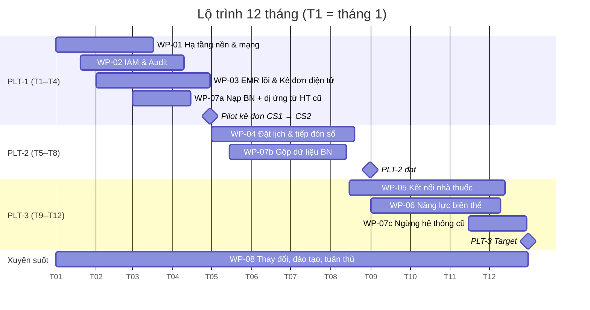

# Chương: Phân tích khoảng trống, Gói công việc và Lộ trình chuyển đổi (Pha E, F) — TV3, bản nháp v0.1 (2026-11-03)

> Mã phần tử theo 3 catalog: `01-vision/catalog.md` (TV1), `02-models/app-catalog.md` (TV2), `02-models/tech-catalog.md` (TV3).
> Thuật ngữ theo bài giảng Chương 8: **Gói công việc (Work Package)**, **Giao phẩm (Deliverable)**, **Bình cảnh (Plateau)**, **Khoảng trống (Gap)**, **Sự kiện thực hiện (Implementation Event)**. Góc nhìn dùng: **Kế hoạch dịch chuyển (Migration)**, **Dự án (Project)**, **Thực hiện và dịch chuyển (Implementation & Migration)**, theo cách ArchiSurance (Ch.9, pha E&F).
> Giả định: 12 tháng chuyển đổi (ASSUMP-08), đánh số tháng T1…T12.

## 1. Phân tích khoảng trống (ma trận Baseline × Target)

Cách đọc theo TOGAF: mỗi phần tử Baseline hoặc **được giữ** (Included/Retain), **được thay** bởi phần tử Target (Replace), hoặc **bị loại** (Eliminate); phần tử Target không có tiền thân là **Mới** (New). Mỗi dòng có Work Package xử lý (quy tắc vàng 5 của nhóm).

### 1.1. Tầng Công nghệ (TV3)

| Baseline (PLT-0) | → Target (PLT-3) | Loại | Lý do / Pain point | WP |
|---|---|---|---|---|
| ND-B-ServerCS1 (Win 2012 R2) | ND-SiteServerCS1 (OS còn hỗ trợ, chỉ chạy HIS-Lite) + dịch vụ lõi lên ND-AppCluster | Replace | T1 OS hết hỗ trợ, điểm lỗi đơn | WP-01 |
| ND-B-ServerCS2 (PC Win10) | ND-SiteServerCS2 (chỉ chạy ClinicSoft) | Replace | T1 | WP-01 |
| ND-B-SaaS (Google Sheets, Zalo OA cho dữ liệu sức khỏe) | — (AC-Booking, AC-Notification + EXT-SmsGateway) | Eliminate | T6 dữ liệu nhạy cảm trên tài khoản chung | WP-04, WP-07 |
| NW-B-LAN phẳng | NW-LAN-CS1/CS2 phân VLAN, Wi-Fi khách tách | Replace | T4 | WP-01 |
| Internet 1 đường | NW-Internet 2 nhà mạng + 4G dự phòng | Replace | NFR-AVL-01 | WP-01 |
| TS-B-Backup (thủ công) | TS-Backup + ND-BackupDR (vùng 2) | Replace | T7 | WP-01 |
| DV-B-Workstation | DV-Workstation (giữ máy, cài lại, gắn vào IdP) | Retain | Tiết kiệm chi phí | WP-01 |
| — | ND-EdgeGateway, TS-ApiGateway, TS-SecureChannel, NW-SiteVPN, NW-PartnerChannel | New | T5 không có kênh tích hợp | WP-01, WP-05 |
| — | ND-AppCluster, ND-DataCluster, ND-MessageBroker, ND-ObjectStore | New | Nền cho AC mới | WP-01 |
| — | ND-SecurityPlatform (TS-Identity, TS-PolicyDecision) | New | T2, NFR-SEC-01/02, ADR-002 | WP-02 |
| — | ND-AuditStore, ND-SecOps (TS-Audit, TS-SIEM) | New | T3, NFR-SEC-03, ADR-003 | WP-02 |
| — | ND-KeyVault (TS-KeyManagement, TS-Signing) | New | T8, CON-03 | WP-02 |
| — | DV-Kiosk, DV-IdCardReader | New | FR-03 check-in nhanh | WP-04 |

### 1.2. Tầng Ứng dụng & Dữ liệu (tóm tắt, chi tiết do TV2)

| Baseline | → Target | Loại | WP |
|---|---|---|---|
| HIS-Lite (CS1): thu ngân, BHYT, in đơn | AC-HisLite-CS1 chỉ còn thu ngân/BHYT; chức năng in đơn chuyển sang AC-ePrescription | Retain (thu hẹp) | WP-03 |
| ClinicSoft (CS2) | AC-ClinicSoft-CS2 chỉ còn thu ngân/BHYT | Retain (thu hẹp) | WP-03 |
| Google Sheet lịch hẹn | AC-Booking, AC-PatientPortal | Replace | WP-04 |
| Zalo OA nhắc lịch / nhận ảnh đơn | AC-Notification; AC-PharmacyGateway | Replace | WP-04, WP-05 |
| Bệnh án giấy | AC-EMR (DO-Encounter, DO-ClinicalRecord) | Replace | WP-03 |
| Tài khoản chung theo quầy | AC-IAM (tài khoản cá nhân, MFA) | Replace | WP-02 |
| — | AC-Reception, AC-MasterData, AC-Reporting | New | WP-04, WP-03 |
| — | AC-Audit (DO-AuditEvent) | New | WP-02 |
| Nhập tay đơn lên Hệ thống đơn thuốc quốc gia | AS-SubmitNationalRx (tự động) | Replace | WP-03 |
| Mã BN riêng ở mỗi cơ sở | DO-Patient dùng chung (+ AC-MPI nếu biến thể A) | Replace | WP-07 (WP-06A) |
| Biến thể | AC-IntegrationHub/AC-MPI/AC-Consent (A) · AC-PharmacyAgent/AC-Reconciliation (B) · AF-PrescriptionVersioning (C) | New | WP-06 |

### 1.3. Tầng Nghiệp vụ (tóm tắt; chi tiết Replace/Retain/New/Eliminate ở tài liệu của TV1, mục 8)

| Baseline | → Target | Loại | WP |
|---|---|---|---|
| Đặt lịch qua hotline/Zalo, ghi tay | BP-01 Đặt lịch khám (online + tổng đài trên cùng hệ thống) | Replace | WP-04 |
| Tiếp đón nhập tay, 60% không hẹn | BP-02 Tiếp đón (QR/CCCD, kiosk) | Replace | WP-04 |
| Kê đơn giấy/in, kiểm tra bằng trí nhớ | BP-04 Kê đơn điện tử (kiểm tra an toàn, ký số) | Replace | WP-03 |
| Nhà thuốc nhận ảnh đơn | BP-05 Cấp thuốc (tra mã đơn, xác nhận cấp) | Replace | WP-05 |
| — | BF-01 Kiểm soát truy cập & lưu vết; BR-QuanTriBaoMat | New | WP-02, WP-08 |
| — | BP-06A/B/C (ngoại lệ biến thể) | New | WP-06 |

## 2. Gói công việc (Work Package) và Giao phẩm (Deliverable)

| WP | Tên | Nội dung chính | Giao phẩm (DLV) | Xử lý khoảng trống | Phụ thuộc |
|---|---|---|---|---|---|
| WP-01 | Hạ tầng nền & mạng | Thuê DC 2 vùng, DMZ/App/Data/Security zones, VPN 2 cơ sở, VLAN, 2 nhà mạng, máy chủ cơ sở mới cho HIS-Lite/ClinicSoft, sao lưu + DR | DLV-01 Hạ tầng DC vận hành; DLV-02 Mạng cơ sở phân vùng; DLV-03 Biên bản diễn tập DR | T1, T4, T5, T7 | — |
| WP-02 | Định danh, phân quyền & lưu vết | IdP + MFA, xóa tài khoản chung, PDP + bộ chính sách POL-01..07 (ADR-002), dịch vụ audit + WORM + SIEM (ADR-003), KMS | DLV-04 IAM vận hành; DLV-05 Audit service + báo cáo verify; DLV-06 Bộ chính sách ABAC v1 | T2, T3, T8 | WP-01 |
| WP-03 | Bệnh án lõi & Kê đơn điện tử | AC-EMR lõi (BN, lượt khám, dị ứng, chẩn đoán ICD-10), AC-ePrescription (kiểm tra an toàn, ký số), AC-MasterData (danh mục thuốc), liên thông EXT-NationalRxSystem (mock); thu hẹp HIS-Lite/ClinicSoft | DLV-07 Kê đơn điện tử ký số tại 2 cơ sở; DLV-08 Kết nối Hệ thống đơn thuốc quốc gia | Kê đơn giấy, nhập tay liên thông | WP-01, WP-02 |
| WP-04 | Đặt lịch & tiếp đón số | AC-Booking, AC-PatientPortal, AC-Reception, kiosk + đầu đọc CCCD, AC-Notification, AC-Reporting (đo OC-01) | DLV-09 Cổng đặt lịch; DLV-10 Tiếp đón QR/CCCD; DLV-11 Báo cáo thời gian chờ | Google Sheet, Zalo, tiếp đón nhập tay | WP-02, WP-03 (dùng DO-Patient) |
| WP-05 | Kết nối nhà thuốc | AC-PharmacyGateway, AI-PharmacyWebUI, cổng đối tác mTLS, onboard 2 nhà thuốc nội bộ + 6 đối tác (ADR-001 của TV2) | DLV-12 API nhà thuốc + webhook; DLV-13 6 nhà thuốc đối tác kết nối | Ảnh đơn qua Zalo | WP-03 |
| WP-06 | Năng lực theo biến thể (chỉ làm biến thể được giao) | A: Integration Hub, FHIR adapter, MPI, consent · B: Pharmacy agent offline, đối soát · C: phiên bản đơn, sửa/thu hồi, thông báo | DLV-14 Năng lực biến thể + BPMN ngoại lệ chạy thật | Khoảng trống biến thể | A: WP-03; B, C: WP-05 |
| WP-07 | Chuyển đổi dữ liệu & ngừng hệ thống cũ | **7a (PLT-1):** nạp một lần danh sách BN + **dị ứng, đơn 90 ngày gần nhất** từ HIS-Lite và ClinicSoft vào AC-EMR (chưa khử trùng, gắn nguồn) để kiểm tra an toàn thuốc có dữ liệu ngay từ ngày đầu · **7b (PLT-2):** khử trùng/gộp BN 2 cơ sở, chạy song song có đối soát, ngừng Sheet/Zalo cho dữ liệu sức khỏe · **7c (PLT-3):** thu hồi ND-B-Server*, lưu trữ dữ liệu cũ chỉ đọc | DLV-15 Dữ liệu BN đã gộp + biên bản đối soát; DLV-16 Biên bản ngừng hệ thống cũ | T6, mã BN phân tán | WP-03 (7a), WP-04 (7b) |
| WP-08 | Quản lý thay đổi, đào tạo & tuân thủ | Đánh giá tác động xử lý dữ liệu cá nhân, quy trình break-glass & rà soát, đào tạo theo vai trò, pilot, quy trình giấy dự phòng | DLV-17 Hồ sơ đánh giá tác động DLCN; DLV-18 Tài liệu đào tạo & SOP | Con người/quy trình | xuyên suốt |

## 3. Bình cảnh (Plateau) và lộ trình

### 3.1. Thứ tự và lý do

| Plateau | Thời điểm đạt | Nội dung kiến trúc ổn định | WP hoàn thành | Vì sao đặt ở đây |
|---|---|---|---|---|
| **PLT-0** Hiện trạng | T0 | Baseline mục 1 | — | — |
| **PLT-1** Nền tảng an toàn & Kê đơn điện tử liên thông | cuối T4 | DC + mạng phân vùng; IAM/MFA, ABAC, audit bất biến hoạt động; bác sĩ 2 cơ sở kê đơn điện tử ký số, tự động liên thông Hệ thống đơn thuốc quốc gia; BN nhận mã đơn/QR in trên đơn; nhà thuốc vẫn tra đơn qua mã trên hệ thống quốc gia | WP-01, WP-02, WP-03, WP-07a (+ WP-08 đợt 1) | **Tuân thủ trước, tối ưu sau:** kê đơn điện tử đã là nghĩa vụ pháp lý (TT 26/2025/TT-BYT), hiện trạng CS2 đang vi phạm. Bảo mật/audit phải có **trước** khi đưa dữ liệu sức khỏe lên hệ thống mới (PR-04) |
| **PLT-2** Đặt lịch, tiếp đón số & hồ sơ thống nhất | cuối T8 | Đặt lịch online/tổng đài, check-in QR/CCCD, nhắc lịch; dữ liệu BN 2 cơ sở đã gộp; Google Sheet/Zalo ngừng dùng cho dữ liệu sức khỏe; báo cáo thời gian chờ đo được OC-01 | WP-04, WP-07b (gộp dữ liệu) | Mục tiêu hiệu quả G-01 cần dữ liệu BN sạch (dựa trên PLT-1) |
| **PLT-3** Liên thông nhà thuốc & biến thể (**Target**) | cuối T12 | 8 nhà thuốc nhận đơn qua cổng đối tác/web, phản hồi trạng thái cấp; năng lực biến thể vận hành; hệ thống cũ (máy chủ, Sheet) đã thu hồi | WP-05, WP-06, WP-07c (ngừng hệ thống) | Phụ thuộc đơn điện tử ổn định; đối tác bên ngoài cần thời gian đàm phán (CT-02) |

**Hạn chế đã biết của PLT-1 (ghi rõ trong báo cáo):** dữ liệu BN 2 cơ sở chưa khử trùng, nên một BN từng khám cả 2 nơi có thể có 2 hồ sơ; kiểm tra dị ứng ở PLT-1 dựa trên dị ứng nạp từ cả 2 hệ thống cũ (WP-07a) **cộng** khai thác dị ứng bắt buộc khi khám, chứ chưa dựa trên hồ sơ đã gộp. Rủi ro này thuộc RSK-05 và được đóng ở PLT-2 (WP-07b).

**Điều chỉnh theo biến thể:** nếu nhóm nhận **biến thể A**, chuyển WP-06A (MPI, Integration Hub) lên PLT-2 vì "hồ sơ thống nhất" của PLT-2 chính là bài toán liên thông 2 cơ sở; khi đó WP-07 gộp dữ liệu dùng MPI thay vì gộp thủ công. Biến thể B, C giữ ở PLT-3.

### 3.2. Khoảng trống giữa các bình cảnh (phần tử Gap trong ArchiMate)

| Gap | Giữa | Nội dung chính |
|---|---|---|
| GAP-01 | PLT-0 → PLT-1 | Thiếu hạ tầng tập trung, IAM, audit, ký số, kê đơn điện tử, liên thông quốc gia tự động |
| GAP-02 | PLT-1 → PLT-2 | Thiếu đặt lịch/tiếp đón số, dữ liệu BN còn phân tán, còn dùng Sheet/Zalo |
| GAP-03 | PLT-2 → PLT-3 | Thiếu kênh điện tử với nhà thuốc, thiếu năng lực biến thể, hệ thống cũ chưa thu hồi |

### 3.3. Lộ trình (xem nhanh)

(Ngày trong sơ đồ chỉ để vẽ; báo cáo ghi theo T1…T12.)

### 3.4. Cách vẽ trong Archi (quan hệ chuẩn ArchiMate)

- **Kế hoạch dịch chuyển (Migration viewpoint):** PLT-0 **triggers** PLT-1 **triggers** PLT-2 **triggers** PLT-3; GAP-01 **association** với PLT-0 và PLT-1 (tương tự GAP-02, GAP-03).
- **Dự án (Project viewpoint):** WP-xx **realizes** DLV-xx; WP-01 **triggers** WP-02 (phụ thuộc); BR-QuanLy / phòng CNTT **assigned to** WP; Implementation Event "Pilot kê đơn hoàn tất" **triggers** WP-04.
- **Thực hiện và dịch chuyển (Implementation & Migration):** DLV-xx **realizes** phần tử lõi (vd DLV-05 realizes AC-Audit, ND-AuditStore); PLT-x **aggregates** các phần tử kiến trúc thuộc bình cảnh đó; WP **associated** với GAP nó lấp.

## 4. Quản trị triển khai và thay đổi (Pha G, H — nêu ngắn)

- **Hội đồng kiến trúc** gọn: Giám đốc, trưởng CNTT, 1 bác sĩ đại diện, DPO; duyệt mỗi lần qua bình cảnh (cổng chất lượng: đạt chỉ số NFR và OC liên quan).
- **Tiêu chí qua cổng:** PLT-1 = 100% đơn điện tử tại 2 cơ sở, 0 tài khoản chung, verify audit không lỗi 14 ngày liên tiếp; PLT-2 = ≥ 40% lượt khám có hẹn, check-in ≤ 60 s (NFR-USB-01); PLT-3 = ≥ 90% đơn tại nhà thuốc đối tác nhận điện tử (OC-04).
- **Quản lý thay đổi kiến trúc:** yêu cầu thay đổi (vd quy định consent mới) → cập nhật Requirement/Constraint → dò RTM → xác định ADR cần xem lại và WP/Plateau bị ảnh hưởng (quy trình 4 bước trả lời "thay đổi giả định").
