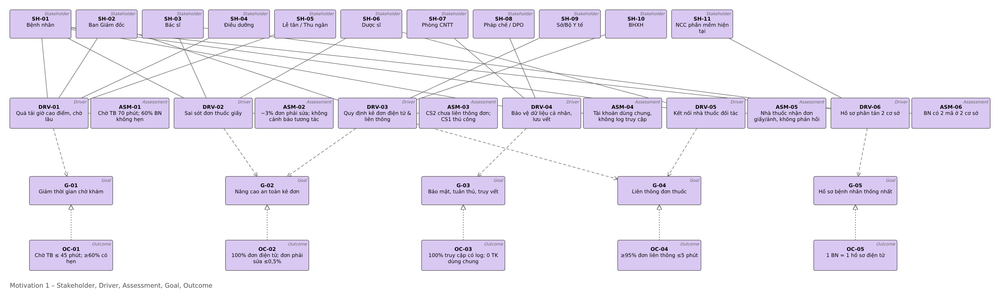
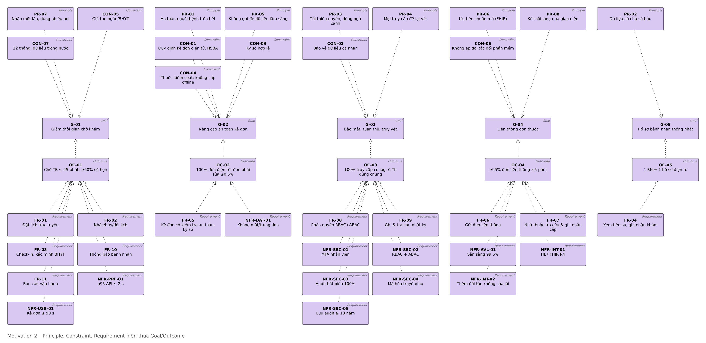
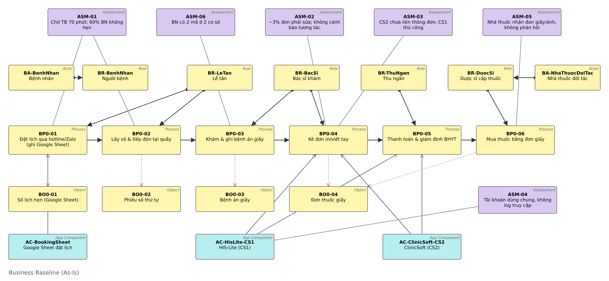
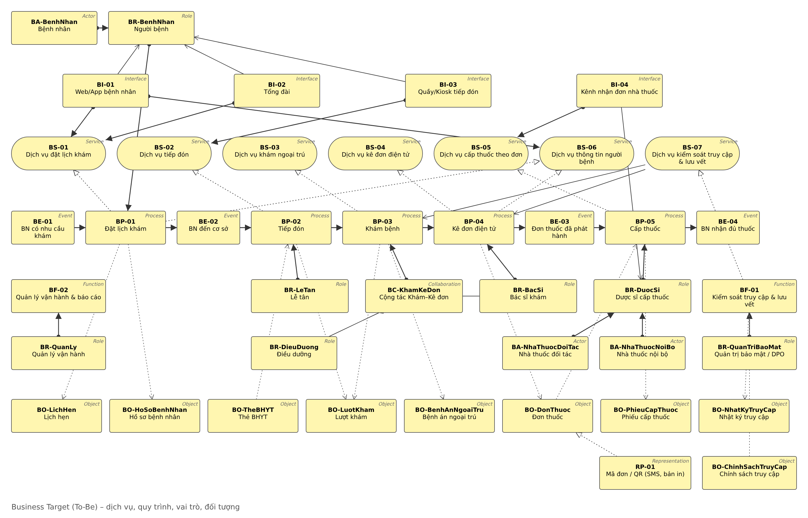
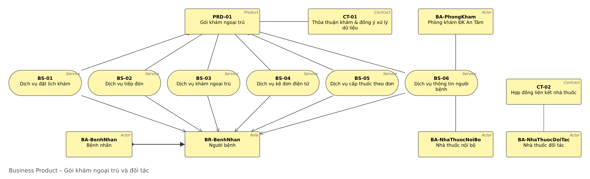
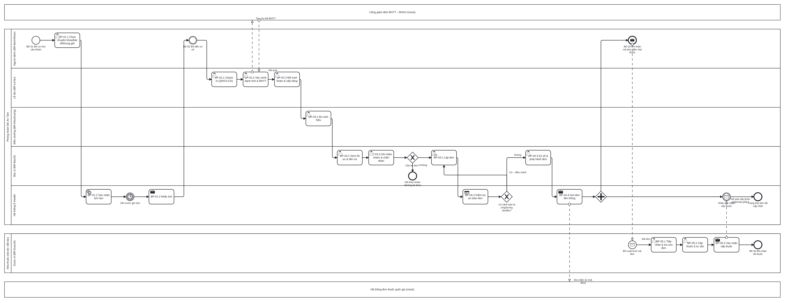
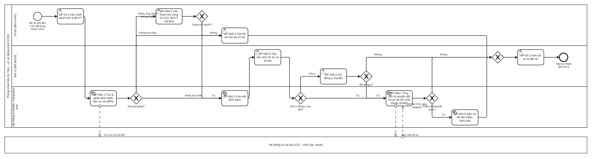
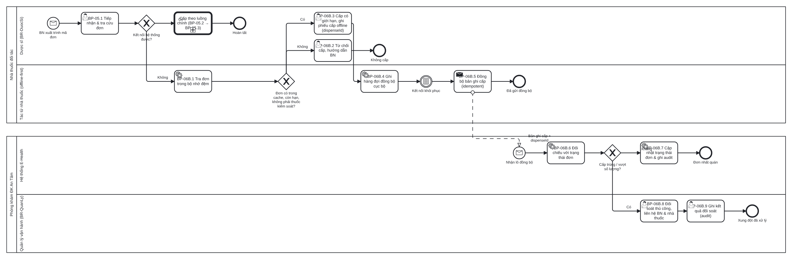
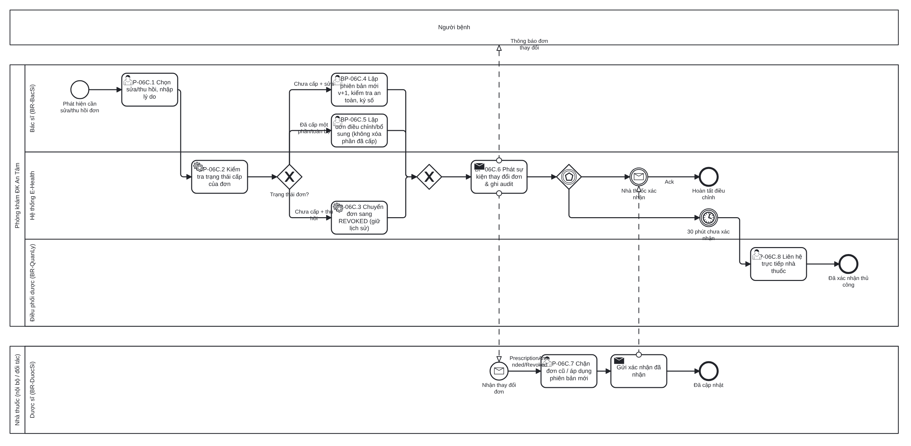

# E-Health ngoại trú – M1 Brief & Vision + Kiến trúc nghiệp vụ (TV1)

Nov 3, 2026 · @Long

## 0. Rà soát file hướng dẫn so với đề và slide

File hướng dẫn đúng hướng và dùng được làm khung, nhưng có 8 điểm cần sửa để khớp đề và slide chương 5 (Nghiệp vụ), chương 7 (Động lực). Tài liệu này đã áp dụng các sửa đổi bên dưới.

| \#  | Trong file hướng dẫn                                                           | Vấn đề                                                                                                                                                 | Đã sửa thành                                                                                |
|-----|--------------------------------------------------------------------------------|--------------------------------------------------------------------------------------------------------------------------------------------------------|---------------------------------------------------------------------------------------------|
| 1   | Giả định "3 cơ sở, ~800 lượt/ngày"                                             | Biến thể A yêu cầu đúng hai cơ sở có dữ liệu khác nhau; giả định 3 cơ sở làm lệch ràng buộc biến thể (đề: giả định không được làm mất ràng buộc chính) | 2 cơ sở, ~500 lượt/ngày, hai phần mềm khác nhau (ASSUMP-02, 05)                             |
| 2   | Chuỗi Motivation chỉ có Stakeholder → Driver → Goal → Requirement → Constraint | Slide chương 7 có thêm Assessment, Outcome, Principle, Value; thiếu Assessment thì Driver không có bằng chứng, thiếu Outcome thì Goal không đo được    | Thêm ASM-xx (đánh giá hiện trạng) và OC-xx (kết quả đo được), PR-xx nối vào Motivation view |
| 3   | "Mục tiêu: giảm thời gian chờ 30%, giảm sai sót 90%" đặt là Goal               | Con số cụ thể là Outcome, không phải Goal trong ArchiMate                                                                                              | G-xx là phát biểu mức cao, OC-xx giữ con số                                                 |
| 4   | Chỉ nói "Vision statement"                                                     | Slide 3.1 yêu cầu tuyên bố Sứ mạng–Tầm nhìn–Giá trị cốt lõi                                                                                            | Thêm Mission–Vision–Value ở mục 1                                                           |
| 5   | Business layer chỉ có Role, Process, Service, Object                           | Slide chương 5 có Business Interface (kênh), Event, Collaboration, Contract, Product, Representation; khung "kênh truy cập" và "sản phẩm hóa dịch vụ"  | Thêm BI-xx, BE-xx, BC, CT-xx, PRD-01, RP-01                                                 |
| 6   | Một mã BP-xx cho cả BPMN task và ArchiMate process                             | Một BPMN process gồm nhiều task; dùng chung mã làm vỡ quy tắc "một khái niệm một mã"                                                                   | BP-0x = process (ArchiMate + BPMN process), BP-0x.y = task/sub-process                      |
| 7   | Thiếu ràng buộc pháp lý cụ thể, thiếu thuốc kiểm soát đặc biệt                 | Đề chấm "ràng buộc" 10 điểm; biến thể B/C đụng trực tiếp tới thuốc kiểm soát                                                                           | CON-01..07, trong đó CON-04 cấm cấp offline thuốc kiểm soát                                 |
| 8   | "Năm tầng" gộp Motivation & Strategy                                           | ArchiMate 3.1 có Strategy, Business, Application, Technology, Physical, Implementation & Migration; Motivation là khía cạnh riêng                      | Ghi đúng; Strategy (Capability) chỉ dùng ở mức gọn nếu cần                                  |

Ngoài ra hướng dẫn giao TV2 giữ tên phần tử dùng chung; trong dự án này TV1 giữ mã Motivation/Business, TV2 giữ AC/AS/AI/DO, TV3 giữ ND/TS/WP/PLT/RSK. Văn bản pháp luật nêu ở CON-xx viết theo hiểu biết đến 2026, nhóm cần đối chiếu bản hiện hành trước khi nộp.

## 1. Bối cảnh tổ chức và tầm nhìn

Phòng khám Đa khoa An Tâm (hư cấu) có 2 cơ sở, khoảng 500 lượt khám ngoại trú mỗi ngày, và muốn chuyển từ giấy tờ, phần mềm rời rạc sang một chuỗi đặt lịch – tiếp đón – khám – kê đơn – cấp thuốc điện tử, có kiểm soát truy cập và lưu vết.

### 1.1 Giả định

| Mã        | Giả định                                                                                                                                                                                         |
|-----------|--------------------------------------------------------------------------------------------------------------------------------------------------------------------------------------------------|
| ASSUMP-01 | Phòng khám tư nhân, có hợp đồng KCB BHYT                                                                                                                                                         |
| ASSUMP-02 | CS1 (Cầu Giấy) ~300 lượt/ngày, CS2 (Long Biên) ~200 lượt/ngày; cao điểm 7h–10h chiếm ~45%                                                                                                        |
| ASSUMP-03 | ~40 bác sĩ, 30 điều dưỡng, 12 lễ tân/thu ngân, 10 chuyên khoa; không có nội trú                                                                                                                  |
| ASSUMP-04 | Mỗi cơ sở có 1 nhà thuốc nội bộ; có 6 nhà thuốc đối tác, mỗi nơi dùng phần mềm bán thuốc riêng                                                                                                   |
| ASSUMP-05 | CS1 dùng HIS-Lite (thu ngân, BHYT, in đơn), CS2 dùng ClinicSoft (nhà cung cấp khác, mã bệnh nhân khác); đặt lịch qua hotline/Zalo ghi Google Sheet; bệnh án giấy; tài khoản dùng chung theo quầy |
| ASSUMP-06 | Thu ngân và giám định BHYT giữ hệ thống hiện có, chỉ kết nối                                                                                                                                     |
| ASSUMP-07 | Cổng giám định BHYT, Hệ thống đơn thuốc quốc gia, SMS, phần mềm nhà thuốc, CA ký số được mock                                                                                                    |
| ASSUMP-08 | Chuyển đổi trong 12 tháng, 3 giai đoạn                                                                                                                                                           |
| ASSUMP-09 | Số liệu hiện trạng (thời gian chờ, tỷ lệ sai sót) là giả định có chủ đích để đặt mục tiêu đo được                                                                                                |

Phạm vi: 5 bước lõi của đề cộng kiểm soát truy cập và lưu vết. Ngoài phạm vi: thu ngân, cận lâm sàng, nội trú, kho dược.

### 1.2 Sứ mạng – Tầm nhìn – Giá trị cốt lõi

- **Sứ mạng:** Mang lại dịch vụ khám ngoại trú an toàn, nhanh và minh bạch cho người dân khu vực Hà Nội.

- **Tầm nhìn kiến trúc (Architecture Vision):** Đến hết 12 tháng, mọi lượt khám tại hai cơ sở đi qua một hồ sơ điện tử duy nhất, từ lịch hẹn trực tuyến đến đơn thuốc điện tử được nhà thuốc xác nhận cấp, và mọi truy cập dữ liệu người bệnh đều được phân quyền và lưu vết.

- **Giá trị cốt lõi:** An toàn người bệnh; Tôn trọng quyền riêng tư; Minh bạch và truy vết được; Thuận tiện cho người bệnh và nhân viên y tế.

## 2. Architecture Principles

8 nguyên tắc dưới đây là căn cứ để TV2/TV3 viết ADR; mỗi ADR nên dẫn ít nhất một PR-xx.

| Mã    | Nguyên tắc                       | Phát biểu                                                                        | Lý do                                         | Hệ quả cho kiến trúc                                                |
|-------|----------------------------------|----------------------------------------------------------------------------------|-----------------------------------------------|---------------------------------------------------------------------|
| PR-01 | An toàn người bệnh trên hết      | Khi phải đánh đổi, chọn phương án an toàn (fail-safe) trước tiện lợi             | Sai thuốc gây hại trực tiếp                   | Kiểm tra an toàn đơn bắt buộc; khi mất kết nối chỉ cấp có giới hạn  |
| PR-02 | Dữ liệu là tài sản có chủ sở hữu | Dữ liệu lâm sàng do cơ sở khám quản lý; mỗi Data Object có một nguồn chuẩn       | Tránh nhiều bản không khớp                    | Mỗi DO có hệ thống nguồn; hệ khác đọc qua API                       |
| PR-03 | Tối thiểu quyền, đúng ngữ cảnh   | Chỉ truy cập dữ liệu cần cho công việc, với BN đang phục vụ                      | Dữ liệu sức khỏe là dữ liệu nhạy cảm (CON-02) | RBAC + ABAC, break-glass có cờ; bỏ tài khoản dùng chung             |
| PR-04 | Mọi truy cập đều để lại vết      | Ghi ai, làm gì, trên đối tượng nào, khi nào, từ đâu, kết quả; bất biến           | Đề yêu cầu lưu vết; phục vụ tranh chấp        | Audit tập trung, append-only                                        |
| PR-05 | Không ghi đè dữ liệu lâm sàng    | Thay đổi tạo phiên bản hoặc bản ghi mới                                          | Giữ lịch sử điều trị, pháp lý                 | Đơn thuốc có trạng thái và phiên bản                                |
| PR-06 | Ưu tiên chuẩn mở                 | Trao đổi dữ liệu theo HL7 FHIR R4, ICD-10, danh mục thuốc quốc gia               | Giảm chi phí tích hợp với đối tác             | API dạng FHIR; danh mục dùng chung                                  |
| PR-07 | Nhập một lần, dùng nhiều nơi     | Dữ liệu nhập tại nguồn, bước sau dùng lại                                        | Giảm thời gian và lỗi nhập                    | Thông tin đặt lịch chuyển thẳng sang tiếp đón                       |
| PR-08 | Kết nối lỏng qua giao diện       | Hệ thống nội bộ và đối tác giao tiếp qua API/sự kiện, không truy cập DB của nhau | Nhà thuốc và CS2 không đổi phần mềm (CON-06)  | Pharmacy Gateway, adapter; thay một hệ thống không kéo theo hệ khác |

## 3. Stakeholder

Bốn nhóm cần quản lý chặt là Ban Giám đốc, Bác sĩ, Phòng CNTT và (mức thỏa mãn) Dược sĩ; cơ quan quản lý có quyền lực cao nhưng ít quan tâm chi tiết, nên chỉ cần giữ hài lòng bằng tuân thủ.

| Mã    | Stakeholder                       | Mối quan tâm chính                                        | Quyền lực / Quan tâm | Cách quản lý              |
|-------|-----------------------------------|-----------------------------------------------------------|----------------------|---------------------------|
| SH-01 | Bệnh nhân                         | Chờ ít, đặt lịch dễ, nhận đúng thuốc, dữ liệu được bảo vệ | Thấp / Cao           | Thông tin đầy đủ          |
| SH-02 | Ban Giám đốc                      | Công suất, chi phí, uy tín, tuân thủ                      | Cao / Cao            | Quản lý chặt              |
| SH-03 | Bác sĩ                            | Kê đơn nhanh, an toàn, xem đủ tiền sử                     | Cao / Cao            | Quản lý chặt              |
| SH-04 | Điều dưỡng                        | Điều phối hàng chờ, đo sinh hiệu                          | Thấp / Trung bình    | Thông tin                 |
| SH-05 | Lễ tân / Thu ngân                 | Tiếp đón nhanh, ít nhập trùng                             | Thấp / Cao           | Thông tin đầy đủ          |
| SH-06 | Dược sĩ (nội bộ, đối tác)         | Nhận đơn hợp lệ, không cấp trùng, ít đổi phần mềm         | Trung bình / Cao     | Giữ hài lòng và thông tin |
| SH-07 | Phòng CNTT                        | Vận hành, tích hợp, bảo mật                               | Trung bình / Cao     | Quản lý chặt              |
| SH-08 | Pháp chế / DPO                    | Tuân thủ dữ liệu cá nhân, lưu vết                         | Cao / Trung bình     | Giữ hài lòng              |
| SH-09 | Sở/Bộ Y tế                        | Kê đơn điện tử, liên thông đơn thuốc                      | Cao / Thấp           | Giữ hài lòng              |
| SH-10 | BHXH                              | Dữ liệu KCB BHYT đúng chuẩn                               | Cao / Thấp           | Giữ hài lòng              |
| SH-11 | Nhà cung cấp HIS-Lite, ClinicSoft | Giữ hợp đồng, phạm vi tích hợp                            | Thấp / Trung bình    | Theo dõi                  |

Lưu ý phân biệt theo slide chương 5: Stakeholder (SH-xx) nằm ở Motivation; cùng người đó khi tham gia nghiệp vụ là Business Actor/Role (BA-/BR-xx) ở mục 8.

## 4. Driver, Assessment, Goal, Outcome

6 động cơ dẫn đến 5 mục đích; mỗi mục đích có một Outcome đo được để kiểm chứng sau triển khai (số liệu hiện trạng là giả định ASSUMP-09).

| Driver                                               | Assessment (hiện trạng)                                                                                      | Stakeholder         |
|------------------------------------------------------|--------------------------------------------------------------------------------------------------------------|---------------------|
| DRV-01 Quá tải giờ cao điểm, chờ lâu                 | ASM-01: chờ TB 70 phút (7h–10h); 60% BN đến không hẹn                                                        | SH-01, SH-02, SH-05 |
| DRV-02 Sai sót đơn giấy, không kiểm tra an toàn      | ASM-02: ~3% đơn phải sửa; không có cảnh báo tương tác, dị ứng                                                | SH-03, SH-06, SH-01 |
| DRV-03 Quy định kê đơn điện tử, liên thông đơn thuốc | ASM-03: CS2 chưa kê đơn điện tử/liên thông (đang trái quy định từ 01/01/2026); CS1 liên thông thủ công, chậm | SH-09, SH-02        |
| DRV-04 Bảo vệ dữ liệu cá nhân, yêu cầu lưu vết       | ASM-04: tài khoản dùng chung theo quầy, không có log truy cập hồ sơ                                          | SH-08, SH-01, SH-07 |
| DRV-05 Nhu cầu kết nối nhà thuốc đối tác             | ASM-05: nhà thuốc nhận đơn giấy/ảnh chụp, không xác thực, không phản hồi trạng thái cấp                      | SH-06, SH-01        |
| DRV-06 Hồ sơ phân tán giữa 2 cơ sở và giấy           | ASM-06: BN khám ở 2 cơ sở có 2 mã khác nhau; bác sĩ không xem được tiền sử bên kia                           | SH-03, SH-01        |

| Goal                                                         | Outcome đo được                                                                                                  | Từ Driver      |
|--------------------------------------------------------------|------------------------------------------------------------------------------------------------------------------|----------------|
| G-01 Giảm thời gian chờ khám                                 | OC-01: chờ TB ≤ 45 phút (giảm ≥ 35%) sau 6 tháng; ≥ 60% lượt khám có hẹn trước                                   | DRV-01         |
| G-02 Nâng cao an toàn kê đơn                                 | OC-02: 100% đơn ngoại trú (trừ thuốc kiểm soát đặc biệt) là đơn điện tử có kiểm tra an toàn; đơn phải sửa ≤ 0,5% | DRV-02, DRV-03 |
| G-03 Bảo đảm bảo mật, tuân thủ, truy vết                     | OC-03: 100% truy cập hồ sơ/đơn có log bất biến; 0 tài khoản dùng chung                                           | DRV-04         |
| G-04 Liên thông đơn thuốc với nhà thuốc và hệ thống quốc gia | OC-04: ≥ 95% đơn liên thông trong ≤ 5 phút; ≥ 90% đơn tại nhà thuốc đối tác nhận qua kênh điện tử                | DRV-03, DRV-05 |
| G-05 Hồ sơ bệnh nhân thống nhất                              | OC-05: mỗi BN một hồ sơ điện tử dùng chung; không nhập lại thông tin hành chính khi tái khám                     | DRV-06         |

## 5. Requirements Catalog

Catalog gồm 11 FR lõi, 9 FR theo biến thể (chỉ giữ 3 FR của biến thể được giao), 11 NFR và 7 ràng buộc. Cột BP cho biết yêu cầu được hiện thực ở quy trình nào, để TV2 nối tiếp sang Application Service trong RTM.

### 5.1 Yêu cầu chức năng (lõi)

| Mã    | Yêu cầu                                                                                                    | Goal       | BP                  |
|-------|------------------------------------------------------------------------------------------------------------|------------|---------------------|
| FR-01 | Đặt lịch trực tuyến/qua tổng đài: chọn chuyên khoa, bác sĩ, khung giờ; xác nhận tức thì                    | G-01       | BP-01               |
| FR-02 | Nhắc lịch, hủy/đổi lịch, giải phóng khung giờ                                                              | G-01       | BP-01               |
| FR-03 | Check-in bằng QR lịch hẹn hoặc CCCD, xác minh danh tính và thẻ BHYT, mở lượt khám, xếp hàng chờ            | G-01, G-05 | BP-02               |
| FR-04 | Xem tiền sử, dị ứng, đơn cũ; ghi nhận khám và chẩn đoán ICD-10                                             | G-02, G-05 | BP-03               |
| FR-05 | Kê đơn điện tử có kiểm tra dị ứng, tương tác, trùng hoạt chất, liều; ký số, phát hành mã đơn               | G-02       | BP-04               |
| FR-06 | Gửi đơn liên thông lên Hệ thống đơn thuốc quốc gia và tới nhà thuốc; BN nhận mã đơn (SMS/app/bản in có QR) | G-04       | BP-04               |
| FR-07 | Nhà thuốc tra cứu đơn theo mã, ghi nhận cấp toàn phần/một phần, cập nhật trạng thái đơn                    | G-04       | BP-05               |
| FR-08 | Phân quyền theo vai trò và ngữ cảnh (BN đang khám, cơ sở, ca trực); truy cập khẩn cấp có cờ                | G-03       | BF-01               |
| FR-09 | Ghi và tra cứu nhật ký truy cập; báo cáo truy cập bất thường                                               | G-03       | BF-01               |
| FR-10 | Thông báo BN: xác nhận/nhắc lịch, đơn đã phát hành, trạng thái cấp thuốc                                   | G-01, G-04 | BP-01, BP-04, BP-05 |
| FR-11 | Báo cáo vận hành: thời gian chờ, số lượt, tỷ lệ đơn điện tử và đơn phải sửa (đo Outcome)                   | G-01, G-02 | BF-02               |

### 5.2 Yêu cầu chức năng theo biến thể

| Mã    | Yêu cầu                                                                                  | Goal       | BP            |
|-------|------------------------------------------------------------------------------------------|------------|---------------|
| FR-A1 | Ghép định danh BN giữa CS1/CS2 (CCCD/BHYT + đối chiếu), xác minh thủ công khi không chắc | G-05       | BP-06A        |
| FR-A2 | Xem hồ sơ liên cơ sở qua mô hình dữ liệu chuẩn, không buộc 2 cơ sở đổi hệ thống          | G-05       | BP-03, BP-06A |
| FR-A3 | Ghi nhận và kiểm tra đồng ý của BN khi xem hồ sơ cơ sở kia                               | G-03       | BP-06A        |
| FR-B1 | Nhà thuốc cấp thuốc khi mất kết nối theo đơn đã nhận trước (cache), có giới hạn          | G-04       | BP-06B        |
| FR-B2 | Đồng bộ lại và đối chiếu bản ghi cấp thuốc với đơn gốc khi có kết nối                    | G-04       | BP-06B        |
| FR-B3 | Phát hiện, chặn và xử lý cấp trùng; lưu vết đối soát                                     | G-02, G-03 | BP-06B        |
| FR-C1 | Sửa đơn sau phát hành tạo phiên bản mới kèm lý do, chữ ký; không ghi đè                  | G-02, G-03 | BP-06C        |
| FR-C2 | Thu hồi đơn theo trạng thái cấp (chưa cấp / cấp một phần / đã cấp)                       | G-02       | BP-06C        |
| FR-C3 | Thông báo thay đổi đơn tới nhà thuốc và BN; nhà thuốc xác nhận đã nhận                   | G-04       | BP-06C        |

### 5.3 Yêu cầu phi chức năng

| Mã         | Yêu cầu                                                                                         | Goal       |
|------------|-------------------------------------------------------------------------------------------------|------------|
| NFR-PRF-01 | p95 phản hồi API ≤ 2 s giờ cao điểm (300 người dùng đồng thời); tra cứu đơn tại nhà thuốc ≤ 3 s | G-01       |
| NFR-AVL-01 | Sẵn sàng 99,5% trong 6h–21h; RPO ≤ 15 phút, RTO ≤ 4 giờ                                         | G-01, G-04 |
| NFR-SEC-01 | MFA cho nhân viên; OTP cho BN                                                                   | G-03       |
| NFR-SEC-02 | RBAC + ABAC (đúng người, đúng BN đang khám, break-glass)                                        | G-03       |
| NFR-SEC-03 | 100% truy cập hồ sơ/đơn ghi audit bất biến                                                      | G-03       |
| NFR-SEC-04 | Mã hóa khi truyền (TLS 1.2+, mTLS với đối tác) và khi lưu (AES-256)                             | G-03       |
| NFR-SEC-05 | Lưu audit ≥ 10 năm, không ngắn hơn thời hạn lưu hồ sơ bệnh án                                   | G-03       |
| NFR-INT-01 | Trao đổi theo HL7 FHIR R4 (Patient, Encounter, MedicationRequest, MedicationDispense)           | G-04, G-05 |
| NFR-INT-02 | Thêm một nhà thuốc/cơ sở mới không phải sửa hệ thống lõi                                        | G-04       |
| NFR-DAT-01 | Không mất, không trùng đơn/bản ghi cấp thuốc (idempotent, mã duy nhất)                          | G-02, G-04 |
| NFR-USB-01 | Kê 1 đơn 5 thuốc ≤ 90 s; check-in 1 BN có hẹn ≤ 60 s                                            | G-01       |

### 5.4 Ràng buộc

| Mã     | Ràng buộc                                                                                                              | Căn cứ                                                                                           |
|--------|------------------------------------------------------------------------------------------------------------------------|--------------------------------------------------------------------------------------------------|
| CON-01 | Tuân thủ quy định về kê đơn điện tử, liên thông đơn thuốc, hồ sơ bệnh án điện tử                                       | Luật Khám bệnh, chữa bệnh 2023; TT 26/2025/TT-BYT (kê đơn điện tử bắt buộc chậm nhất 01/01/2026) |
| CON-02 | Dữ liệu sức khỏe là dữ liệu cá nhân nhạy cảm: cần căn cứ xử lý/đồng ý, thông báo, lưu vết                              | Luật Bảo vệ dữ liệu cá nhân 91/2025/QH15 (hiệu lực 01/01/2026), NĐ 356/2025/NĐ-CP                |
| CON-03 | Đơn thuốc và hồ sơ điện tử phải ký số hợp lệ                                                                           | Luật Giao dịch điện tử 2023                                                                      |
| CON-04 | Thuốc gây nghiện/hướng thần/tiền chất theo quy định riêng: không cấp offline, không qua nhà thuốc đối tác thông thường | Quy định kê đơn thuốc kiểm soát đặc biệt                                                         |
| CON-05 | Giữ hệ thống thu ngân/BHYT; kết nối Cổng giám định BHYT theo chuẩn BHXH                                                | ASSUMP-06                                                                                        |
| CON-06 | Không bắt buộc nhà thuốc đối tác và CS2 thay phần mềm nội bộ                                                           | ASSUMP-04, 05                                                                                    |
| CON-07 | 12 tháng, ngân sách hạn chế; lưu trữ dữ liệu trong nước                                                                | ASSUMP-08                                                                                        |

Căn cứ pháp lý viết theo hiểu biết hiện có, chưa tra cứu văn bản gốc; nhóm cần kiểm tra số hiệu và hiệu lực trước khi nộp.

## 6. Motivation view

Motivation được tách thành 2 view để đọc được: view 1 trả lời "ai quan tâm, vì sao, muốn gì"; view 2 trả lời "nguyên tắc, ràng buộc và yêu cầu nào hiện thực mục tiêu". Quan hệ dùng đúng ArchiMate 3.1: Stakeholder–Driver và Assessment–Driver là association, Driver → Goal là influence, Outcome/Principle/Requirement → Goal/Outcome là realization, Constraint → Goal là influence.

Trong file Archi, quan hệ Requirement → Principle (FR-08 → PR-03, FR-09 → PR-04, NFR-INT-01 → PR-06, NFR-DAT-01 → PR-01) có trong model nhưng ẩn khỏi view 2 cho đỡ rối.

## 7. Baseline Business (As-Is)

Hiện trạng là một chuỗi 6 quy trình thủ công nối bằng giấy, với 3 phần mềm rời rạc chỉ hỗ trợ kê đơn và thu ngân; mỗi điểm đau được gắn Assessment (ASM-xx) ngay trên view để nối với Motivation.

| Quy trình hiện trạng                               | Pain point                                                           | Assessment     |
|----------------------------------------------------|----------------------------------------------------------------------|----------------|
| BP0-01 Đặt lịch qua hotline/Zalo, ghi Google Sheet | Nghẽn điện thoại giờ cao điểm; trùng khung giờ; 60% BN đến không hẹn | ASM-01         |
| BP0-02 Lấy số & tiếp đón tại quầy                  | Nhập lại thông tin hành chính mỗi lần; xếp hàng thủ công             | ASM-01         |
| BP0-03 Khám & ghi bệnh án giấy                     | Không xem được tiền sử ở cơ sở kia; BN có 2 mã                       | ASM-06         |
| BP0-04 Kê đơn in/viết tay                          | Không kiểm tra tương tác/dị ứng; CS2 chưa liên thông đơn             | ASM-02, ASM-03 |
| BP0-05 Thanh toán & giám định BHYT                 | Chạy ổn, giữ nguyên (ASSUMP-06)                                      | –              |
| BP0-06 Mua thuốc bằng đơn giấy                     | Nhà thuốc không xác thực được đơn, không phản hồi trạng thái cấp     | ASM-05         |
| (xuyên suốt) HIS-Lite, ClinicSoft                  | Tài khoản dùng chung, không log truy cập                             | ASM-04         |

## 8. Target Business (To-Be) và gap nghiệp vụ

Target gồm 7 dịch vụ nghiệp vụ, 5 quy trình lõi nối bằng 4 sự kiện, 2 chức năng xuyên suốt và 9 đối tượng nghiệp vụ. Theo khung "kênh truy cập" của slide chương 5, dịch vụ được gán cho kênh (BI-xx), kênh phục vụ người bệnh; mỗi quy trình hiện thực một dịch vụ và được gán một vai trò.

View "sản phẩm hóa dịch vụ": Gói khám ngoại trú (PRD-01) gộp BS-01..BS-06 và Thỏa thuận khám (CT-01, gồm đồng ý xử lý dữ liệu theo CON-02); Hợp đồng liên kết (CT-02) ràng buộc nhà thuốc đối tác.

### Gap nghiệp vụ (để TV3 gộp vào Gap tổng hợp)

| Baseline                                                       | Target                                                                     | Loại      | Giải quyết                   |
|----------------------------------------------------------------|----------------------------------------------------------------------------|-----------|------------------------------|
| BP0-01 Đặt lịch qua hotline/Zalo                               | BP-01 Đặt lịch khám (BI-01 web/app, BI-02 tổng đài)                        | Replace   | ASM-01, FR-01, FR-02         |
| BP0-02 Lấy số & tiếp đón                                       | BP-02 Tiếp đón (QR/CCCD, xác minh BHYT)                                    | Replace   | ASM-01, FR-03                |
| BP0-03 Khám, bệnh án giấy                                      | BP-03 Khám bệnh trên hồ sơ điện tử                                         | Replace   | ASM-06, FR-04                |
| BP0-04 Kê đơn in/viết tay                                      | BP-04 Kê đơn điện tử                                                       | Replace   | ASM-02, ASM-03, FR-05, FR-06 |
| BP0-05 Thanh toán & giám định BHYT                             | Giữ nguyên, kết nối từ BP-02                                               | Retain    | CON-05                       |
| BP0-06 Mua thuốc bằng đơn giấy                                 | BP-05 Cấp thuốc theo đơn điện tử                                           | Replace   | ASM-05, FR-07                |
| –                                                              | BF-01 Kiểm soát truy cập & lưu vết, BR-QuanTriBaoMat                       | New       | ASM-04, FR-08, FR-09         |
| –                                                              | BF-02 Quản lý vận hành & báo cáo                                           | New       | FR-11 (đo Outcome)           |
| –                                                              | BS-06 Dịch vụ thông tin người bệnh, BI-01                                  | New       | FR-10                        |
| –                                                              | BP-06A/B/C xử lý ngoại lệ theo biến thể                                    | New       | FR-A/B/C                     |
| BO0-01..04 (sổ Google Sheet, phiếu số, bệnh án giấy, đơn giấy) | BO-LichHen, BO-LuotKham, BO-BenhAnNgoaiTru, BO-DonThuoc (+RP-01 mã đơn/QR) | Replace   | PR-07                        |
| Tài khoản dùng chung theo quầy                                 | Tài khoản cá nhân theo vai trò                                             | Eliminate | PR-03, NFR-SEC-01            |

## 9. BPMN

Có 1 BPMN luồng chính và 3 BPMN ngoại lệ (mỗi biến thể một file); khi biết biến thể được giao, báo cáo chỉ giữ một file làm BPMN-02, hai file còn lại dùng để trả lời "thay đổi giả định". Mọi task mang mã BP-0x.y trùng với ArchiMate; cả 4 file đã mở được bằng bpmn-js (engine của Camunda Modeler) không cảnh báo.

### BPMN-01 Khám ngoại trú end-to-end

Pool Phòng khám (5 lane theo vai trò + hệ thống), pool Nhà thuốc, và 2 pool đóng cho BHXH và Hệ thống đơn thuốc quốc gia (nối bằng message flow vì là tổ chức khác). Có timer nhắc lịch 24h, gateway "Cần kê đơn?", vòng lặp "Có cảnh báo?" quay lại BP-04.1, và parallel gateway tách BN đi nhà thuốc với hệ thống chờ xác nhận cấp.

### BPMN-02A Liên thông hai cơ sở

Ngoại lệ: không tìm thấy hoặc nhiều ứng viên khi ghép định danh → xác minh thủ công; chưa có đồng ý → xin đồng ý; dữ liệu cơ sở kia thiếu trường → gắn cờ cảnh báo.

### BPMN-02B Nhà thuốc mất kết nối

Ngoại lệ: mất kết nối → tra cache; chỉ cấp nếu đơn còn hạn và không phải thuốc kiểm soát (CON-04, PR-01); cấp offline ghi dispenseId; khi có mạng đồng bộ idempotent, hệ thống đối chiếu và chuyển Quản lý đối soát nếu cấp trùng/vượt.

### BPMN-02C Điều chỉnh / thu hồi đơn

Ngoại lệ rẽ 3 nhánh theo trạng thái cấp: chưa cấp + thu hồi → REVOKED; chưa cấp + sửa → phiên bản v+1; đã cấp → đơn điều chỉnh, không xóa phần đã cấp (PR-05). Event-based gateway chờ nhà thuốc xác nhận, quá 30 phút thì liên hệ trực tiếp.

## 10. Danh mục mã chung và file nguồn

Danh mục mã (ASSUMP, SH, DRV, ASM, G, OC, PR, FR, NFR, CON, BA, BR, BS, BI, BP, BF, BE, BO, kể cả mã task ngoại lệ BP-06A/B/C.x) nằm ở ehealth-ea/01-vision/catalog.md trong thư mục dự án; TV2 đã khớp AC/AS/DO theo danh mục này.

| File                                          | Mở bằng                                        | Nội dung                                                                              |
|-----------------------------------------------|------------------------------------------------|---------------------------------------------------------------------------------------|
| 02-models/ehealth-tv1-motivation-business.xml | Archi: File → Import → Open Exchange XML Model | 148 phần tử, 187 quan hệ, 5 view (Motivation 1–2, Business Baseline, Target, Product) |
| 02-models/bpmn/BPMN-01-kham-ngoai-tru.bpmn    | Camunda Modeler / draw.io                      | Luồng chính                                                                           |
| 02-models/bpmn/BPMN-02A/B/C-\*.bpmn           | Camunda Modeler                                | Ngoại lệ theo biến thể                                                                |
| 02-models/exports/\*.png                      | Ảnh                                            | Ảnh xuất của các view và BPMN                                                         |

Việc còn lại: khi biết biến thể, giữ 3 FR và 1 BPMN-02 tương ứng; nhập file .xml vào model chung ehealth.archimate rồi chỉnh bố cục trong Archi nếu muốn đẹp hơn; đối chiếu số hiệu văn bản pháp luật ở CON-01..03.

---
_Bản xuất từ Claude Doc: https://claude.ai/artifact/DvoMRt1oxZSNTauQ6XG8vs_
