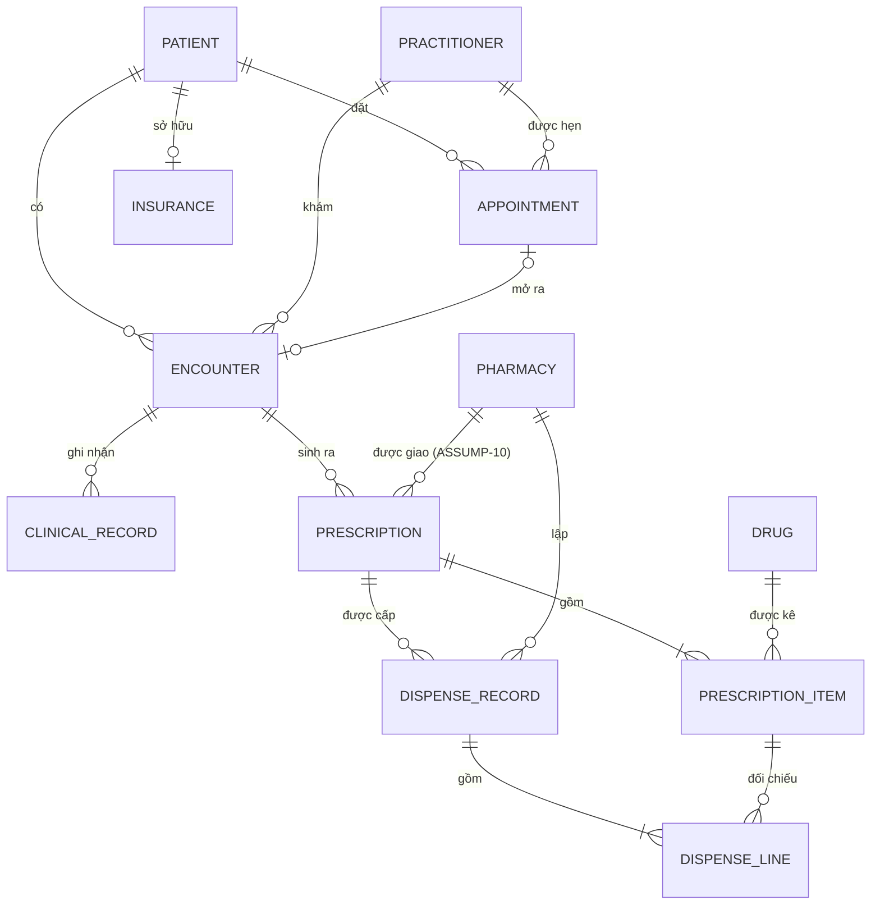
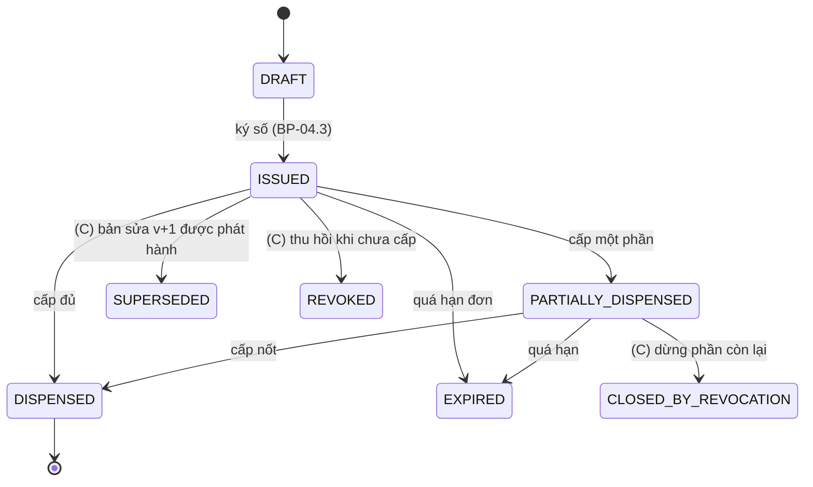

# TV2 – Kiến trúc Ứng dụng, Dữ liệu và ADR (E-Health ngoại trú)

Nov 3, 2026 · @Long

## 0. Phạm vi và giả định

Tài liệu này là phần TV2 (pha C của TOGAF ADM: Application + Data). Phần lõi dùng được cho cả 3 biến thể; phần riêng theo biến thể được tách thành khối "Bổ sung biến thể" để khi giảng viên giao biến thể chỉ cần giữ lại một khối.

**Trạng thái biến thể:** chưa biết (đang chờ giảng viên giao). ADR-001 viết đủ cho cả A, B, C ở mức phương án và chấm điểm; khi có biến thể sẽ rút gọn về một.

**Giả định** lấy từ catalog TV1 (`01-vision/catalog.md`), chỉ nhắc lại những điểm ảnh hưởng tới tầng ứng dụng/dữ liệu:

| Mã | Giả định | Ảnh hưởng tới phần TV2 |
| --- | --- | --- |
| ASSUMP-02 | 2 cơ sở: CS1 \~300, CS2 \~200 lượt/ngày, 45% dồn vào 7h–10h | Tải đỉnh \~225 lượt/3 giờ; API và hàng đợi tính theo mức này |
| ASSUMP-04 | Mỗi cơ sở 1 nhà thuốc nội bộ + 6 nhà thuốc đối tác dùng phần mềm riêng | Cần 2 kênh: API cho đối tác tích hợp được, cổng web cho phần còn lại |
| ASSUMP-05 | CS1 dùng HIS-Lite, CS2 dùng ClinicSoft (cấu trúc và mã BN khác), lịch hẹn trên Google Sheet, bệnh án giấy | Là Baseline ở mục 1 |
| ASSUMP-06 | Thu ngân và giám định BHYT giữ hệ thống cũ | HIS-Lite và ClinicSoft được **Retain** ở Target, chỉ nhận DO-Encounter để tính tiền |
| ASSUMP-07 | BHYT, đơn thuốc quốc gia, SMS, phần mềm nhà thuốc, CA đều mock | 4 hệ thống EXT- trong view |
| ASSUMP-10 (TV2 đề xuất) | Mỗi đơn tại một thời điểm chỉ được **giao cho một nhà thuốc**; muốn đổi nơi mua thì nhà thuốc cũ trả đơn về | Làm bài toán cấp trùng (B) và thu hồi (C) có lời giải rõ; ADR-004 dựa vào đây |

Nếu nhóm muốn mọi nhà thuốc cùng nhận một đơn (giống mã đơn quốc gia dùng ở bất kỳ đâu) thì ASSUMP-10 bị bỏ và ADR-004 phải xem lại; đây là một câu "thay đổi giả định" rất có thể bị hỏi.

**Danh mục mã:** AC/AS/AI/DO ở `02-models/app-catalog.md` (TV2), G/FR/NFR/CON/BP/BO ở `01-vision/catalog.md` (TV1), ND/TS/WP/PLT ở `02-models/tech-catalog.md` (TV3). Mã tiếng Anh, tên tiếng Việt; trong Archi đặt tên "\<mã> \<tên>", ví dụ "AS-IssuePrescription Lập, ký số & phát hành đơn".

## 1. Baseline Application & Data (As-Is)

Hiện trạng có 3 ứng dụng rời rạc, không có giao diện tích hợp nào; dữ liệu bệnh nhân bị nhân đôi theo cơ sở và đơn thuốc chỉ tồn tại trên giấy khi rời phòng khám.

**Phần tử Baseline Application view** (vẽ trong Archi, viewpoint Application Cooperation, folder "Baseline"):

| Mã | Loại ArchiMate | Vai trò hiện tại | Dữ liệu nắm giữ |
| --- | --- | --- | --- |
| AC-HisLite-CS1 | Application Component | CS1: thu ngân, BHYT, in đơn giấy | DO-Patient (mã CS1), DO-Encounter, DO-Insurance |
| AC-ClinicSoft-CS2 | Application Component | CS2: như trên, nhà cung cấp khác, CSDL và mã BN khác | DO-Patient (mã CS2), DO-Encounter |
| AC-BookingSheet | Application Component (Google Sheet) | Lễ tân ghi lịch nhận từ hotline/Zalo OA | DO-Appointment (không chuẩn hóa, không khóa khung giờ) |
| EXT-InsurancePortal | Application Component (bên ngoài) | HIS-Lite/ClinicSoft gửi dữ liệu giám định | DO-Insurance |
| EXT-NationalRxSystem | Application Component (bên ngoài) | CS1 nhập tay sau khi khám, CS2 chưa liên thông (ASM-03) | bản sao đơn |
| EXT-PharmacySystem | Application Component (bên ngoài) | Dược sĩ gõ lại từ đơn giấy/ảnh chụp | bản sao đơn do nhà thuốc tự gõ |

Quan hệ cần vẽ: mỗi AC-HisLegacy *access* DO-Patient riêng của nó; **không có** flow/serving nào giữa các component (đây chính là điểm cần thể hiện). Đơn thuốc là Business Object "Đơn thuốc giấy" (do TV1 vẽ), ở Baseline chưa có Data Object tương ứng.

**Pain points (đưa vào báo cáo, mỗi dòng sẽ thành một Gap ở mục 6):**

| Mã | Vấn đề | Hậu quả | Driver (TV1) |
| --- | --- | --- | --- |
| PP-01 | Một BN có 2 mã ở HIS-Lite và ClinicSoft; bệnh án giấy | Bác sĩ không thấy tiền sử, dị ứng | DRV-06 |
| PP-02 | Lịch hẹn trên Google Sheet, không khóa khung giờ | Trùng lịch; 60% BN đến không hẹn | DRV-01 |
| PP-03 | Đơn giấy, không kiểm tra tương tác/dị ứng tự động | \~3% đơn phải sửa | DRV-02 |
| PP-04 | Liên thông đơn quốc gia thủ công (CS1) hoặc chưa có (CS2) | Không đạt quy định | DRV-03 |
| PP-05 | Nhà thuốc nhận đơn giấy/ảnh, không báo lại trạng thái cấp | Không biết đơn đã dùng; có thể mua lặp | DRV-05 |
| PP-06 | Tài khoản dùng chung theo quầy, không có log truy cập | Không trả lời được "ai đã xem hồ sơ này" | DRV-04 |

## 2. Target Application (To-Be)

Target gồm 11 component nội bộ mới chia 4 nhóm (kênh, nghiệp vụ lõi, tích hợp, dùng chung), 2 phần mềm cũ được giữ cho thu ngân/BHYT và 4 hệ thống ngoài; mọi trao đổi đơn thuốc ra bên ngoài đi qua một cửa duy nhất là AC-PharmacyGateway. Slide chương 4 (Kiến trúc ứng dụng) liệt kê 6 góc nhìn; phần TV2 vẽ 4 góc nhìn dưới đây, gộp "Hành vi ứng dụng" vào Structure và "Tích hợp ứng dụng" vào ADR-001.

| View (viewpoint Archi) | Trả lời câu hỏi | Nội dung |
| --- | --- | --- |
| V-APP-01 Application Cooperation | Ứng dụng nào nói chuyện với ứng dụng nào, qua dữ liệu gì | Sơ đồ 2.1 + bảng 2.2 |
| V-APP-02 Application Usage | Quy trình nghiệp vụ nào dùng dịch vụ ứng dụng nào | Bảng 2.3 |
| V-APP-03 Application Structure (AC-ePrescription) | Bên trong component trọng tâm gồm gì | Bảng 2.4 |
| V-APP-04 Sơ đồ trình tự kê đơn → cấp thuốc | Thứ tự gọi giữa các component | Mục 2.5 |

### 2.2. Quan hệ trong Application Cooperation view

| # | Từ | Quan hệ ArchiMate | Đến | Dữ liệu / ghi chú |
| --- | --- | --- | --- | --- |
| 1 | AC-PatientPortal | serving (AS-BookAppointment qua AI-PortalUI) | BR-BenhNhan |  |
| 2 | AC-PatientPortal | serving | AC-Booking | Portal chỉ là kênh, nghiệp vụ lịch nằm ở AC-Booking |
| 3 | AC-Booking | flow | AC-Reception | DO-Appointment của ngày |
| 4 | EXT-InsurancePortal | serving | AC-Reception | AS-VerifyInsurance, DO-Insurance |
| 5 | AC-Reception | flow | AC-EMR | DO-Encounter (mở lượt khám) |
| 6 | AC-Reception | flow | AC-HisLite-CS1 / AC-ClinicSoft-CS2 | DO-Encounter để thu ngân, giám định BHYT (hệ thống Retain) |
| 7 | AC-EMR | serving | AC-ePrescription | Dị ứng, chẩn đoán (DO-ClinicalRecord) cho kiểm tra an toàn |
| 8 | AC-MasterData | serving | AC-ePrescription, AC-EMR, AC-PharmacyGateway | DO-Drug, ICD-10, DO-Pharmacy |
| 9 | AC-ePrescription | flow | AC-PharmacyGateway | DO-Prescription (sự kiện PrescriptionIssued) |
| 10 | AC-PharmacyGateway | flow | EXT-NationalRxSystem | DO-Prescription (AS-SubmitNationalRx) |
| 11 | AC-PharmacyGateway | flow (2 chiều) | EXT-PharmacySystem | Đi: DO-Prescription; về: DO-DispenseRecord; qua AI-PharmacyAPI |
| 12 | AC-PharmacyGateway | serving (AI-PharmacyWebUI) | BR-DuocSi | Nhà thuốc nội bộ và đối tác chưa tích hợp (CON-06) |
| 13 | AC-PharmacyGateway | flow | AC-ePrescription | DO-DispenseRecord → cập nhật trạng thái đơn |
| 14 | AC-Booking, AC-ePrescription, AC-PharmacyGateway | flow | AC-Notification | Nhắc lịch, mã đơn, trạng thái cấp; AC-Notification dùng EXT-SmsGateway |
| 15 | AC-IAM | serving | mọi component nội bộ | AS-Authenticate, AS-Authorize (ADR-002, TV3) |
| 16 | mọi component nội bộ | flow | AC-Audit | DO-AuditEvent (ADR-003, TV3) |
| 17 | AC-Booking, AC-Reception, AC-ePrescription | flow | AC-Reporting | Số liệu chờ khám, tỷ lệ đơn sửa (FR-11) |

Lưu ý ký pháp: giữa hai component dùng **flow** khi dữ liệu chảy theo sự kiện, **serving** khi một bên gọi dịch vụ của bên kia. Đừng dùng association vô hướng "cho nhanh", vì đó là lỗi bị trừ điểm nhất quán.

### 2.3. Application Usage: BP → AS → AC → DO

| BPMN task (TV1) | Application Service | Component | Interface | Data Object (truy cập) |
| --- | --- | --- | --- | --- |
| BP-01.1 Chọn chuyên khoa/bác sĩ/khung giờ, BP-01.2 Xác nhận lịch | AS-BookAppointment (+ AS-CancelAppointment cho FR-02) | AC-Booking | AI-PortalUI, AI-StaffUI | DO-Appointment (ghi), DO-Patient (đọc/ghi), DO-Practitioner (đọc) |
| BP-01.3 Nhắc lịch | AS-SendNotification | AC-Notification | AI-EventChannel | DO-Notification |
| BP-02.1 Check-in, BP-02.3 Mở lượt khám & xếp hàng | AS-CheckIn | AC-Reception | AI-StaffUI | DO-Appointment (đọc), DO-Encounter (ghi) |
| BP-02.2 Xác minh danh tính & BHYT | AS-VerifyInsurance | AC-Reception → EXT-InsurancePortal | AI-StaffUI | DO-Patient, DO-Insurance (đọc) |
| BP-03.1 Đo sinh hiệu, BP-03.3 Ghi nhận khám & chẩn đoán | AS-RecordEncounter | AC-EMR | AI-StaffUI | DO-ClinicalRecord, DO-Encounter (ghi) |
| BP-03.2 Xem hồ sơ & tiền sử | AS-ViewMedicalRecord | AC-EMR | AI-StaffUI | DO-ClinicalRecord, DO-Prescription cũ (đọc) |
| BP-04.1 Lập đơn, BP-04.3 Ký số & phát hành | AS-IssuePrescription | AC-ePrescription | AI-StaffUI, AI-PrescriptionAPI | DO-Prescription, DO-PrescriptionItem (ghi) |
| BP-04.2 Kiểm tra an toàn đơn | AS-CheckDrugSafety | AC-ePrescription | (nội bộ) | DO-Drug, DO-ClinicalRecord (đọc) |
| BP-04.4 Gửi đơn liên thông | AS-SendPrescription, AS-SubmitNationalRx | AC-PharmacyGateway | AI-PharmacyAPI | DO-Prescription (đọc), DO-OutboxEvent |
| BP-05.1 Tiếp nhận & tra cứu đơn | AS-ReceivePrescription | AC-PharmacyGateway | AI-PharmacyAPI, AI-PharmacyWebUI | DO-Prescription (đọc) |
| BP-05.3 Xác nhận cấp thuốc | AS-RecordDispense | AC-PharmacyGateway | AI-PharmacyAPI, AI-PharmacyWebUI | DO-DispenseRecord (ghi) |
| BF-01 Kiểm soát truy cập & lưu vết | AS-Authenticate, AS-Authorize, AS-RecordAudit, AS-QueryAudit | AC-IAM, AC-Audit | (nội bộ) | DO-AccessPolicy, DO-AuditEvent |
| BF-02 Quản lý vận hành & báo cáo | AS-ReportOperations | AC-Reporting | AI-StaffUI | đọc DO-Appointment, DO-Encounter, DO-Prescription |

BP-05.2 Cấp thuốc & tư vấn là việc thủ công của dược sĩ, không có Application Service (ghi rõ để checklist không báo thiếu).

Quan hệ cần vẽ trong Usage view: AS *serving* Business Process; AC *assigned to* Application Function, Function *realizes* AS (trong Archi có thể vẽ tắt AC *realizes* AS); AI *assigned to* AS; AS *access* DO.

### 2.4. Application Structure: AC-ePrescription

| Application Function | Hiện thực AS | Data Object |
| --- | --- | --- |
| AF-ComposePrescription Soạn đơn | AS-IssuePrescription | DO-Prescription, DO-PrescriptionItem |
| AF-CheckDrugSafety Kiểm tra dị ứng/tương tác | AS-CheckDrugSafety | DO-Drug, DO-ClinicalRecord (đọc qua AC-EMR) |
| AF-SignPrescription Ký số đơn | AS-IssuePrescription | DO-Prescription (chữ ký) |
| AF-ManagePrescriptionState Quản lý trạng thái đơn | AS-IssuePrescription, AS-RecordDispense (nhận kết quả) | DO-Prescription.status |
| *Biến thể C:* AF-PrescriptionVersioning | AS-AmendPrescription, AS-RevokePrescription | DO-PrescriptionVersion, DO-AmendmentReason |

### 2.5. Trình tự kê đơn → cấp thuốc (luồng chính)

1. Bác sĩ mở lượt khám trên AI-StaffUI; AC-IAM kiểm tra quyền (bác sĩ được gán cho DO-Encounter này).
2. AC-ePrescription lấy dị ứng/chẩn đoán từ AC-EMR, thuốc từ AC-MasterData, chạy AF-CheckDrugSafety.
3. Bác sĩ ký đơn; trạng thái `DRAFT → ISSUED`; phát sự kiện `PrescriptionIssued`; ghi DO-AuditEvent.
4. AC-PharmacyGateway nhận sự kiện, chuyển sang định dạng nhà thuốc, gửi tới nhà thuốc bệnh nhân đã chọn (ASM-05); AC-Notification gửi mã đơn cho bệnh nhân.
5. Dược sĩ cấp thuốc; EXT-PharmacySystem gọi `POST /dispenses` kèm `dispenseId` (khóa chống lặp).
6. AC-PharmacyGateway chuyển DO-DispenseRecord về AC-ePrescription; trạng thái `ISSUED → PARTIALLY_DISPENSED / DISPENSED`; ghi audit.

Sơ đồ 2.1 bên dưới là bản phác để cả nhóm thống nhất bố cục; bản nộp phải vẽ lại trong Archi bằng ký pháp ArchiMate chuẩn.

> _Sơ đồ 2.1 · Application Cooperation (Target): sơ đồ tương tác, xem bản gốc trên Claude Doc._

Đọc theo hành trình: hàng trên là đặt lịch và tiếp đón, cột giữa là kê đơn và gửi đơn. AC-Booking, AC-ePrescription cũng gửi sự kiện cho AC-Notification (bảng 2.2, dòng 14) nhưng không vẽ để sơ đồ đỡ rối.

## 3. Mô hình dữ liệu

Mô hình xoay quanh 3 thực thể có vòng đời dài (Patient, Encounter, Prescription) và mỗi Data Object có đúng một component là nguồn chuẩn (PR-02). Theo slide chương 4 (Kiến trúc dữ liệu), phần này đi đủ 3 mức: khái niệm (3.1), logic (3.2), vật lý chỉ nêu hướng (3.4, chi tiết thuộc TV3).

### 3.1. Mức khái niệm (ERD)

AuditEvent, Notification, OutboxEvent không vẽ quan hệ cứng: chúng tham chiếu bất kỳ thực thể nào qua cặp (`entityType`, `entityId`) để không khóa schema nghiệp vụ vào schema lưu vết.

### 3.2. Mức logic: các thực thể trọng tâm

| Data Object | Thuộc tính chính | Khóa / ràng buộc |
| --- | --- | --- |
| DO-Patient | patientId, họ tên, ngày sinh, giới, CCCD, SĐT, dị ứng (tham chiếu ClinicalRecord) | PK patientId (UUID); CCCD duy nhất khi có |
| DO-Encounter | encounterId, patientId, practitionerId, site (CS1/CS2), checkInAt, status (WAITING/IN\_PROGRESS/DONE) | FK patient, practitioner |
| DO-Prescription | prescriptionId, **rxCode** (mã đơn in QR), encounterId, prescriberId, pharmacyId, **status**, **version**, issuedAt, signature, nationalRxId | PK prescriptionId; rxCode duy nhất; `version` dùng cho optimistic locking |
| DO-PrescriptionItem | itemId, drugCode, liều, cách dùng, **qtyPrescribed**, **qtyDispensed** | qtyDispensed ≤ qtyPrescribed (ràng buộc CSDL) |
| DO-DispenseRecord | **dispenseId** (do nhà thuốc sinh, UUID), prescriptionId, pharmacyId, pharmacistId, dispensedAt, lines\[itemId, qty\], source (ONLINE/OFFLINE\_SYNC) | dispenseId duy nhất = **idempotency key** (NFR-DAT-01) |
| DO-OutboxEvent | eventId, eventType (PrescriptionIssued, DispenseRecorded…), aggregateId, payload, createdAt, publishedAt | Ghi cùng giao dịch với thay đổi đơn (ADR-001) |
| DO-AuditEvent | actor, action, entityType, entityId, at, sourceIp, result, prevHash | Append-only; cấu trúc chi tiết do TV3 chốt (ADR-003) |

### 3.3. Trạng thái đơn thuốc (dùng chung cho mọi biến thể)

Quy tắc cố định: không trạng thái nào đi ngược; số lượng đã cấp không bao giờ bị xóa (PR-05). Các nhánh (C) chỉ vẽ khi nhóm nhận biến thể C. Với biến thể B, trạng thái không đổi, nhưng mỗi chuyển trạng thái có thể đến muộn qua đồng bộ (xem ADR-004).

### 3.4. Nguồn chuẩn và Data Delivery Architecture

| Data Object | Nguồn chuẩn (system of record) | Nơi đọc bản sao | Cách giao dữ liệu | Schema (TV3, ART-) |
| --- | --- | --- | --- | --- |
| DO-Patient, DO-Encounter, DO-ClinicalRecord | AC-EMR | AC-Reception, AC-ePrescription, HIS-Lite/ClinicSoft (thu ngân) | API đồng bộ (đọc), sự kiện cho thu ngân | ART-emr-db |
| DO-Appointment | AC-Booking | AC-Reception, AC-Reporting | Sự kiện | (booking) |
| DO-Prescription, DO-PrescriptionItem, DO-DispenseRecord, DO-OutboxEvent | AC-ePrescription | AC-PharmacyGateway, EXT-PharmacySystem, EXT-NationalRxSystem | Outbox + hàng đợi (ADR-001) | ART-erx-db |
| DO-Drug, DO-Pharmacy, DO-Practitioner | AC-MasterData | mọi component | Cache, đồng bộ hàng ngày | (masterdata) |
| DO-Notification | AC-Notification | AC-PatientPortal | Sự kiện | (notify) |
| DO-AccessPolicy | AC-IAM | TS-PolicyDecision | Gói chính sách có phiên bản (ADR-002) | ART-abac-policy |
| DO-Insurance | EXT-InsurancePortal | AC-Reception | Tra cứu trực tiếp, không lưu lâu | — |
| DO-AuditEvent | AC-Audit | AC-Reporting (tra cứu) | Sự kiện | ART-audit-log |

AC-Reporting đọc từ bản sao chỉ đọc (read replica) để không làm chậm giao dịch kê đơn giờ cao điểm (NFR-PRF-01).

### 3.5. Information Value Chain: từ dữ liệu tới Outcome

| Outcome (TV1) | Chỉ số | Cách tính từ dữ liệu |
| --- | --- | --- |
| OC-01 Chờ TB ≤ 45 phút | Thời gian chờ | trung bình(Encounter.startAt − Encounter.checkInAt), lọc 7h–10h |
| OC-01 ≥ 60% có hẹn | Tỷ lệ có hẹn | số Encounter có appointmentId / tổng Encounter |
| OC-02 Đơn sửa ≤ 0,5% | Tỷ lệ đơn phải sửa | số đơn có version > 1 hoặc bị thu hồi / tổng đơn ISSUED |
| OC-04 ≥ 95% đẩy trong 5 phút | Độ trễ liên thông | OutboxEvent.publishedAt − Prescription.issuedAt |
| OC-03 100% truy cập có log | Độ phủ audit | đối chiếu log truy cập API Gateway với AuditEvent |

### 3.6. Ánh xạ chuẩn FHIR R4 (NFR-INT-01)

| Data Object | FHIR resource |
| --- | --- |
| DO-Patient | Patient |
| DO-Encounter | Encounter |
| DO-Practitioner | Practitioner |
| DO-Prescription + DO-PrescriptionItem | MedicationRequest (mỗi dòng thuốc một MedicationRequest, gộp bằng `groupIdentifier` = rxCode) |
| DO-DispenseRecord | MedicationDispense |
| DO-Drug | Medication |
| DO-AuditEvent | AuditEvent |
| DO-Consent (biến thể A) | Consent |

## 4. Bảng API chính

11 API lõi phủ hết luồng chính BP-01 → BP-05; mỗi API gắn đúng một Application Service để RTM trỏ được. TV3 dùng bảng này viết `openapi.yaml` và mock. Mọi API đi qua TS-ApiGateway, cần token OIDC (nhà thuốc dùng mTLS + client credentials) và đều sinh DO-AuditEvent.

| # | Phương thức & đường dẫn (khớp `04-prototype/openapi.yaml`) | Application Service | Component | Mã lỗi nghiệp vụ đáng chú ý |
| --- | --- | --- | --- | --- |
| 1 | `GET /slots`, `POST /appointments` | AS-BookAppointment | AC-Booking | 409 khung giờ đã hết |
| 2 | `PATCH /appointments/{`appointmentId} (action CANCEL / RESCHEDULE) | AS-CancelAppointment | AC-Booking | 409 quá hạn đổi |
| 3 | `POST /encounters` (check-in bằng QR lịch hẹn hoặc CCCD) | AS-CheckIn, AS-VerifyInsurance | AC-Reception | 404 không tìm thấy lịch; 422 thẻ BHYT không hợp lệ |
| 4 | `GET /patients/{patientId}/records` | AS-ViewMedicalRecord | AC-EMR | 403 bác sĩ không có lượt khám với BN (ABAC); `POST /access/break-glass` để mở khẩn cấp |
| 5 | `POST /prescriptions` (tạo DRAFT kèm kiểm tra an toàn) | AS-IssuePrescription, AS-CheckDrugSafety | AC-ePrescription | 422 cảnh báo mức cao (dị ứng…) chưa có lý do bỏ qua |
| 6 | `GET /prescriptions/{prescriptionId}` | AS-IssuePrescription | AC-ePrescription | 403, 404 |
| 7 | `POST /prescriptions/{prescriptionId}/issue` (ký số, phát hành, đẩy hệ thống quốc gia) | AS-IssuePrescription, AS-SubmitNationalRx | AC-ePrescription, AC-PharmacyGateway | 409 đơn đã phát hành |
| 8 | Sự kiện `PrescriptionIssued` (outbox → hàng đợi → webhook nhà thuốc) | AS-SendPrescription | AC-PharmacyGateway | Thử lại có backoff; vào DLQ sau N lần |
| 9 | `GET /pharmacy/prescriptions/{rxCode}` | AS-ReceivePrescription | AC-PharmacyGateway | 403 đơn đã giao nhà thuốc khác (ASSUMP-10); 410 đơn hết hiệu lực |
| 10 | `POST /pharmacy/dispenses` (header `Idempotency-Key: <dispenseId>`) | AS-RecordDispense | AC-PharmacyGateway | 201 mới; 200 + `idempotentReplay` khi gửi lặp; 409 vượt số lượng còn lại |
| 11 | `GET /audit-events`, `GET /audit-events/verify` | AS-QueryAudit | AC-Audit | (TV3, ADR-003) |

API bổ sung theo biến thể (giữ đúng một nhóm khi biết biến thể):

| Biến thể | API (khớp mock) | Application Service | Ghi chú |
| --- | --- | --- | --- |
| A | `GET /patients/match`; tra hồ sơ cơ sở kia qua AC-IntegrationHub (FHIR) | AS-MatchPatient, AS-ExchangeRecord, AS-RecordConsent | Nhiều ứng viên khớp → xác minh thủ công; 403 chưa có consent |
| B | `POST /pharmacy/sync` | AS-SyncDispense, AS-ReconcileDispense | Mỗi bản ghi trả ACCEPTED / DUPLICATE / CONFLICT, xử lý theo thứ tự server nhận |
| C | `POST /prescriptions/{prescriptionId}/amend`; `POST /prescriptions/{prescriptionId}/revoke`; sự kiện `PrescriptionAmended`, `PrescriptionRevoked` | AS-AmendPrescription, AS-RevokePrescription | 409 nếu đơn đã DISPENSED; nhà thuốc xác nhận đã nhận thay đổi qua POST /pharmacy/prescriptions/{rxCode}/ack (FR-C3, BP-06C.7) |

## 5. Quyết định kiến trúc (ADR-001, ADR-004)

Hai ADR của TV2 chọn **cổng tích hợp + hàng đợi bền** (4,35/5) và **đơn bất biến theo phiên bản + sổ cái cấp thuốc** (4,30/5); cả hai đều có 3 phương án thật, tiêu chí gắn mã NFR/CON và mục "điều chỉnh theo biến thể". Bản file nằm ở `03-adr/ADR-001-integration-style.md` và `03-adr/ADR-004-prescription-data-model.md`, cùng khuôn với ADR-002, ADR-003 của TV3.

### ADR-001: Kiểu tích hợp đơn thuốc với nhà thuốc và Hệ thống đơn thuốc quốc gia

- **Trạng thái:** Đề xuất (chờ nhóm duyệt) · **Tác giả:** TV2 · **Người duyệt:** TV1, TV3
- **Liên quan:** G-04, FR-06, FR-07, NFR-DAT-01, NFR-INT-01, NFR-INT-02, NFR-AVL-01, CON-06, CON-07, PR-06, PR-08; ADR-004; RSK-03, RSK-04, RSK-07

**Bối cảnh.** Mỗi đơn phải tới Hệ thống đơn thuốc quốc gia và nhà thuốc BN chọn (8 nhà thuốc), ≥95% trong ≤5 phút (OC-04). Nhà thuốc đối tác giữ phần mềm riêng (CON-06), mạng không ổn định (RSK-03). Không được mất đơn hay ghi cấp hai lần (NFR-DAT-01); thêm nhà thuốc không sửa lõi (NFR-INT-02).

| Phương án | Mô tả |
| --- | --- |
| **A. API đồng bộ điểm–điểm** | Khi phát hành, AC-ePrescription gọi thẳng API nhà thuốc và hệ thống quốc gia trong cùng yêu cầu; mỗi nhà thuốc một đoạn code riêng |
| **B. Cổng tích hợp + hàng đợi bền** | Ghi đơn và `DO-OutboxEvent` trong cùng giao dịch; bộ phát đẩy vào hàng đợi (TS-Messaging); AC-PharmacyGateway chuyển sang FHIR, gửi webhook/hệ thống quốc gia, thử lại có backoff, lỗi quá N lần vào DLQ; nhà thuốc không tích hợp dùng AI-PharmacyWebUI; chiều về có `Idempotency-Key = dispenseId` |
| **C. CSDL dùng chung / file theo lô** | Mở view CSDL hoặc xuất CSV/SFTP mỗi 15 phút cho nhà thuốc; đẩy quốc gia theo lô cuối ngày |

| Tiêu chí (1–5, cao là tốt) | Trọng số | A | B | C |
| --- | --- | --- | --- | --- |
| Không mất, không trùng đơn/bản ghi cấp (NFR-DAT-01) | 25% | 2 | 5 | 3 |
| Chịu được đối tác mất kết nối (NFR-AVL-01, RSK-03) | 20% | 1 | 5 | 4 |
| Thêm nhà thuốc không sửa lõi (NFR-INT-02, CON-06) | 20% | 2 | 4 | 3 |
| Độ trễ liên thông ≤ 5 phút (OC-04) | 15% | 5 | 4 | 1 |
| Chi phí, độ phức tạp vận hành (CON-07; 5 = rẻ/đơn giản) | 10% | 4 | 2 | 4 |
| Truy vết từng lần gửi/nhận (NFR-SEC-03) | 10% | 3 | 5 | 2 |
| **Tổng có trọng số** | 100% | **2,55** | **4,35** | **2,90** |

- A nhanh nhất khi mọi thứ chạy tốt, nhưng một nhà thuốc mất mạng làm bác sĩ không phát hành được đơn (trái PR-08); gọi lại sau timeout dễ tạo bản ghi trùng.
- C giữ được đơn khi đối tác mất mạng, nhưng chu kỳ lô vi phạm OC-04 và mở CSDL cho đối tác trái PR-08.
- B mất điểm chi phí vì phải vận hành broker, outbox, DLQ; chấp nhận được vì TV3 đã có ND-MessageBroker cho Notification và Audit.

**Quyết định:** chọn **B**. Outbox bảo đảm "ghi đơn thành công thì sự kiện chắc chắn được phát" (at-least-once); idempotency key biến "ít nhất một lần" thành "hiệu quả đúng một lần". Lỗi của một nhà thuốc chỉ làm chậm đơn của nhà thuốc đó.

**Đánh đổi.** Được: bác sĩ không bao giờ bị chặn vì đối tác; thêm nhà thuốc = thêm cấu hình/adapter; mọi lần gửi có bản ghi để đối soát. Mất: nhất quán sau cùng (nhà thuốc thấy đơn chậm vài giây), phải vận hành broker và theo dõi DLQ.

**Rủi ro.** RSK-03: hàng đợi giữ sự kiện, quá 5 phút thì cảnh báo, BN vẫn có mã đơn/QR. RSK-04: `dispenseId` duy nhất, gửi lặp trả kết quả cũ. RSK-07: adapter riêng cho từng định dạng, không tích hợp được thì dùng web.

**Phần tử bị ảnh hưởng:** AC-ePrescription, AC-PharmacyGateway, AI-PharmacyAPI, AI-PharmacyWebUI, AI-EventChannel, DO-OutboxEvent, DO-DispenseRecord, EXT-PharmacySystem, EXT-NationalRxSystem; TS-Messaging, TS-ApiGateway, NW-PartnerChannel.

**Theo biến thể.** A: mở rộng thành hub-and-spoke (AC-IntegrationHub + AC-FhirAdapter mỗi cơ sở), số kết nối tăng tuyến tính thay vì n(n−1)/2; cần thêm ADR ghép định danh (MPI tất định theo CCCD/BHYT hay xác suất). B: thêm AC-PharmacyAgent giữ outbox cục bộ, đồng bộ bằng `POST /pharmacy/sync`. C: sự kiện Amended/Revoked đi chung kênh, nhà thuốc phải xác nhận (`POST /pharmacy/acks`).

**Xem lại khi:** đối tác vượt khoảng 50 hoặc cần đẩy dưới 1 giây; hoặc Bộ Y tế bắt buộc nhà thuốc chỉ nhận đơn qua hệ thống quốc gia.

### ADR-004: Mô hình lưu dữ liệu đơn thuốc

- **Trạng thái:** Đề xuất (chờ nhóm duyệt) · **Tác giả:** TV2 · **Người duyệt:** TV1, TV3
- **Liên quan:** G-02, G-03, FR-05, FR-07, FR-11, NFR-DAT-01, NFR-SEC-03, PR-05, CON-03; FR-B2, FR-B3, FR-C1, FR-C2; ADR-001, ADR-003; RSK-04

**Bối cảnh.** Đơn đã ký số là chứng từ pháp lý (CON-03), không được sửa nội dung (PR-05). Một đơn có thể cấp nhiều lần; tổng đã cấp không được vượt số kê kể cả khi bản ghi đến muộn hoặc đến hai lần. Báo cáo FR-11 cần đếm nhanh. Nhóm 3 người, 5 tuần.

| Phương án | Mô tả |
| --- | --- |
| **A. CRUD ghi đè + bảng lịch sử bằng trigger** | UPDATE tại chỗ trạng thái và số đã cấp; trigger chép bản cũ sang bảng history |
| **B. Đơn bất biến theo phiên bản + sổ cái cấp thuốc** | Nội dung đơn ISSUED không UPDATE; sửa = dòng mới `version + 1` trỏ `supersedes`. Mỗi lần cấp = dòng `dispense_record` chỉ INSERT, `dispenseId` UNIQUE. `status`, `qtyDispensed` là giá trị suy ra, cập nhật cùng giao dịch, có `version` (optimistic locking) và ràng buộc `qtyDispensed ≤ qtyPrescribed` |
| **C. Event sourcing toàn phần** | Đơn là chuỗi sự kiện, trạng thái dựng lại bằng phát lại; báo cáo đọc từ projection |

| Tiêu chí (1–5, cao là tốt) | Trọng số | A | B | C |
| --- | --- | --- | --- | --- |
| Giữ lịch sử, không ghi đè nội dung đã ký (PR-05, CON-03) | 25% | 2 | 5 | 5 |
| Chống cấp trùng, đối soát được (NFR-DAT-01, RSK-04) | 25% | 2 | 5 | 5 |
| Độ phức tạp với nhóm nhỏ (CON-07; 5 = đơn giản) | 20% | 5 | 3 | 1 |
| Truy vấn, báo cáo dễ (FR-11) | 15% | 5 | 4 | 2 |
| Truy vết "ai đổi gì, khi nào" (NFR-SEC-03) | 15% | 3 | 4 | 5 |
| **Tổng có trọng số** | 100% | **3,20** | **4,30** | **3,75** |

- A dễ nhất nhưng hai bản ghi cấp đến cùng lúc có thể ghi đè nhau (lost update); trigger có thể bị quản trị CSDL tắt nên không đủ làm bằng chứng.
- C mạnh nhất về truy vết nhưng cần projection, phát lại, tiến hóa cấu trúc sự kiện: quá sức nhóm trong 5 tuần.
- B lấy đúng phần cốt lõi của C (chỉ thêm, không sửa) cho hai chỗ cần nó, và giữ bảng trạng thái quen thuộc cho truy vấn.

**Quyết định:** chọn **B**, với 4 quy tắc cứng:

1. Nội dung đơn ISSUED không UPDATE; chỉ cột suy ra được đổi, cùng giao dịch với INSERT sổ cái.
2. `dispenseId` UNIQUE; nhận lại cùng `dispenseId` thì trả kết quả cũ.
3. Ràng buộc CSDL `qty_dispensed ≤ qty_prescribed` theo từng dòng thuốc; vi phạm trả 409 và ghi sự kiện đối soát.
4. Mọi thay đổi phát `DO-OutboxEvent` (ADR-001) và `DO-AuditEvent` (ADR-003).

**Đánh đổi.** Được: không thể cấp vượt số kê dù đồng bộ lặp; lịch sử đơn đầy đủ; báo cáo vẫn dùng SQL thường. Mất: bảng tăng nhanh hơn CRUD; phải review quy tắc "chỉ thêm"; cần job đối chiếu hằng đêm phòng trường hợp ai đó sửa tay CSDL.

**Phần tử bị ảnh hưởng:** DO-Prescription, DO-PrescriptionItem, DO-DispenseRecord, DO-OutboxEvent; AF-ManagePrescriptionState; AS-RecordDispense; ART-erx-db.

**Theo biến thể.** B: bản ghi offline mang `source = OFFLINE_SYNC`; khi đồng bộ mỗi bản ghi là ACCEPTED, DUPLICATE (trùng `dispenseId`) hoặc CONFLICT (vượt số còn lại → hàng đối soát cho BR-QuanLy, BR-DuocSi). Thứ tự xử lý theo thời điểm server nhận, **không** theo đồng hồ nhà thuốc. Nhờ ASSUMP-10, xung đột chỉ xảy ra trong nội bộ một nhà thuốc. C: thêm DO-PrescriptionVersion, DO-AmendmentReason; đơn đã cấp một phần không bị thu hồi ngược, phần còn lại đóng (`CLOSED_BY_REVOCATION`) và kê đơn mới nếu cần. A: không đổi mô hình đơn; thêm DO-PatientLink, DO-CodeMapping ở AC-MPI.

**Xem lại khi:** luật yêu cầu dựng lại toàn bộ lịch sử ở mức sự kiện (chuyển dần sang C); hoặc bỏ ASSUMP-10 (cần cơ chế giữ chỗ đơn trước khi cấp).

## 6. Gap phần Ứng dụng/Dữ liệu

Gap tầng ứng dụng đã nằm trong bảng tổng hợp của TV3 (`05-verification/gap-roadmap.md`) và khớp với mục 1–2 ở đây; TV2 chỉ bổ sung Gap ở mức dữ liệu, mỗi dòng đều có Work Package của TV3.

| Baseline | Target | Loại | Pain point | WP |
| --- | --- | --- | --- | --- |
| Mã BN riêng trong HIS-Lite và ClinicSoft | DO-Patient dùng chung, nguồn chuẩn AC-EMR (biến thể A: + DO-PatientLink qua AC-MPI) | Replace | PP-01 | WP-07 |
| Lịch hẹn dòng tự do trong Google Sheet | DO-Appointment có khóa khung giờ | Replace | PP-02 | WP-04 |
| Đơn giấy, bản in từ HIS-Lite | DO-Prescription ký số + DO-PrescriptionItem, trạng thái theo mục 3.3 | New | PP-03 | WP-03 |
| Danh mục thuốc riêng mỗi phần mềm | DO-Drug theo danh mục quốc gia trong AC-MasterData | Replace | PP-03 | WP-03 |
| Không có bản ghi cấp thuốc | DO-DispenseRecord dạng sổ cái (ADR-004) | New | PP-05 | WP-05 |
| Không có hàng đợi liên thông | DO-OutboxEvent (ADR-001) | New | PP-04, PP-05 | WP-03, WP-05 |
| Không có nhật ký truy cập | DO-AuditEvent (ADR-003) | New | PP-06 | WP-02 |
| DO-Encounter trong HIS-Lite/ClinicSoft | DO-Encounter nguồn chuẩn AC-EMR, bản sao sang phần mềm cũ để thu ngân | Retain (đổi nguồn) | PP-01 | WP-03 |

Một điểm cần TV3 xác nhận: WP-07 (gộp dữ liệu BN) nằm ở PLT-2, trong khi kê đơn điện tử (WP-03) đã chạy ở PLT-1. Như vậy ở PLT-1 bác sĩ CS1 vẫn không thấy dị ứng ghi ở CS2, nên kiểm tra an toàn đơn (FR-05) chỉ đầy đủ từ PLT-2; cần ghi rõ hạn chế này trong Roadmap.

## 7. Ma trận truy vết (RTM)

RTM có 4 yêu cầu lõi (vượt mức ≥3 của đề) cộng 1 hàng riêng cho biến thể được giao; mỗi hàng đi đủ Goal → BPMN → Business → Application → Technology → ADR → cách kiểm chứng. Bản file: `05-verification/rtm.md`.

| Goal | Yêu cầu | BPMN task | Business | Application (AS / AC / DO) | Technology | ADR | Kiểm chứng |
| --- | --- | --- | --- | --- | --- | --- | --- |
| G-01 | FR-01 Đặt lịch, xác nhận tức thì | BP-01.1, BP-01.2 | BP-01, BS-01, BR-BenhNhan, BO-LichHen | AS-BookAppointment / AC-Booking, AC-PatientPortal / DO-Appointment | TS-ApiGateway, ND-AppCluster, TS-Database | — | Mock `POST /appointments` 201 và 409 hết khung giờ |
| G-02 | FR-05 Kê đơn có kiểm tra an toàn, ký số | BP-04.1, BP-04.2, BP-04.3 | BP-04, BS-04, BR-BacSi, BO-DonThuoc | AS-CheckDrugSafety, AS-IssuePrescription / AC-ePrescription (+ AC-EMR, AC-MasterData) / DO-Prescription, DO-Drug | ND-AppCluster, TS-Signing, TS-Database | ADR-004 | E2E: kê thuốc BN dị ứng → cảnh báo chặn → sửa → phát hành |
| G-04 | FR-07 + NFR-DAT-01 Cấp thuốc, không mất/không trùng | BP-04.4, BP-05.1, BP-05.3 | BP-05, BS-05, BR-DuocSi, BO-PhieuCapThuoc | AS-SendPrescription, AS-ReceivePrescription, AS-RecordDispense / AC-PharmacyGateway / DO-DispenseRecord, DO-OutboxEvent | TS-Messaging, TS-ApiGateway, NW-PartnerChannel | ADR-001, ADR-004 | Gửi cùng `dispenseId` 2 lần → lần 2 trả 200 kết quả cũ; cấp vượt → 409 |
| G-03 | NFR-SEC-03 100% truy cập có log bất biến | BP-03.2, BP-04.x (BF-01) | BF-01, BS-07, BR-QuanTriBaoMat, BO-NhatKyTruyCap | AS-Authorize, AS-RecordAudit / AC-IAM, AC-Audit / DO-AuditEvent | TS-PolicyDecision, TS-Audit, TS-ObjectStorage (WORM) | ADR-002, ADR-003 | Bác sĩ không có lượt khám mở hồ sơ → 403 + AuditEvent DENIED |
| G-05 (A) | FR-A1 Ghép định danh 2 cơ sở | BPMN-02A | BP-06A, BR-LeTan | AS-MatchPatient / AC-MPI, AC-IntegrationHub / DO-PatientLink | TS-Messaging, NW-SiteVPN | ADR-001 (A) | Cùng CCCD, khác cách viết tên → hàng xác minh thủ công |
| G-04 (B) | FR-B3 Chặn cấp trùng khi đồng bộ | BPMN-02B | BP-06B, BR-DuocSi, BR-QuanLy | AS-SyncDispense, AS-ReconcileDispense / AC-PharmacyAgent, AC-Reconciliation | TS-Messaging, ND-PartnerPharmacy | ADR-001, ADR-004 (B) | Lô offline có bản ghi vượt số còn lại → CONFLICT vào hàng đối soát |
| G-02 (C) | FR-C2 Thu hồi theo trạng thái cấp | BPMN-02C | BP-06C, BR-BacSi, BR-DuocSi | AS-RevokePrescription / AC-ePrescription / DO-PrescriptionVersion, DO-AmendmentReason | TS-Signing, TS-Messaging | ADR-004 (C) | Thu hồi đơn PARTIALLY\_DISPENSED → CLOSED\_BY\_REVOCATION, nhà thuốc ack |

**Chiều ngược** (trả lời "thành phần này tồn tại vì sao?"): ND-MessageBroker → AC-PharmacyGateway → NFR-DAT-01, FR-06 (ADR-001) → G-04. Ràng buộc `qty_dispensed ≤ qty_prescribed` → AS-RecordDispense → NFR-DAT-01 (ADR-004) → G-02, G-04. AC-MasterData → AS-CheckDrugSafety → FR-05 → G-02. Cột "số hình" sẽ điền khi ghép báo cáo.

## 8. Checklist nhất quán (TV2 chạy cuối mỗi tuần)

Lần chạy đầu tiên (2026-11-03) đạt 8/9 mục; mục còn lại chờ file Archi tầng Application.

- [x] Mọi BPMN task có mã BP-0x.y trùng với ArchiMate và có Application Service: đã đối chiếu 16 task luồng chính trong `bpmn/BPMN-01` với bảng 2.3 (ngoại lệ khai báo: BP-05.2 thủ công); 25 task BP-06A/B/C đã gán AS trong `app-catalog.md` mục 6.
- [x] Mọi Application Service phục vụ ít nhất 1 Business Process/Function (bảng 2.3).
- [x] Mọi Application Component chạy trên ít nhất 1 Node/Tech Service (đối chiếu `technology.md` của TV3, kể cả AC-Reporting, AI-PharmacyWebUI).
- [x] Mọi FR-01…FR-11 có Goal ở trên và ít nhất 1 AS ở dưới (FR-02 → AS-CancelAppointment, FR-06 → AS-SubmitNationalRx, FR-11 → AS-ReportOperations…).
- [x] Mọi ADR (001–004) nêu Requirement/Constraint và phần tử bị ảnh hưởng.
- [x] Mọi Business Object có Data Object tương ứng (catalog TV1 mục 9.4).
- [x] Mọi Data Object có đúng một nguồn chuẩn (bảng 3.4, đã bổ sung DO-Practitioner, DO-Notification, DO-AccessPolicy).
- [x] Mọi Gap dữ liệu có Work Package (mục 6).
- [ ] Trong file Archi: không có association vô hướng giữa các component; mọi phần tử đặt tên "\<mã> \<tên>". *TV1 đã có file Archi tầng Motivation/Business; còn chờ tầng Application.*

Lỗi nhất quán đã phát hiện và sửa trong lần này: giả định của TV2 (800 lượt/ngày, 5 nhà thuốc, mã ASM-xx) lệch với TV1 (500 lượt/ngày, 2 + 6 nhà thuốc, ASM-xx là Assessment) → đã theo TV1, giả định mới của TV2 đổi thành ASSUMP-10.

## 9. Rà file hướng dẫn tham khảo: chỗ cần sửa

File hướng dẫn dùng được làm khung, nhưng có 9 chỗ sai hoặc thiếu liên quan tới phần ứng dụng/dữ liệu; chỗ nào đã xử lý trong tài liệu này thì ghi mục tương ứng.

| # | Vị trí trong hướng dẫn | Vấn đề | Cách làm đúng |
| --- | --- | --- | --- |
| 1 | Mục 6.1, mẫu RTM | Tự vi phạm quy tắc "một tên một mã": cùng một hàng ghi "BP-01 Đặt lịch" ở cột BPMN và "Đặt lịch hẹn" ở cột ArchiMate | Dùng đúng mã + tên trong catalog ở mọi cột (mục 7) |
| 2 | Mục 6.1, hàng NFR-03 | "Role-based access policy" đặt ở cột ArchiMate Business, nhưng đó không phải loại phần tử Business nào | Business: BF-01 + BR-QuanTriBaoMat + BO-ChinhSachTruyCap; chính sách là DO-AccessPolicy ở tầng ứng dụng |
| 3 | Mục 6.2, mẫu ADR | Bộ tiêu chí và trọng số cố định cho mọi ADR; không nói thang điểm, không nói chiều điểm của "độ phức tạp" | Mỗi ADR tự chọn tiêu chí gắn mã NFR/CON, ghi rõ thang 1–5, "5 = đơn giản/rẻ", có dòng tổng (mục 5) |
| 4 | Mục 2.2, biến thể B | Quy tắc xung đột "ai cấp trước theo timestamp": đồng hồ của máy đang offline không tin được | Xếp theo thời điểm server nhận + ràng buộc số lượng còn lại (ADR-004, mục B) |
| 5 | Mục 2.2, biến thể B | Không nói đơn được giao cho một hay nhiều nhà thuốc; nếu nhiều nhà thuốc cùng offline thì không thể chặn trùng, chỉ phát hiện sau | Nêu giả định ASSUMP-10 và hệ quả của nó (mục 0) |
| 6 | Mục 2.2, biến thể C | State machine ghi `AMENDED → ISSUED v2`, nhưng v2 là bản ghi khác; v1 không "quay lại" ISSUED. Mục 6.4 #3 lại cho `PARTIALLY_DISPENSED → REVOKE_REQUESTED`, mâu thuẫn với câu "đã cấp → không thu hồi" ngay trên | v1 chuyển `SUPERSEDED`, v2 là đơn mới `ISSUED`; cấp một phần thì đóng phần còn lại (`CLOSED_BY_REVOCATION`) (mục 3.3) |
| 7 | Mục 1.3.2 | Xếp Motivation và Strategy chung "tầng 1". Trong ArchiMate 3.x, Strategy là một tầng riêng còn Motivation là một khía cạnh (aspect) | Vẽ view Strategy (TV1) tách khỏi Motivation |
| 8 | Mục 4 (giai đoạn 5) và cây repo | Chỉ có Cooperation + Usage; thiếu các góc nhìn Structure, Integration, trình tự mà slide chương 4 (Kiến trúc ứng dụng) dạy; thiếu hoàn toàn nội dung chương 4 (Kiến trúc dữ liệu): 3 mức mô hình, Data Delivery Architecture, Information Value Chain | Bổ sung mục 2.4, 2.5, 3.4, 3.5 |
| 9 | Mục 5.1 và kế hoạch đã chốt của nhóm | Hướng dẫn giao prototype cho TV3, bản kế hoạch đầu tiên của nhóm lại giao cho TV2 | Đang theo hướng dẫn (TV3 làm prototype, TV2 cung cấp bảng API ở mục 4); cần cả nhóm chốt một lần |

Ngoài ra, khi dùng ví dụ "chi phí tăng tuyến tính thay vì bình phương" (mục 6.4 #1): với 2–3 cơ sở chênh lệch rất nhỏ (1 so với 2 kết nối, 3 so với 3), nên khi bảo vệ hãy nói đúng là lợi ích rõ từ khoảng 4 cơ sở hoặc khi tính cả nhà thuốc vào mạng lưới, để không bị bắt bẻ.

---
_Bản xuất từ Claude Doc: https://claude.ai/artifact/2WVSCbPouF2X2E5yvKGw5U_
