> **Ghi chú biên tập (xóa trước khi nộp).** Bản dựng tự động từ thư mục `ehealth-ea/` ngày 2026-11-04. Chỗ có dấu ⟦BIẾN THỂ⟧ là chỗ cần rút gọn về đúng biến thể giảng viên giao (A, B hoặc C); hai biến thể còn lại chuyển sang Phụ lục E. Điền tên nhóm, MSSV ở trang bìa. Kiểm tra lại số hiệu văn bản pháp luật ở mục 3.3 trên cổng văn bản chính thức.

# Giới thiệu

## Bối cảnh và phạm vi

Phòng khám Đa khoa An Tâm (tổ chức hư cấu) là phòng khám tư nhân có hợp đồng khám chữa bệnh BHYT, gồm **2 cơ sở**: CS1 Cầu Giấy (~300 lượt/ngày) và CS2 Long Biên (~200 lượt/ngày), cao điểm 7h–10h chiếm khoảng 45% lượt khám. Phòng khám có ~40 bác sĩ, 30 điều dưỡng, 12 lễ tân/thu ngân, 10 chuyên khoa ngoại trú, 2 nhà thuốc nội bộ và liên kết với 6 nhà thuốc đối tác.

Hiện trạng là một chuỗi quy trình thủ công nối bằng giấy: đặt lịch qua hotline/Zalo ghi vào Google Sheet; CS1 dùng HIS-Lite, CS2 dùng ClinicSoft (hai nhà cung cấp, hai cấu trúc dữ liệu, hai mã bệnh nhân); bệnh án giấy; đơn thuốc in hoặc viết tay; tài khoản phần mềm dùng chung theo quầy, không có nhật ký truy cập.

**Phạm vi thiết kế** đúng theo đề: đặt lịch, tiếp đón, khám, kê đơn điện tử, kết nối nhà thuốc, kiểm soát quyền truy cập và lưu vết. **Ngoài phạm vi:** thu ngân và giám định BHYT (giữ hệ thống cũ, chỉ kết nối), cận lâm sàng, nội trú, kho dược. Các hệ thống ngoài (Cổng giám định BHYT, Hệ thống đơn thuốc quốc gia, SMS, phần mềm nhà thuốc, CA ký số) được mô phỏng (mock).

## Giả định của nhóm

| Mã | Giả định |
|---|---|
| ASSUMP-01 | Phòng khám tư nhân, có hợp đồng KCB BHYT |
| ASSUMP-02 | 2 cơ sở, tổng ~500 lượt/ngày, cao điểm 7h–10h ~45% |
| ASSUMP-03 | ~40 bác sĩ, 30 điều dưỡng, 12 lễ tân/thu ngân; không nội trú |
| ASSUMP-04 | 2 nhà thuốc nội bộ + 6 nhà thuốc đối tác, mỗi nơi dùng phần mềm riêng, không bắt buộc đổi |
| ASSUMP-05 | CS1 HIS-Lite, CS2 ClinicSoft (khác cấu trúc, khác mã BN); lịch hẹn Google Sheet; bệnh án giấy; tài khoản dùng chung |
| ASSUMP-06 | Thu ngân và giám định BHYT giữ hệ thống hiện có (Retain) |
| ASSUMP-07 | Hệ thống ngoài được mock |
| ASSUMP-08 | Chuyển đổi trong 12 tháng, 3 giai đoạn |
| ASSUMP-09 | Số liệu hiện trạng (thời gian chờ, tỷ lệ sai sót) là giả định có chủ đích để đặt mục tiêu đo được |
| ASSUMP-10 | Mỗi đơn tại một thời điểm chỉ giao cho **một** nhà thuốc; muốn đổi nơi mua thì "trả đơn" khi chưa cấp |

Giả định 2 cơ sở với 2 phần mềm khác nhau được giữ có chủ đích để **không làm mất ràng buộc của biến thể A**; ASSUMP-10 giúp bài toán cấp trùng (B) và thu hồi (C) có lời giải rõ ràng.

## Biến thể được giao ⟦BIẾN THỂ⟧

| Biến thể | Ràng buộc của đề | Trọng tâm trong bài |
|---|---|---|
| A | Dữ liệu bệnh nhân từ hai cơ sở có cấu trúc khác nhau | Ghép định danh (MPI), mô hình chuẩn FHIR, consent |
| B | Nhà thuốc mất kết nối: đối chiếu đơn, tránh cấp trùng khi đồng bộ lại | Tác tử offline, idempotency, đối soát theo thứ tự server nhận |
| C | Bác sĩ sửa/thu hồi đơn sau phát hành, bảo đảm truy vết | Đơn bất biến theo phiên bản, trừ phần đã cấp, xác nhận của nhà thuốc |

## Phương pháp, ký pháp và công cụ

- **Phương pháp:** TOGAF ADM rút gọn: Pha A (Vision), B (Nghiệp vụ), C (Ứng dụng & Dữ liệu), D (Công nghệ), E–F (Cơ hội, giải pháp, dịch chuyển), G–H nêu ngắn. Không điền đủ mọi biểu mẫu ADM, đúng như đề cho phép.
- **Ký pháp:** ArchiMate 3.1 cho Motivation, Strategy, Business, Application, Technology, Implementation & Migration; BPMN 2.0 cho quy trình; ADR theo mẫu Nygard mở rộng (phương án, tiêu chí có trọng số, quyết định, đánh đổi, điều kiện xem xét lại).
- **Công cụ:** Archi (file `02-models/archimate/ehealth-full-model.xml`, nhập bằng *File › Import › Open Exchange XML Model*), Camunda Modeler/bpmn.io cho `.bpmn`, Node.js cho prototype mock.
- **Quy ước mã (một khái niệm, một mã, dùng xuyên mọi mô hình):** tên phần tử trong Archi = "‹mã› ‹tên tiếng Việt›". TV1 giữ mã Motivation/Business (SH, DRV, ASM, G, OC, PR, FR, NFR, CON, BA, BR, BS, BP, BO); TV2 giữ AC, AS, AI, DO; TV3 giữ ND, TS, ART, WP, PLT, GAP, RSK. Danh mục đầy đủ ở Phụ lục B.

# Tầm nhìn kiến trúc (Pha A)

## Sứ mạng, tầm nhìn, giá trị cốt lõi

- **Sứ mạng:** mang lại dịch vụ khám ngoại trú an toàn, nhanh và minh bạch cho người dân khu vực Hà Nội.
- **Tầm nhìn kiến trúc:** đến hết 12 tháng, mọi lượt khám tại hai cơ sở đi qua một hồ sơ điện tử duy nhất, từ lịch hẹn trực tuyến đến đơn thuốc điện tử được nhà thuốc xác nhận cấp; mọi truy cập dữ liệu người bệnh đều được phân quyền và lưu vết.
- **Giá trị cốt lõi:** an toàn người bệnh; tôn trọng quyền riêng tư; minh bạch, truy vết được; thuận tiện cho người bệnh và nhân viên y tế.

## Các bên liên quan

| Mã | Stakeholder | Mối quan tâm chính | Quyền lực / Quan tâm → Cách quản lý |
|---|---|---|---|
| SH-01 | Bệnh nhân | Chờ ít, đặt lịch dễ, nhận đúng thuốc, dữ liệu được bảo vệ | Thấp/Cao → Thông tin đầy đủ |
| SH-02 | Ban Giám đốc | Công suất, chi phí, uy tín, tuân thủ | Cao/Cao → Quản lý chặt |
| SH-03 | Bác sĩ | Kê đơn nhanh, an toàn, xem đủ tiền sử | Cao/Cao → Quản lý chặt |
| SH-04 | Điều dưỡng | Điều phối hàng chờ, đo sinh hiệu | Thấp/TB → Thông tin |
| SH-05 | Lễ tân / Thu ngân | Tiếp đón nhanh, ít nhập trùng | Thấp/Cao → Thông tin đầy đủ |
| SH-06 | Dược sĩ (nội bộ, đối tác) | Nhận đơn hợp lệ, không cấp trùng, ít đổi phần mềm | TB/Cao → Giữ hài lòng |
| SH-07 | Phòng CNTT | Vận hành, tích hợp, bảo mật | TB/Cao → Quản lý chặt |
| SH-08 | Pháp chế / DPO | Tuân thủ dữ liệu cá nhân, lưu vết | Cao/TB → Giữ hài lòng |
| SH-09 | Sở/Bộ Y tế | Kê đơn điện tử, liên thông đơn thuốc | Cao/Thấp → Giữ hài lòng |
| SH-10 | BHXH | Dữ liệu KCB BHYT đúng chuẩn | Cao/Thấp → Giữ hài lòng |
| SH-11 | Nhà cung cấp HIS-Lite, ClinicSoft | Giữ hợp đồng, phạm vi tích hợp | Thấp/TB → Theo dõi |

## Động cơ, đánh giá hiện trạng, mục tiêu và kết quả đo được

| Driver | Assessment (hiện trạng, ASSUMP-09) | Goal | Outcome đo được |
|---|---|---|---|
| DRV-01 Quá tải giờ cao điểm | ASM-01: chờ TB 70 phút; 60% BN không hẹn | G-01 Giảm thời gian chờ | OC-01: chờ TB ≤ 45 phút sau 6 tháng; ≥ 60% lượt có hẹn |
| DRV-02 Sai sót đơn giấy | ASM-02: ~3% đơn phải sửa; không cảnh báo dị ứng/tương tác | G-02 An toàn kê đơn | OC-02: 100% đơn ngoại trú là đơn điện tử có kiểm tra an toàn; đơn phải sửa ≤ 0,5% |
| DRV-03 Quy định kê đơn điện tử | ASM-03: CS2 chưa kê đơn điện tử/liên thông (đang trái quy định từ 01/01/2026) | (G-02, G-04) | |
| DRV-04 Bảo vệ dữ liệu, lưu vết | ASM-04: tài khoản chung, không có log truy cập | G-03 Bảo mật, tuân thủ, truy vết | OC-03: 100% truy cập hồ sơ/đơn có log bất biến; 0 tài khoản chung |
| DRV-05 Kết nối nhà thuốc | ASM-05: nhà thuốc nhận ảnh đơn, không phản hồi trạng thái | G-04 Liên thông đơn thuốc | OC-04: ≥ 95% đơn liên thông ≤ 5 phút; ≥ 90% đơn tại đối tác nhận điện tử |
| DRV-06 Hồ sơ phân tán | ASM-06: một BN hai mã, không xem được tiền sử cơ sở kia | G-05 Hồ sơ thống nhất | OC-05: mỗi BN một hồ sơ dùng chung |

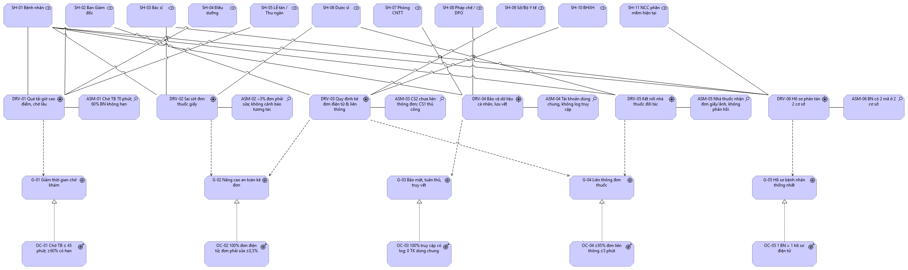

## Nguyên tắc kiến trúc

| Mã | Nguyên tắc | Hệ quả cho kiến trúc |
|---|---|---|
| PR-01 | An toàn người bệnh trên hết (fail-safe) | Kiểm tra an toàn đơn bắt buộc; mất kết nối chỉ cấp có giới hạn; sự cố bên ngoài không được chặn khám chữa bệnh |
| PR-02 | Dữ liệu có chủ sở hữu, một nguồn chuẩn | Mỗi Data Object có đúng một component ghi |
| PR-03 | Tối thiểu quyền, đúng ngữ cảnh | RBAC + ABAC, break-glass có cờ; bỏ tài khoản chung |
| PR-04 | Mọi truy cập đều để lại vết | Audit tập trung, append-only, ghi cả đọc và bị từ chối |
| PR-05 | Không ghi đè dữ liệu lâm sàng | Đơn có trạng thái và phiên bản; sổ cái cấp thuốc chỉ thêm |
| PR-06 | Ưu tiên chuẩn mở | HL7 FHIR R4, ICD-10, danh mục thuốc quốc gia |
| PR-07 | Nhập một lần, dùng nhiều nơi | Lịch hẹn chuyển thẳng sang tiếp đón, tiếp đón sang khám |
| PR-08 | Kết nối lỏng qua giao diện | Gateway, adapter, sự kiện; không truy cập CSDL của nhau |

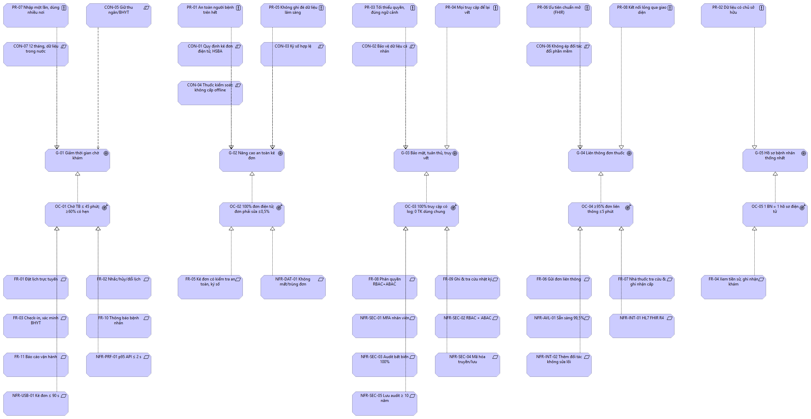

# Yêu cầu và ràng buộc

## Yêu cầu chức năng

| Mã | Yêu cầu | Goal | Quy trình |
|---|---|---|---|
| FR-01 | Đặt lịch trực tuyến/tổng đài, chọn chuyên khoa, bác sĩ, khung giờ; xác nhận tức thì | G-01 | BP-01 |
| FR-02 | Nhắc lịch, hủy/đổi lịch, giải phóng khung giờ | G-01 | BP-01 |
| FR-03 | Check-in bằng QR hoặc CCCD, xác minh danh tính và BHYT, mở lượt khám, xếp hàng | G-01, G-05 | BP-02 |
| FR-04 | Xem tiền sử, dị ứng, đơn cũ; ghi nhận khám, chẩn đoán ICD-10 | G-02, G-05 | BP-03 |
| FR-05 | Kê đơn điện tử có kiểm tra dị ứng, tương tác, trùng hoạt chất, liều; ký số, phát hành mã đơn | G-02 | BP-04 |
| FR-06 | Gửi đơn lên Hệ thống đơn thuốc quốc gia và tới nhà thuốc; BN nhận mã đơn/QR | G-04 | BP-04 |
| FR-07 | Nhà thuốc tra đơn theo mã, ghi nhận cấp toàn phần/một phần | G-04 | BP-05 |
| FR-08 | Phân quyền theo vai trò và ngữ cảnh; truy cập khẩn cấp có cờ | G-03 | BF-01 |
| FR-09 | Ghi, tra cứu nhật ký truy cập; báo cáo truy cập bất thường | G-03 | BF-01 |
| FR-10 | Thông báo BN: lịch, đơn đã phát hành, trạng thái cấp | G-01, G-04 | BP-01/04/05 |
| FR-11 | Báo cáo vận hành để đo Outcome | G-01, G-02 | BF-02 |

**Yêu cầu theo biến thể ⟦BIẾN THỂ⟧** — A: FR-A1 ghép định danh 2 cơ sở, FR-A2 xem hồ sơ liên cơ sở qua mô hình chuẩn, FR-A3 consent. B: FR-B1 cấp có giới hạn khi mất kết nối, FR-B2 đồng bộ và đối chiếu, FR-B3 phát hiện và chặn cấp trùng. C: FR-C1 sửa đơn tạo phiên bản mới, FR-C2 thu hồi theo trạng thái cấp, FR-C3 thông báo thay đổi tới nhà thuốc và BN.

## Yêu cầu phi chức năng

| Mã | Yêu cầu | Goal |
|---|---|---|
| NFR-PRF-01 | p95 API ≤ 2 s giờ cao điểm (300 người dùng đồng thời); tra đơn tại nhà thuốc ≤ 3 s | G-01 |
| NFR-AVL-01 | Sẵn sàng 99,5% trong 6h–21h; RPO ≤ 15 phút, RTO ≤ 4 giờ | G-01, G-04 |
| NFR-SEC-01 | MFA cho nhân viên, OTP cho BN | G-03 |
| NFR-SEC-02 | RBAC + ABAC, break-glass | G-03 |
| NFR-SEC-03 | 100% truy cập hồ sơ/đơn có audit bất biến | G-03 |
| NFR-SEC-04 | TLS 1.2+ (mTLS với đối tác), mã hóa khi lưu AES-256 | G-03 |
| NFR-SEC-05 | Lưu audit ≥ 10 năm | G-03 |
| NFR-INT-01 | Trao đổi theo HL7 FHIR R4 | G-04, G-05 |
| NFR-INT-02 | Thêm nhà thuốc/cơ sở không sửa lõi | G-04 |
| NFR-DAT-01 | Không mất, không trùng đơn và bản ghi cấp (idempotent) | G-02, G-04 |
| NFR-USB-01 | Kê đơn 5 thuốc ≤ 90 s; check-in BN có hẹn ≤ 60 s | G-01 |

## Ràng buộc

| Mã | Ràng buộc | Căn cứ (cần đối chiếu bản hiện hành) |
|---|---|---|
| CON-01 | Kê đơn điện tử, liên thông đơn thuốc, hồ sơ bệnh án điện tử | Luật Khám bệnh, chữa bệnh 2023; TT 26/2025/TT-BYT (kê đơn điện tử chậm nhất 01/01/2026); TT 13/2025/TT-BYT (bệnh án điện tử) |
| CON-02 | Dữ liệu sức khỏe là dữ liệu cá nhân nhạy cảm | Luật Bảo vệ dữ liệu cá nhân 91/2025/QH15; NĐ 356/2025/NĐ-CP |
| CON-03 | Đơn và hồ sơ điện tử phải ký số hợp lệ | Luật Giao dịch điện tử 2023 |
| CON-04 | Thuốc gây nghiện/hướng thần/tiền chất: không cấp offline, không qua nhà thuốc đối tác thông thường | Quy định kê đơn thuốc kiểm soát đặc biệt |
| CON-05 | Giữ thu ngân/BHYT; kết nối Cổng giám định theo chuẩn BHXH | ASSUMP-06 |
| CON-06 | Không bắt buộc nhà thuốc đối tác và CS2 đổi phần mềm | ASSUMP-04, 05 |
| CON-07 | 12 tháng, ngân sách hạn chế, lưu trữ dữ liệu trong nước | ASSUMP-08 |

Hệ quả quan trọng nhất của ràng buộc: vì kê đơn điện tử **đã là nghĩa vụ** từ 01/01/2026, ở thời điểm 11/2026 việc CS2 chưa kê đơn điện tử là vi phạm hiện hành chứ không chỉ là điểm yếu. Điều này quyết định thứ tự lộ trình ở chương 9.

# Kiến trúc chiến lược

Tầng chiến lược (bài giảng chương 7) là cầu nối giữa Motivation và Business: mục tiêu chiến lược không được hiện thực trực tiếp bởi quy trình mà thông qua **năng lực** và **tài nguyên**.

## Bản đồ năng lực và mức khoảng trống

| Năng lực | Mức khoảng trống | Hiện thực bởi |
|---|---|---|
| CAP-01 Quản lý lịch hẹn & điều phối công suất | **Mới** | BP-01 |
| CAP-02 Tiếp nhận & định danh người bệnh | Nâng cấp | BP-02 |
| CAP-03 Khám & quản lý hồ sơ lâm sàng | Nâng cấp | BP-03 |
| CAP-04 Kê đơn an toàn | **Mới** | BP-04 |
| CAP-05 Liên thông đơn thuốc & cấp thuốc | **Mới** | BP-05 |
| CAP-06 Kiểm soát truy cập & lưu vết | **Mới** | BF-01 |
| CAP-07 Quản trị dữ liệu người bệnh liên cơ sở | **Mới** (trọng tâm biến thể A) | BP-06A |
| CAP-08 Đo lường & cải tiến vận hành | Nâng cấp | BF-02 |
| CAP-09 Thanh toán & giám định BHYT | Giữ | BP0-05 |

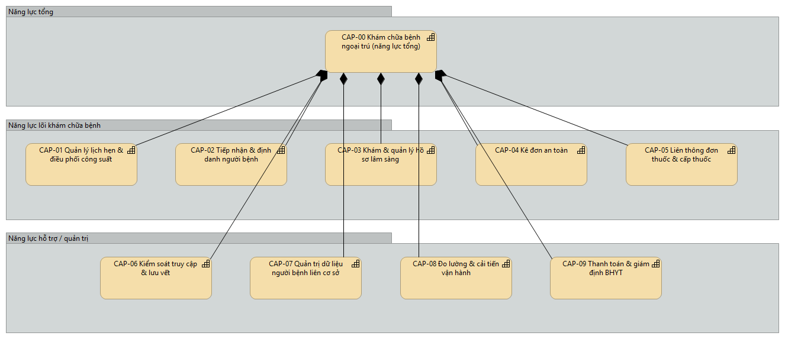

## Hoạch định năng lực và luồng giá trị

Bốn **lộ trình hành động** (Course of Action) nối mục tiêu với năng lực: COA-01 *Tuân thủ trước, tối ưu sau* (G-02, G-03 → CAP-04, CAP-06); COA-02 *Số hóa đầu vào để giảm chờ* (G-01 → CAP-01, CAP-02); COA-03 *Liên thông qua cổng chuẩn, không buộc đối tác đổi phần mềm* (G-04 → CAP-05); COA-04 *Một hồ sơ người bệnh dùng chung* (G-05 → CAP-03, CAP-07). Tài nguyên: RS-01 đội ngũ y tế, RS-02 dữ liệu BN và đơn, RS-03 nền tảng số dùng chung, RS-04 mạng lưới nhà thuốc.

Luồng giá trị VS-01 *Khám ngoại trú đến khi nhận thuốc* gồm 5 công đoạn **Hẹn khám → Tiếp đón → Khám & chẩn đoán → Kê đơn an toàn → Nhận thuốc**, mang giá trị VAL-01 "được khám đúng hẹn, nhận thuốc đúng và an toàn" cho người bệnh; mỗi công đoạn được một năng lực phục vụ và một quy trình BP-0x hiện thực. CAP-06 phục vụ toàn bộ luồng.

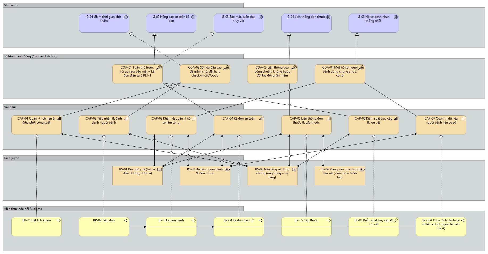

# Kiến trúc nghiệp vụ (Pha B)

## Hiện trạng (Baseline)

| Quy trình hiện trạng | Điểm đau | Assessment |
|---|---|---|
| BP0-01 Đặt lịch qua hotline/Zalo, ghi Google Sheet | Nghẽn điện thoại, trùng khung giờ, 60% BN không hẹn | ASM-01 |
| BP0-02 Lấy số & tiếp đón tại quầy | Nhập lại thông tin hành chính mỗi lần | ASM-01 |
| BP0-03 Khám & ghi bệnh án giấy | Không xem được tiền sử cơ sở kia | ASM-06 |
| BP0-04 Kê đơn in/viết tay | Không kiểm tra dị ứng/tương tác; CS2 chưa liên thông | ASM-02, ASM-03 |
| BP0-05 Thanh toán & giám định BHYT | Chạy ổn, giữ nguyên | — |
| BP0-06 Mua thuốc bằng đơn giấy | Nhà thuốc không xác thực được đơn, không báo lại trạng thái | ASM-05 |

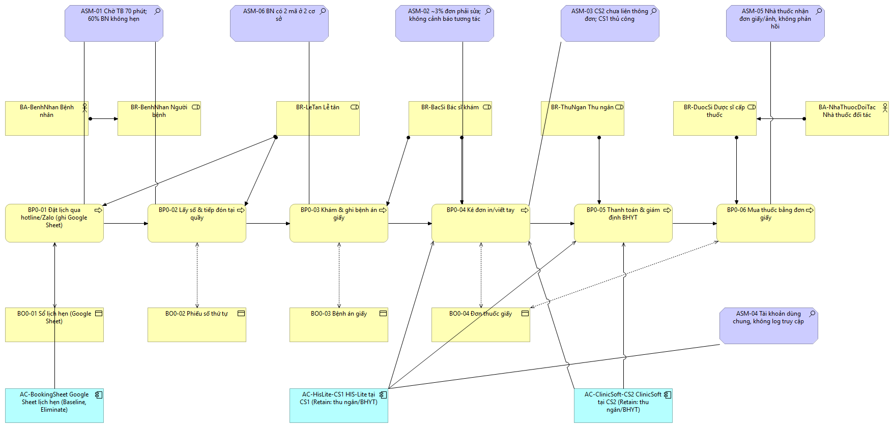

## Mục tiêu (Target)

Target gồm 7 dịch vụ nghiệp vụ (BS-01..07) cung cấp qua 4 kênh (BI-01 web/app, BI-02 tổng đài, BI-03 quầy/kiosk, BI-04 kênh nhận đơn của nhà thuốc); 5 quy trình lõi BP-01 Đặt lịch → BP-02 Tiếp đón → BP-03 Khám → BP-04 Kê đơn điện tử → BP-05 Cấp thuốc, nối bằng 4 sự kiện nghiệp vụ; 2 chức năng xuyên suốt BF-01 Kiểm soát truy cập & lưu vết, BF-02 Quản lý vận hành & báo cáo. Gói khám ngoại trú PRD-01 gộp BS-01..06 và Thỏa thuận khám CT-01 (gồm đồng ý xử lý dữ liệu theo CON-02); nhà thuốc đối tác ràng buộc bằng CT-02.

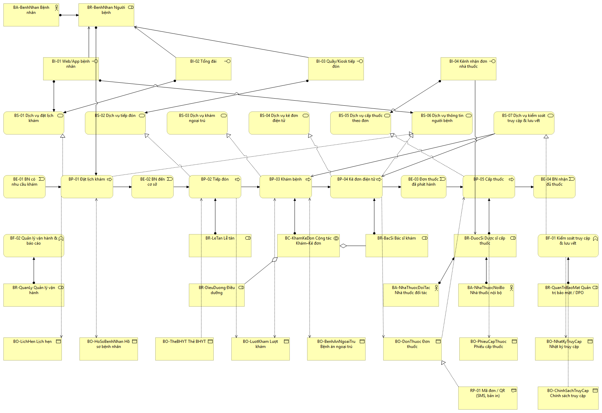

## Quy trình BPMN luồng chính (BPMN-01)

Pool Phòng khám có 5 lane theo vai trò và hệ thống; pool Nhà thuốc; 2 pool đóng cho BHXH và Hệ thống đơn thuốc quốc gia (nối bằng message flow vì là tổ chức khác). Có timer nhắc lịch 24 giờ, gateway "Cần kê đơn?", vòng lặp "Có cảnh báo?" quay lại BP-04.1, và parallel gateway tách việc BN đi nhà thuốc với hệ thống chờ xác nhận cấp. Mọi task mang mã BP-0x.y trùng với ArchiMate.

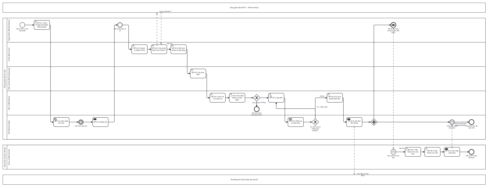

## Quy trình ngoại lệ theo biến thể (BPMN-02) ⟦BIẾN THỂ — giữ 1 trong 3⟧

- **BPMN-02A Liên thông hai cơ sở:** không tìm thấy hoặc nhiều ứng viên khi ghép định danh → xác minh thủ công (CCCD, BHYT, hỏi BN); chưa có đồng ý → xin đồng ý; dữ liệu cơ sở kia thiếu trường → gắn cờ cảnh báo.
- **BPMN-02B Nhà thuốc mất kết nối:** tra đơn trong bộ nhớ đệm; chỉ cấp nếu đơn còn hạn và không phải thuốc kiểm soát (CON-04, PR-01); cấp offline ghi `dispenseId`; khi có mạng đồng bộ idempotent, hệ thống đối chiếu và chuyển Quản lý đối soát nếu cấp trùng/vượt.
- **BPMN-02C Điều chỉnh/thu hồi đơn:** rẽ 3 nhánh theo trạng thái cấp: chưa cấp + thu hồi → REVOKED; chưa cấp + sửa → phiên bản v+1; đã cấp → đơn điều chỉnh, không xóa phần đã cấp (PR-05). Event-based gateway chờ nhà thuốc xác nhận, quá 30 phút thì liên hệ trực tiếp.

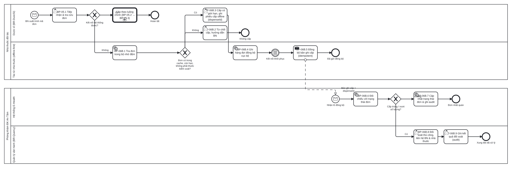

## Khoảng trống nghiệp vụ

| Baseline | Target | Loại |
|---|---|---|
| BP0-01 Đặt lịch hotline/Zalo | BP-01 Đặt lịch (web/app + tổng đài trên cùng hệ thống) | Replace |
| BP0-02 Tiếp đón nhập tay | BP-02 Tiếp đón QR/CCCD, xác minh BHYT | Replace |
| BP0-03 Bệnh án giấy | BP-03 Khám trên hồ sơ điện tử | Replace |
| BP0-04 Kê đơn in/viết tay | BP-04 Kê đơn điện tử ký số | Replace |
| BP0-05 Thanh toán & BHYT | Giữ, kết nối từ BP-02 | Retain |
| BP0-06 Đơn giấy ở nhà thuốc | BP-05 Cấp thuốc theo đơn điện tử | Replace |
| — | BF-01, BF-02, BS-06, BP-06A/B/C | New |
| Tài khoản dùng chung theo quầy | Tài khoản cá nhân theo vai trò | Eliminate |

# Kiến trúc ứng dụng và dữ liệu (Pha C)

## Hiện trạng ứng dụng

Hiện có 3 ứng dụng rời rạc không có giao diện tích hợp: AC-HisLite-CS1 (thu ngân, BHYT, in đơn), AC-ClinicSoft-CS2 (như trên, khác nhà cung cấp, khác mã BN), AC-BookingSheet (Google Sheet lịch hẹn). Liên thông đơn quốc gia nhập tay (CS1) hoặc chưa có (CS2); nhà thuốc gõ lại đơn từ ảnh chụp.

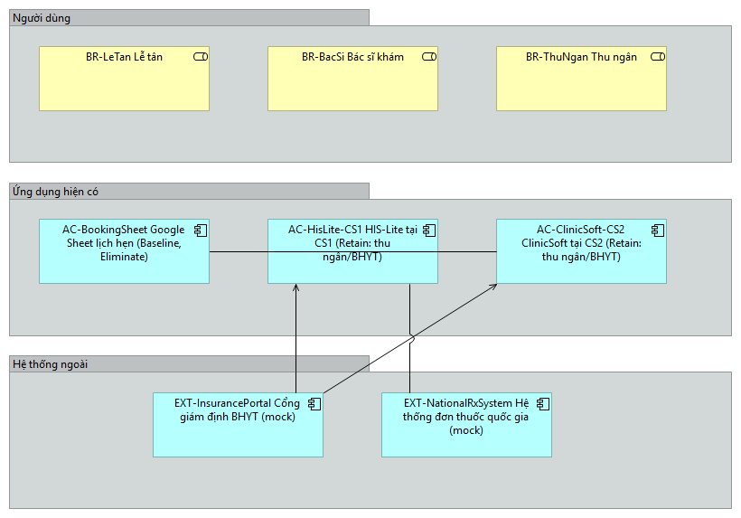

## Ứng dụng mục tiêu

Target gồm **11 thành phần nội bộ** chia 3 nhóm, **2 hệ thống cũ giữ lại** cho thu ngân/BHYT và **4 hệ thống ngoài**. Mọi trao đổi đơn thuốc ra bên ngoài đi qua một cửa duy nhất là AC-PharmacyGateway.

| Nhóm | Thành phần | Vai trò |
|---|---|---|
| Kênh | AC-PatientPortal | Web/app bệnh nhân: đặt lịch, xem đơn, thông báo |
| Nghiệp vụ lõi | AC-Booking, AC-Reception, AC-EMR, AC-ePrescription | Lịch hẹn; tiếp đón; hồ sơ bệnh án; kê đơn, kiểm tra an toàn, ký số, trạng thái đơn |
| Tích hợp & thông báo | AC-PharmacyGateway, AC-Notification, AC-Reporting | Cửa duy nhất tới nhà thuốc và hệ thống quốc gia; SMS/push; đo Outcome |
| Nền dùng chung | AC-IAM, AC-Audit, AC-MasterData | Định danh & phân quyền (ADR-002); lưu vết (ADR-003); danh mục thuốc, ICD-10, nhà thuốc |
| Giữ lại | AC-HisLite-CS1, AC-ClinicSoft-CS2 | Chỉ còn thu ngân/BHYT, nhận lượt khám và đơn để tính tiền |
| Ngoài (mock) | EXT-NationalRxSystem, EXT-PharmacySystem, EXT-InsurancePortal, EXT-SmsGateway | |

Giữa hai thành phần dùng **flow** khi dữ liệu chảy theo sự kiện và **serving** khi một bên gọi dịch vụ của bên kia: AC-Booking ⇢ AC-Reception ⇢ AC-EMR → AC-ePrescription ⇢ AC-PharmacyGateway ⇢ EXT-NationalRxSystem / EXT-PharmacySystem, chiều về là bản ghi cấp thuốc. AC-IAM, AC-Audit và AC-MasterData phục vụ toàn bộ nhóm lõi.

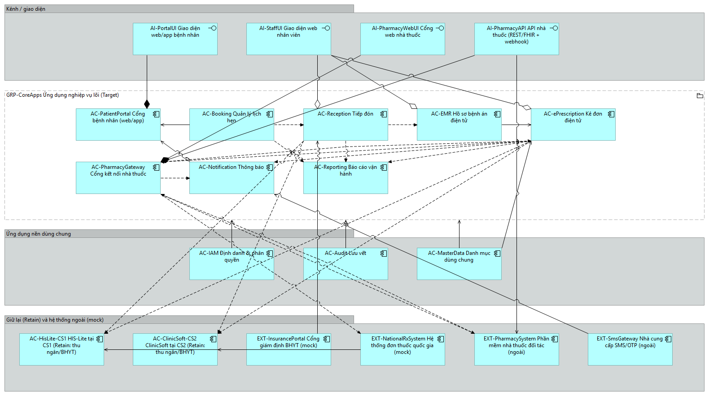

## Sử dụng ứng dụng: quy trình → dịch vụ → thành phần

Mỗi task BPMN có dịch vụ ứng dụng phục vụ (trừ BP-05.2 tư vấn là việc thủ công của dược sĩ):

| Task BPMN | Application Service | Component |
|---|---|---|
| BP-01.1, 01.2 | AS-BookAppointment (+ AS-CancelAppointment) | AC-Booking |
| BP-01.3, 04.4, 05.3 | AS-SendNotification | AC-Notification |
| BP-02.1, 02.3 / BP-02.2 | AS-CheckIn / AS-VerifyInsurance | AC-Reception (→ EXT-InsurancePortal) |
| BP-03.1, 03.3 / BP-03.2 | AS-RecordEncounter / AS-ViewMedicalRecord | AC-EMR |
| BP-04.1, 04.3 / BP-04.2 | AS-IssuePrescription / AS-CheckDrugSafety | AC-ePrescription |
| BP-04.4 | AS-SendPrescription, AS-SubmitNationalRx | AC-PharmacyGateway |
| BP-05.1 / BP-05.3 | AS-ReceivePrescription / AS-RecordDispense | AC-PharmacyGateway |
| BF-01 | AS-Authenticate, AS-Authorize, AS-RecordAudit, AS-QueryAudit | AC-IAM, AC-Audit |
| BF-02 | AS-ReportOperations | AC-Reporting |

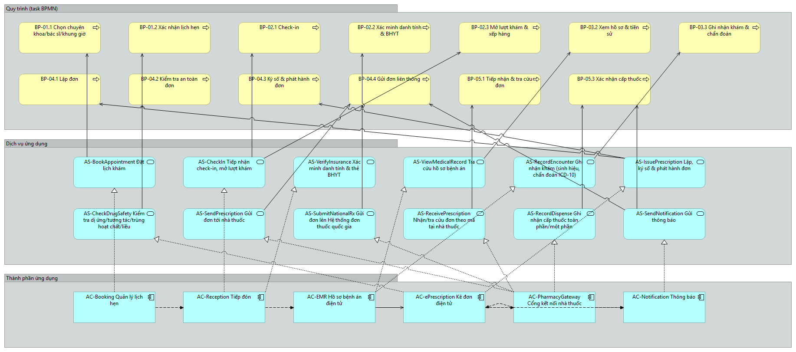

## Kiến trúc dữ liệu

**Mức khái niệm.** Mô hình xoay quanh 3 thực thể có vòng đời dài: Patient, Encounter, Prescription. Một BN có nhiều lịch hẹn và lượt khám; một lượt khám sinh nhiều ghi nhận lâm sàng và đơn; đơn gồm nhiều dòng thuốc; mỗi đơn được giao một nhà thuốc (ASSUMP-10) và có nhiều bản ghi cấp. AuditEvent, Notification, OutboxEvent tham chiếu thực thể qua cặp (`entityType`, `entityId`) để không khóa schema nghiệp vụ vào schema lưu vết. Mỗi Business Object của TV1 được một Data Object hiện thực (BO-DonThuoc ← DO-Prescription + DO-PrescriptionItem…).

**Nguồn chuẩn (PR-02).** Mỗi Data Object có đúng một thành phần ghi:

| Data Object | Nguồn chuẩn | Cách giao dữ liệu | FHIR R4 |
|---|---|---|---|
| DO-Patient, DO-Encounter, DO-ClinicalRecord | AC-EMR (BN do AC-Reception tạo) | API đọc; sự kiện cho thu ngân | Patient, Encounter, Condition/AllergyIntolerance |
| DO-Appointment | AC-Booking | Sự kiện | Appointment |
| DO-Prescription, DO-PrescriptionItem, DO-DispenseRecord, DO-OutboxEvent | AC-ePrescription / AC-PharmacyGateway | Outbox + hàng đợi (ADR-001) | MedicationRequest, MedicationDispense |
| DO-Drug, DO-Pharmacy, DO-Practitioner | AC-MasterData | Cache, đồng bộ hằng ngày | Medication, Organization, Practitioner |
| DO-AccessPolicy | AC-IAM | Gói chính sách có phiên bản (ADR-002) | — |
| DO-AuditEvent | AC-Audit | Sự kiện (ADR-003) | AuditEvent |

**Vòng đời đơn thuốc** (dùng chung mọi biến thể): DRAFT → ISSUED → PARTIALLY_DISPENSED → DISPENSED; ISSUED/PARTIALLY_DISPENSED → EXPIRED khi quá hạn; nhánh biến thể C: ISSUED → SUPERSEDED (có bản v+1) hoặc REVOKED, PARTIALLY_DISPENSED → CLOSED_BY_REVOCATION. Không trạng thái nào đi ngược; số đã cấp không bao giờ bị xóa.

**Chuỗi giá trị thông tin.** Outcome được tính trực tiếp từ dữ liệu vận hành: OC-01 = trung bình (Encounter.startAt − checkInAt) lúc 7h–10h; OC-02 = số đơn có version > 1 hoặc bị thu hồi / tổng đơn; OC-04 = OutboxEvent.publishedAt − Prescription.issuedAt; OC-03 = đối chiếu log API Gateway với AuditEvent.

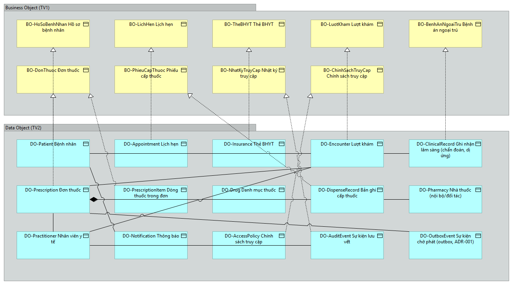

## Phần bổ sung theo biến thể ⟦BIẾN THỂ⟧

| Biến thể | Thành phần / dịch vụ thêm | Data Object thêm |
|---|---|---|
| A | AC-IntegrationHub, AC-FhirAdapter-CS1/CS2, AC-MPI, AC-Consent; AS-MatchPatient, AS-ExchangeRecord, AS-RecordConsent | DO-PatientLink, DO-CodeMapping, DO-Consent |
| B | AC-PharmacyAgent (offline-first, cache đơn), AC-Reconciliation; AS-SyncDispense, AS-ReconcileDispense | DO-DispenseLedger, DO-SyncBatch |
| C | AF-PrescriptionVersioning trong AC-ePrescription; AS-AmendPrescription, AS-RevokePrescription | DO-PrescriptionVersion, DO-AmendmentReason |

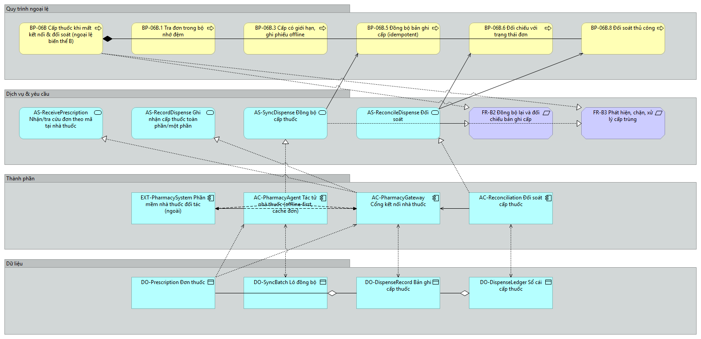

# Kiến trúc công nghệ (Pha D)

## Hiện trạng và điểm yếu

Mỗi cơ sở có một máy chủ đơn lẻ (CS1 Windows Server 2012 R2 đã hết hỗ trợ; CS2 một máy để bàn), LAN phẳng dùng chung Wi-Fi khách, một đường Internet, sao lưu thủ công không kiểm thử khôi phục; dữ liệu sức khỏe nằm trên Google Sheet/Zalo tài khoản chung. Không có VPN giữa 2 cơ sở, không cổng API, không IdP, không log tập trung, không hạ tầng ký số. Tám điểm yếu T1–T8 được gắn vào Driver (chủ yếu DRV-04) và lấp bởi WP-01, WP-02.

## Quyết định nền: nơi đặt hạ tầng

| Tiêu chí (trọng số) | On-prem tại CS1 | Đám mây riêng thuê tại VN, 2 vùng | Đám mây công cộng nước ngoài |
|---|---|---|---|
| Lưu trữ dữ liệu sức khỏe trong nước (30%) | 5 | 5 | 2 |
| Sẵn sàng / DR (25%) | 2 | 4 | 5 |
| Chi phí 12 tháng (20%) | 3 | 4 | 3 |
| Năng lực vận hành CNTT nhỏ (15%) | 2 | 4 | 4 |
| Độ trễ tới 2 cơ sở và nhà thuốc (10%) | 3 | 4 | 3 |
| **Tổng** | 3,20 | **4,30** | 3,35 |

Chọn đám mây riêng (IaaS) của nhà cung cấp trong nước, vùng chính + vùng DR; hai cơ sở chỉ giữ thiết bị đầu cuối, tường lửa, đường truyền. Đánh đổi: phụ thuộc Internet tại cơ sở (xử lý bằng 2 nhà mạng + 4G và chế độ suy giảm) và chi phí thuê định kỳ.

## Hạ tầng mục tiêu

Hạ tầng chia **vùng bảo mật**: DMZ (ND-EdgeGateway: WAF, cân bằng tải, API Gateway làm điểm thực thi chính sách); vùng App (ND-AppCluster, 3 VM chạy container); vùng Data (ND-DataCluster PostgreSQL chính + bản sao, ND-MessageBroker, ND-ObjectStore có khóa WORM, không có đường từ Internet); vùng Security (ND-SecurityPlatform IdP + PDP, ND-AuditStore, ND-KeyVault KMS/HSM, quản trị qua bastion, tách quản trị viên audit khỏi quản trị viên hệ thống); vùng Mgmt (ND-SecOps giám sát, SIEM); vùng DR (ND-BackupDR). Cơ sở có VLAN tách nhân viên/thiết bị/khách và NW-SiteVPN về trung tâm dữ liệu; nhà thuốc đối tác vào qua NW-PartnerChannel mTLS.

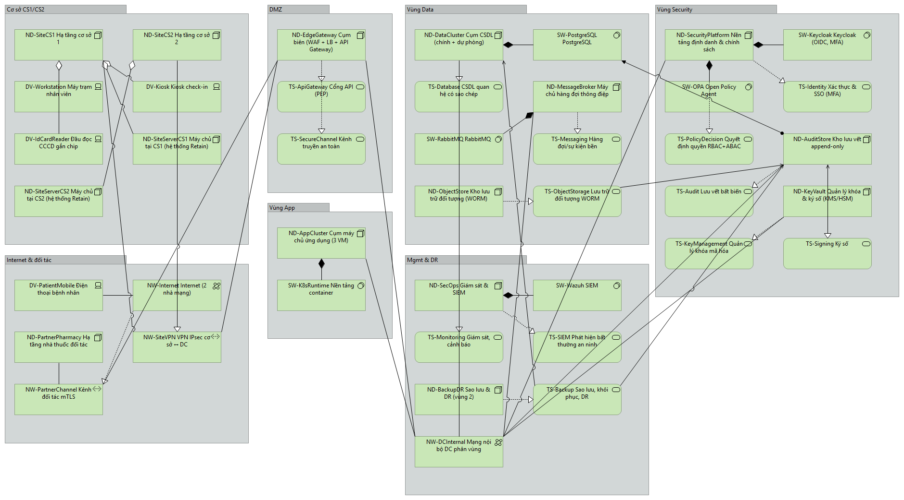

## Từ yêu cầu phi chức năng tới hạ tầng

| NFR | Giải pháp hạ tầng chính |
|---|---|
| NFR-SEC-01/02 | TS-Identity (OIDC, MFA), TS-PolicyDecision (RBAC+ABAC), TS-ApiGateway là PEP — ADR-002 |
| NFR-SEC-03/05 | TS-Audit (chuỗi băm), TS-ObjectStorage WORM, TS-Signing niêm phong, TS-SIEM bản sao — ADR-003 |
| NFR-SEC-04 | TS-SecureChannel (TLS/mTLS/VPN), TS-KeyManagement mã hóa khi lưu |
| NFR-AVL-01 | 3 VM ứng dụng, CSDL có bản sao, TS-Backup + vùng DR, diễn tập DR theo quý |
| NFR-PRF-01 | Rate limit ở gateway, scale ngang cụm ứng dụng, read replica cho báo cáo |
| NFR-DAT-01, NFR-INT-02 | TS-Messaging hàng đợi bền, ràng buộc duy nhất idempotency key; adapter đối tác ở gateway |
| CON-03 | TS-Signing (KMS, kết nối CA — mock) |

Kiểm tra quy mô: ~500 lượt/ngày × ~60 sự kiện truy cập/lượt ≈ 30.000 AuditEvent/ngày ≈ 11 GB/năm, ~110 GB trong 10 năm; ~400 đơn/ngày. Cụm 3 VM 4 vCPU/16 GB và CSDL 8 vCPU/32 GB dư cho tải hiện tại; tăng ×5 vẫn trong khả năng scale ngang.

**Chế độ suy giảm.** Mất Internet tại cơ sở → chuyển 4G, quy trình giấy dự phòng có mẫu đơn đánh số; hệ thống quốc gia ngừng → đơn vào outbox, gửi bù (đã thử nghiệm ở mục 10.3); nhà thuốc đối tác mất mạng → BN dùng mã đơn/QR ở nhà thuốc khác (biến thể B: tác tử offline); audit store lỗi → đọc thường bị chặn (fail-closed), break-glass vẫn cho phép và ghi đệm.

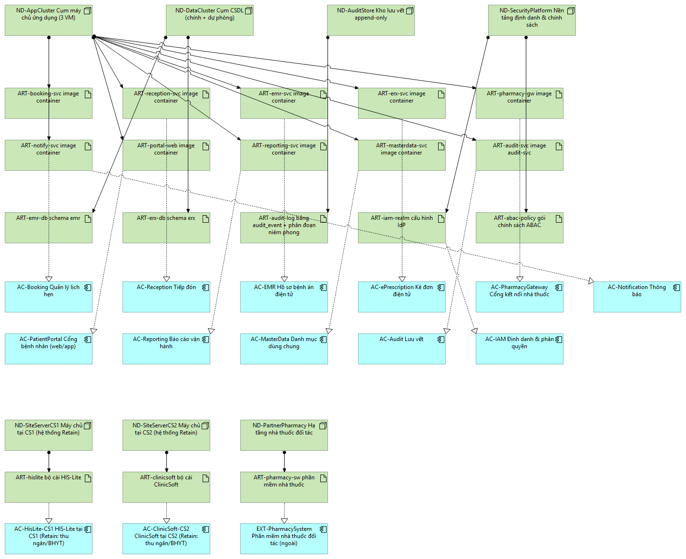

# Quyết định kiến trúc

Nhóm có **4 ADR** (đầy đủ ở Phụ lục A, file nguồn `03-adr/`). Mỗi ADR so sánh 3–4 phương án, tiêu chí có trọng số gắn mã NFR/CON/PR, nêu đánh đổi, rủi ro và điều kiện xem xét lại.

| ADR | Câu hỏi | Phương án (điểm có trọng số) | Chọn | Đánh đổi chấp nhận |
|---|---|---|---|---|
| ADR-001 | Tích hợp đơn thuốc với nhà thuốc và hệ thống quốc gia | A. API đồng bộ điểm–điểm (2,55) · **B. Gateway + hàng đợi bền + outbox + idempotency (4,35)** · C. CSDL dùng chung/file lô (2,90) | B | Nhất quán sau cùng (chậm vài giây); phải vận hành broker và hàng lỗi |
| ADR-002 | Kiểm soát truy cập hồ sơ và đơn | A. RBAC thuần (2,70) · **B. RBAC nền + ABAC qua PDP tập trung (4,50)** · C. ABAC thuần (3,80) | B | Thêm độ phức tạp chính sách; giới hạn ABAC cho tài nguyên nhạy cảm |
| ADR-003 | Kho lưu vết | A. Bảng lịch sử bằng trigger (2,75) · B. SIEM làm kho (3,50) · **C. Dịch vụ audit append-only, chuỗi băm, checkpoint ký số, WORM (4,30)** · D. Blockchain cấp phép (3,10) | C (+B làm luồng phụ) | Thêm một dịch vụ và kho phải vận hành; SIEM chỉ là bản sao, không phải bằng chứng |
| ADR-004 | Mô hình lưu dữ liệu đơn | A. CRUD ghi đè + trigger (3,20) · **B. Đơn bất biến theo phiên bản + sổ cái cấp thuốc (4,30)** · C. Event sourcing toàn phần (3,75) | B | Trạng thái là giá trị suy ra; truy vấn phức tạp hơn CRUD |

Các quyết định khớp nhau: outbox của ADR-001 cũng là đường vào của audit (ADR-003); POL-05 của ADR-002 dựa trên trạng thái đơn của ADR-004; break-glass (POL-07) được ghi vết riêng và DPO rà soát trong 24 giờ. Chính sách ABAC tiêu biểu: **POL-01** quan hệ điều trị (chỉ BN có lượt khám mở được phân cho mình hoặc trong 90 ngày), **POL-04** dược sĩ chỉ xem đơn khi có mã đơn + mã xác minh, **POL-06** thuốc kiểm soát chỉ cấp tại nhà thuốc nội bộ và không cấp offline, **POL-07** break-glass 4 giờ có lý do. Lưu ý ngược với gợi ý "ngoài giờ trực thì chặn": POL-03 chỉ hạ xuống quyền đọc vì chặn cứng có thể cản cấp cứu (PR-01).

# Phân tích khoảng trống và lộ trình chuyển đổi (Pha E, F)

## Khoảng trống tổng hợp

| Tầng | Replace | Retain | New | Eliminate |
|---|---|---|---|---|
| Nghiệp vụ | BP0-01..04, BP0-06 → BP-01..05 | BP0-05 thanh toán & BHYT | BF-01, BF-02, BP-06A/B/C | Tài khoản dùng chung |
| Ứng dụng | Google Sheet → AC-Booking; bệnh án giấy → AC-EMR; nhập tay liên thông → AS-SubmitNationalRx | AC-HisLite-CS1, AC-ClinicSoft-CS2 (thu hẹp) | AC-Reception, AC-ePrescription, AC-PharmacyGateway, AC-IAM, AC-Audit, AC-MasterData, AC-Reporting | AC-BookingSheet, Zalo cho dữ liệu sức khỏe |
| Công nghệ | Máy chủ cơ sở, LAN phẳng, Internet 1 đường, sao lưu thủ công | DV-Workstation (cài lại, gắn IdP) | DC 2 vùng, EdgeGateway, IAM, AuditStore, KeyVault, VPN, kênh đối tác | SaaS tài khoản chung |

## Gói công việc và bình cảnh

| WP | Tên | Bình cảnh |
|---|---|---|
| WP-01 | Hạ tầng nền & mạng | PLT-1 |
| WP-02 | Định danh, phân quyền & lưu vết | PLT-1 |
| WP-03 | Bệnh án lõi & kê đơn điện tử, liên thông quốc gia | PLT-1 |
| WP-07a | Nạp danh sách BN + dị ứng + đơn 90 ngày từ hệ thống cũ | PLT-1 |
| WP-04 | Đặt lịch & tiếp đón số | PLT-2 |
| WP-07b | Khử trùng/gộp dữ liệu BN 2 cơ sở, ngừng Sheet/Zalo | PLT-2 |
| WP-05 | Kết nối nhà thuốc (8 nhà thuốc) | PLT-3 |
| WP-06 | Năng lực theo biến thể ⟦BIẾN THỂ⟧ | PLT-3 (biến thể A: chuyển lên PLT-2) |
| WP-07c | Thu hồi máy chủ cũ, lưu trữ dữ liệu cũ chỉ đọc | PLT-3 |
| WP-08 | Quản lý thay đổi, đào tạo & tuân thủ | Xuyên suốt |

| Bình cảnh | Đạt | Nội dung ổn định |
|---|---|---|
| PLT-0 Hiện trạng | T0 | Baseline |
| **PLT-1** Nền tảng an toàn & Kê đơn điện tử liên thông | cuối T4 | IAM/MFA, ABAC, audit bất biến; bác sĩ 2 cơ sở kê đơn điện tử ký số, tự động liên thông quốc gia |
| **PLT-2** Đặt lịch, tiếp đón số & hồ sơ thống nhất | cuối T8 | Đặt lịch online/tổng đài, check-in QR/CCCD; dữ liệu BN đã gộp; đo được OC-01 |
| **PLT-3** Liên thông nhà thuốc & biến thể (Target) | cuối T12 | 8 nhà thuốc nhận đơn điện tử; năng lực biến thể; hệ thống cũ thu hồi |

**Vì sao thứ tự này.** *Tuân thủ trước, tối ưu sau* (COA-01): kê đơn điện tử đã là nghĩa vụ pháp lý và CS2 đang vi phạm, nên phải nằm ở PLT-1; bảo mật và audit phải có **trước** khi đưa dữ liệu sức khỏe lên hệ thống mới (PR-04, RSK-01). Đặt lịch, tuy là điểm đau dễ thấy nhất, cần dữ liệu BN sạch nên đứng ở PLT-2. Kết nối đối tác cần thời gian đàm phán hợp đồng CT-02 nên ở PLT-3. **Hạn chế đã biết của PLT-1:** dữ liệu BN 2 cơ sở chưa khử trùng; kiểm tra dị ứng dựa trên dị ứng nạp từ cả 2 hệ thống cũ cộng khai thác bắt buộc khi khám; rủi ro này (RSK-05) được đóng ở PLT-2.

Ba phần tử Gap nối các bình cảnh: GAP-01 (PLT-0→1: thiếu hạ tầng tập trung, IAM, audit, ký số, kê đơn điện tử), GAP-02 (PLT-1→2: thiếu đặt lịch/tiếp đón số, dữ liệu BN phân tán), GAP-03 (PLT-2→3: thiếu kênh điện tử với nhà thuốc, năng lực biến thể, hệ thống cũ chưa thu hồi). Mỗi Gap có Work Package lấp.

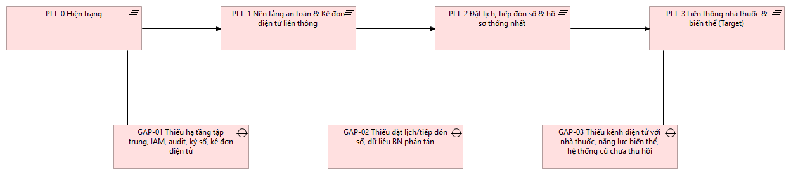

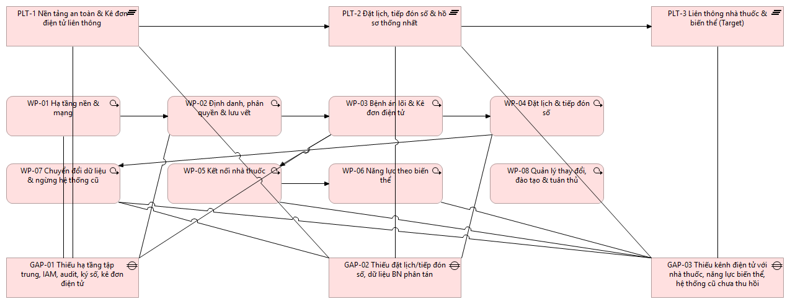

## Quản trị triển khai (Pha G, H)

Hội đồng kiến trúc gọn (Giám đốc, trưởng CNTT, 1 bác sĩ đại diện, DPO) duyệt mỗi lần qua bình cảnh. Tiêu chí qua cổng: **PLT-1** 100% đơn điện tử tại 2 cơ sở, 0 tài khoản chung, verify audit không lỗi 14 ngày liên tiếp; **PLT-2** ≥ 40% lượt khám có hẹn, check-in ≤ 60 s; **PLT-3** ≥ 90% đơn tại nhà thuốc đối tác nhận điện tử. Thay đổi kiến trúc đi theo quy trình 4 bước ở mục 10.3.

# Kiểm chứng

## Truy vết yêu cầu xuyên mô hình

| Goal | Yêu cầu | BPMN | Business | Application | Technology | ADR | Kiểm chứng trên prototype |
|---|---|---|---|---|---|---|---|
| G-01 | FR-01 Đặt lịch, xác nhận tức thì | BP-01.1, 01.2 | BP-01, BS-01, BO-LichHen | AS-BookAppointment / AC-Booking / DO-Appointment | TS-ApiGateway, ND-AppCluster, TS-Database | — | `POST /appointments` 201; đặt trùng 409 |
| G-02 | FR-05 Kê đơn có kiểm tra an toàn, ký số | BP-04.1–04.3 | BP-04, BS-04, BO-DonThuoc | AS-CheckDrugSafety, AS-IssuePrescription / AC-ePrescription / DO-Prescription | TS-Signing (ND-KeyVault), TS-Database | ADR-004 | Kê Amoxicillin cho BN dị ứng penicillin → 422 chặn; đổi thuốc → phát hành |
| G-04 | FR-07 + NFR-DAT-01 Cấp thuốc không mất, không trùng | BP-04.4, 05.1, 05.3 | BP-05, BR-DuocSi, BO-PhieuCapThuoc | AS-SendPrescription, AS-RecordDispense / AC-PharmacyGateway / DO-DispenseRecord, DO-OutboxEvent | TS-Messaging, NW-PartnerChannel | ADR-001, ADR-004 | Gửi lại cùng `dispenseId` → 200 kết quả cũ; cấp vượt → 409 |
| G-03 | NFR-SEC-03 100% truy cập có log bất biến | BP-03.2 (BF-01) | BF-01, BS-07, BO-NhatKyTruyCap | AS-Authorize, AS-RecordAudit / AC-IAM, AC-Audit / DO-AuditEvent | TS-PolicyDecision, TS-Audit, TS-ObjectStorage | ADR-002, ADR-003 | Bác sĩ không phụ trách → 403 + AuditEvent DENY; sửa 1 bản ghi → verify chỉ đúng chỗ |

Hàng theo biến thể ⟦BIẾN THỂ⟧: A — FR-A1 ghép định danh (AS-MatchPatient/AC-MPI, kiểm chứng `GET /patients/match` AUTO_LINK/MANUAL_REVIEW); B — FR-B3 chặn cấp trùng khi đồng bộ (AS-ReconcileDispense, `POST /pharmacy/sync` → ACCEPTED/DUPLICATE/CONFLICT); C — FR-C2 thu hồi theo trạng thái cấp (AS-RevokePrescription, đơn đã cấp → 409, tạo bản v2 trừ phần đã cấp).

Hai view **phân tầng xuyên suốt** thể hiện truy vết trực tiếp trong mô hình: V-LAY-1 cho kê đơn điện tử (G-02 → FR-05 → CAP-04 → BP-04.x → AS → AC-ePrescription → ART-erx-svc → ND-AppCluster, TS-Signing → CON-03) và V-LAY-2 cho phân quyền & lưu vết (G-03 → NFR-SEC-02/03 → BF-01 → AS-Authorize/AS-RecordAudit → AC-IAM/AC-Audit → TS-PolicyDecision/TS-Audit → ND-SecurityPlatform/ND-AuditStore).

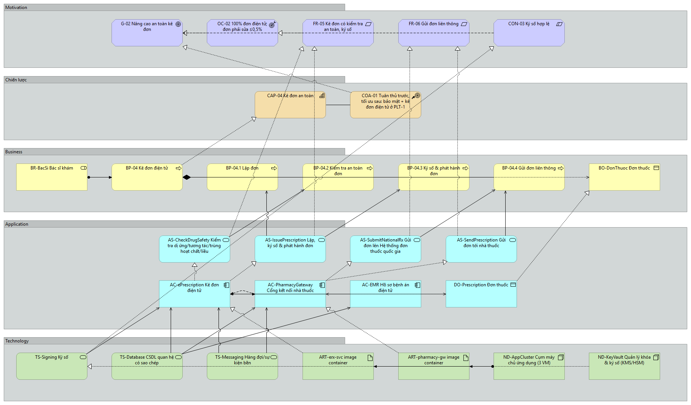

**Kiểm tra nhất quán mô hình** (chạy tự động bởi `build_full_model.py`): mọi phần tử trong view tồn tại trong mô hình; mọi quan hệ trong view khớp quan hệ mô hình; không có mã trùng; mọi task BPMN-01 có AS phục vụ (trừ BP-05.2 thủ công); mọi Data Object có đúng một thành phần ghi; mọi Gap có Work Package; mọi rủi ro gắn ADR/WP.

## Prototype

Prototype gồm hợp đồng API OpenAPI 3.0.3 (đã lint hợp lệ), mock server Node.js không cần thư viện (RBAC+ABAC, audit chuỗi băm, idempotency), giao diện bấm thử 7 vai trò, script `demo.sh` và API trace. Chạy: `node mock-server/server.js` → `http://localhost:4010`.

**Kịch bản end-to-end (BP-01 → BP-05):** BN đặt lịch nhận QR → lễ tân quét QR + CCCD mở lượt khám → bác sĩ mở hồ sơ, kê Amoxicillin bị **chặn** vì dị ứng penicillin, đổi Cefuroxim, ký và phát hành, đơn tự liên thông → nhà thuốc đối tác tra đơn bằng mã + 4 số cuối SĐT, xác nhận cấp; bấm lần 2 không tạo bản ghi mới → DPO xem toàn bộ nhật ký của BN.

**Ngoại lệ lõi:** bác sĩ không phụ trách mở hồ sơ → 403 có ghi vết → khai báo break-glass có lý do → xem được với cờ BREAK-GLASS nhưng không kê đơn được. DPO giả lập sửa 1 bản ghi audit → verify chỉ ra đúng bản ghi bị sửa.

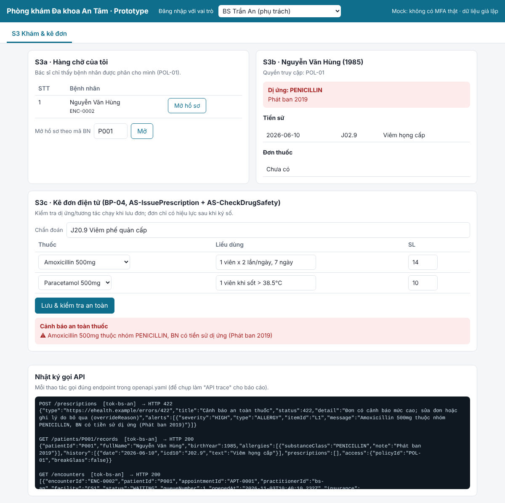

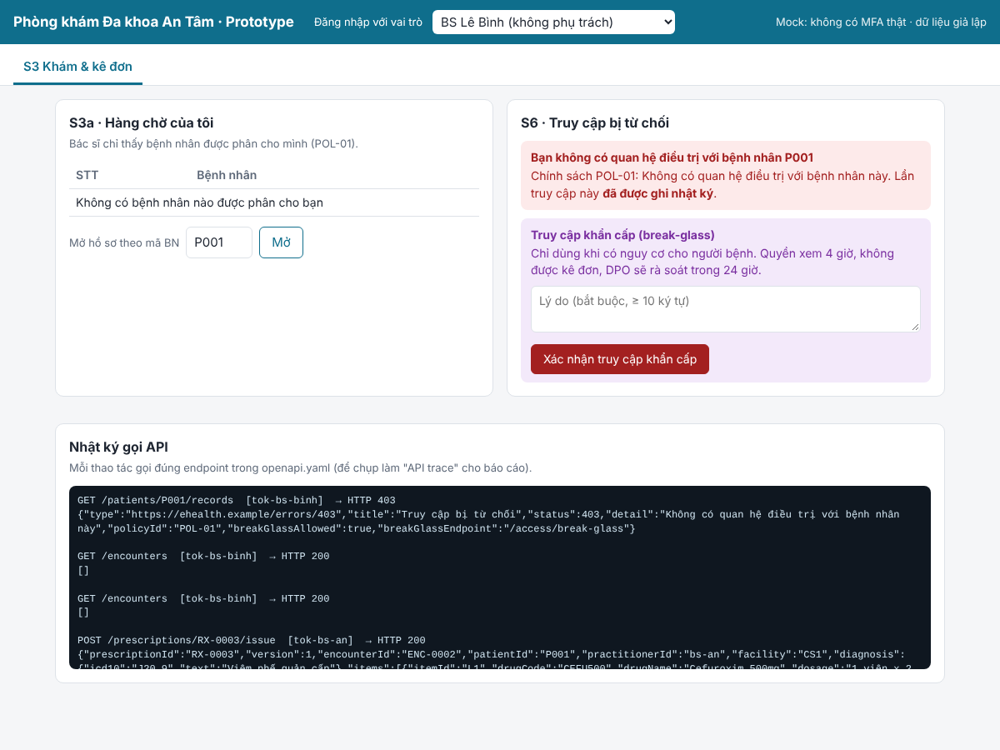

## Thử nghiệm tình huống bất thường và thay đổi giả định

**Tình huống bất thường đã chạy thử: Hệ thống đơn thuốc quốc gia ngừng 2 giờ lúc cao điểm** (~90 đơn bị ảnh hưởng). Chọn vì nó thử cùng lúc PR-01, ADR-001 và NFR-DAT-01. Chạy `bash scenario-outage.sh`, kết quả ở `04-prototype/scenario-outage-trace.txt`:

| # | Bước | Kỳ vọng theo kiến trúc | Kết quả | Đạt |
|---|---|---|---|---|
| 1 | Hệ thống quốc gia ngừng | Không ảnh hưởng ngay | `nationalRxUp: false` | ✓ |
| 2 | Bác sĩ phát hành đơn | Vẫn phát hành; đơn + outbox cùng giao dịch | 200, ISSUED, liên thông `QUEUED` | ✓ |
| 3 | Nhà thuốc tra và cấp | Qua cổng phòng khám, không phụ thuộc hệ thống quốc gia | 200 tra; 201 cấp | ✓ |
| 4 | Giám sát | Thấy đơn tồn | `outboxPending: 1` | ✓ |
| 5 | Hệ thống quốc gia trở lại | Gửi bù tự động, có ghi vết | `SUBMITTED`, `attempts: 2`, audit `OUTBOX_RETRY` | ✓ |
| 6 | Job gửi bù chạy lặp | Không gửi trùng | `flushed: []` | ✓ |
| 7 | Verify audit | Chuỗi băm nguyên vẹn | `valid: true` | ✓ |

Kết luận: ADR-001 được xác nhận (nếu chọn gọi đồng bộ, bác sĩ không phát hành được đơn trong 2 giờ). Đánh đổi lộ ra là OC-04 tạm không đạt trong thời gian sự cố, đúng ưu tiên PR-01. Điều chỉnh sau thử nghiệm: đo OC-04 tách phần do phòng khám kiểm soát; ngưỡng cảnh báo outbox > 20 đơn hoặc tồn > 15 phút; bổ sung vào RSK-03 và SOP của WP-08.

**Thay đổi giả định (phân tích 4 bước):** *mở thêm cơ sở 3 và 10 nhà thuốc đối tác trong 6 tháng.* (1) Yêu cầu bị chạm: NFR-INT-02, NFR-PRF-01, CON-06, CON-07. (2) Dò RTM: AC-PharmacyGateway, AC-Reception, AC-MasterData, ND-AppCluster, NW-SiteVPN, NW-PartnerChannel. (3) ADR: **không phải mở lại ADR nào**, thêm nhà thuốc chỉ là cấu hình + chứng thư + adapter (ngưỡng xem lại của ADR-001 là ~50 đối tác); POL-02 chỉ thêm giá trị `facility = CS3`. (4) Lộ trình: thêm WP-09 sau PLT-3, scale 3 → 4 VM; RSK-06 X 2→3, RSK-05 X 3→4. Đây là bằng chứng cho PR-08. Phân tích đầy đủ và bảng tra nhanh các thay đổi khác ở `05-verification/change-scenario.md`.

# Quản trị rủi ro

Thang Xác suất (X) và Tác động (T) 1–5, Mức = X × T (≥ 15 cao, 8–14 trung bình). Chủ sở hữu ghi vai trò trong tổ chức.

| ID | Rủi ro | X×T | Đối sách chính | Liên kết | Còn lại | Chủ sở hữu |
|---|---|---|---|---|---|---|
| RSK-01 | Tài khoản bị chiếm/lạm quyền → lộ hồ sơ sức khỏe | **15** | MFA, bỏ tài khoản chung, RBAC+ABAC, cảnh báo SIEM, mã hóa, đào tạo | ADR-002/003, WP-02 | 10 | DPO |
| RSK-02 | Nhật ký bị sửa/xóa/mất → mất giá trị bằng chứng | 10 | Chuỗi băm, checkpoint ký số, WORM, outbox, verify hằng ngày, tách quyền | ADR-003, WP-02 | 5 | Trưởng CNTT |
| RSK-03 | Mất kết nối (Internet cơ sở, đối tác, hệ thống quốc gia) | 12 | 2 nhà mạng + 4G, hàng đợi bền, mã đơn/QR, quy trình giấy; đã thử nghiệm mục 10.3 | ADR-001, WP-01/05 | 6 | Trưởng CNTT |
| RSK-04 | Đồng bộ lặp hoặc đơn đã đổi → cấp trùng/cấp theo đơn cũ | 10 | Idempotency key, ràng buộc duy nhất, POL-05, sự kiện đổi đơn có xác nhận, CON-04 | ADR-001/004 | 5 | Trưởng dược |
| RSK-05 | Ghép sai/trùng định danh BN khi gộp | 12 | CCCD gắn chip, gộp có người xác nhận dưới ngưỡng tin cậy; biến thể A: MPI | WP-07, FR-A1 | 8 | Trưởng tiếp đón |
| RSK-06 | Quá tải giờ cao điểm/sự cố vùng DC | 8 | Scale ngang, read replica, rate limit, kiểm thử tải trước PLT-2, DR | NFR-PRF/AVL, WP-01 | 4 | Trưởng CNTT |
| RSK-07 | Hệ thống cũ khó tích hợp, nhà cung cấp không hợp tác | 12 | Chỉ kết nối tối thiểu, adapter phía DC, điều khoản hợp đồng, song song ≤ 4 tuần/cơ sở | WP-03/07, SH-11 | 6 | Giám đốc |
| RSK-08 | Bác sĩ/dược sĩ không chấp nhận (MFA phiền, bị chặn nhầm) | 12 | Thiết kế cùng bác sĩ, SSO + thẻ, ABAC chế độ quan sát 2 tuần, đào tạo, pilot | NFR-USB-01, WP-08 | 6 | Giám đốc chuyên môn |

Rủi ro cao nhất là RSK-01, vì vậy WP-02 nằm ngay PLT-1 và không có dữ liệu sức khỏe nào lên hệ thống mới trước khi IAM và audit chạy. Theo biến thể: A → RSK-05 tăng; B → RSK-03, RSK-04 là trọng tâm; C → RSK-04 tăng (cấp theo đơn đã thu hồi). ⟦BIẾN THỂ⟧

# Kết luận

Kiến trúc đề xuất đưa Phòng khám An Tâm từ chuỗi giấy và phần mềm rời rạc sang một hồ sơ điện tử dùng chung, kê đơn điện tử có kiểm tra an toàn, liên thông nhà thuốc qua một cổng duy nhất, với phân quyền theo ngữ cảnh và lưu vết bất biến. Ba lựa chọn mang tính quyết định là: (1) **tuân thủ trước, tối ưu sau** trong lộ trình; (2) **kết nối lỏng qua gateway + hàng đợi bền** cho mọi trao đổi ra ngoài; (3) **không ghi đè**: đơn theo phiên bản, sổ cái cấp thuốc và audit đều chỉ thêm.

**Hạn chế.** Số liệu hiện trạng là giả định; tích hợp với hệ thống ngoài chỉ ở mức mock; chưa đánh giá chi phí chi tiết; căn cứ pháp lý cần đối chiếu bản hiện hành; bố cục sơ đồ sinh tự động nên cần chỉnh tay trong Archi trước khi in.

**Phân công.** TV1: bối cảnh, Motivation, Chiến lược, Nghiệp vụ, BPMN. TV2: Ứng dụng, Dữ liệu, ADR-001, ADR-004, RTM. TV3: Công nghệ, ADR-002, ADR-003, Gap, lộ trình, rủi ro, prototype. Cả nhóm: kiểm chứng tình huống, ghép báo cáo, slide.

# Phụ lục {-}

## Phụ lục A. Bộ ADR đầy đủ {-}

Xem 4 file trong `03-adr/` (đính kèm nguyên văn khi nộp): ADR-001 Kiểu tích hợp; ADR-002 RBAC + ABAC; ADR-003 Kho lưu vết; ADR-004 Mô hình dữ liệu đơn thuốc.

## Phụ lục B. Danh mục mã và file nguồn {-}

| File | Nội dung |
|---|---|
| `01-vision/catalog.md` | Mã Motivation, Strategy, Business |
| `02-models/app-catalog.md` | Mã Application, Data |
| `02-models/tech-catalog.md` | Mã Technology, Migration |
| `02-models/archimate/ehealth-full-model.xml` | **Mô hình Archi tổng hợp**: 385 phần tử, 724 quan hệ, 25 view (Motivation, Chiến lược, Business, Application, Data, Technology, Migration, biến thể A/B/C, 2 view phân tầng) |
| `02-models/bpmn/*.bpmn` | BPMN-01 và BPMN-02A/B/C |
| `04-prototype/` | OpenAPI, mock server, UI, demo, API trace, kịch bản sự cố |
| `05-verification/` | Gap & roadmap, rủi ro, RTM, tình huống thay đổi |

## Phụ lục C. Danh sách view trong mô hình Archi {-}

| View | Viewpoint | Hình trong báo cáo |
|---|---|---|
| V-MOT-1, V-MOT-2 | Motivation (Stakeholder, Goal Realization) | 2.3, 2.4 |
| V-STR-1, V-STR-2, V-STR-3 | Capability Map, Strategy, Value Stream | 4.1, 4.2 |
| V-BUS-0, V-BUS-1, V-BUS-2 | Business Baseline, Target, Product | 5.1, 5.2 |
| V-APP-0, V-APP-1, V-APP-2 | Application Baseline, Cooperation, Usage | 6.1–6.3 |
| V-DATA-1, V-DATA-2 | Information Structure, Application–Data access | 6.4 |
| V-VAR-A/B/C | Biến thể | 6.5 |
| V-TECH-0..3 | Infrastructure Baseline/Target, Infrastructure Usage, Implementation & Deployment | 7 |
| V-MIG-1..3 | Migration, Project, Implementation & Migration | 9 |
| V-LAY-1, V-LAY-2 | Layered (truy vết) | 10.1 |

## Phụ lục D. Rà soát file hướng dẫn tham khảo {-}

Nhóm dùng file hướng dẫn làm khung nhưng đã sửa các điểm lệch so với đề và bài giảng; danh sách đầy đủ ở `00-brief/TV3-ra-soat-huong-dan.md` và mục 0 của tài liệu TV1. Ví dụ: giả định 3 cơ sở làm mất ràng buộc biến thể A; con số % là Outcome chứ không phải Goal; ABAC "ngoài giờ thì chặn" trái PR-01; xử lý xung đột biến thể B bằng timestamp của máy đang offline là không tin được.

## Phụ lục E. Hai biến thể không được giao ⟦BIẾN THỂ⟧ {-}

Chuyển BPMN-02 và view V-VAR của hai biến thể còn lại vào đây, dùng để trả lời câu hỏi "thay đổi giả định" khi bảo vệ.
